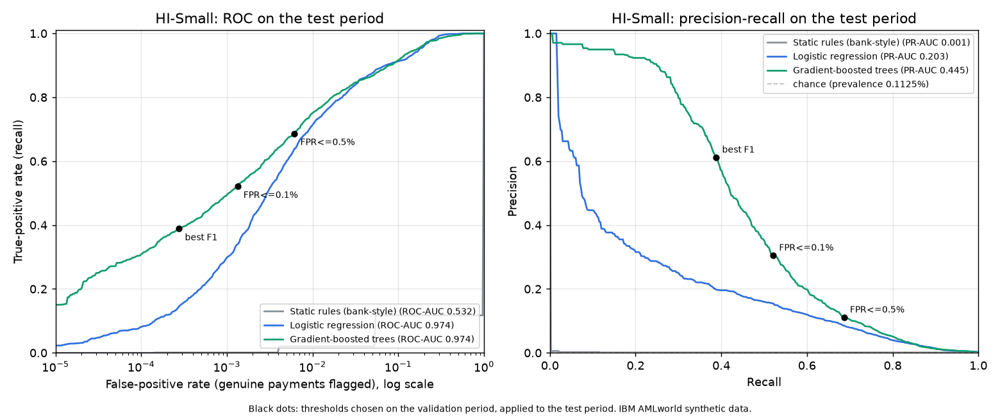
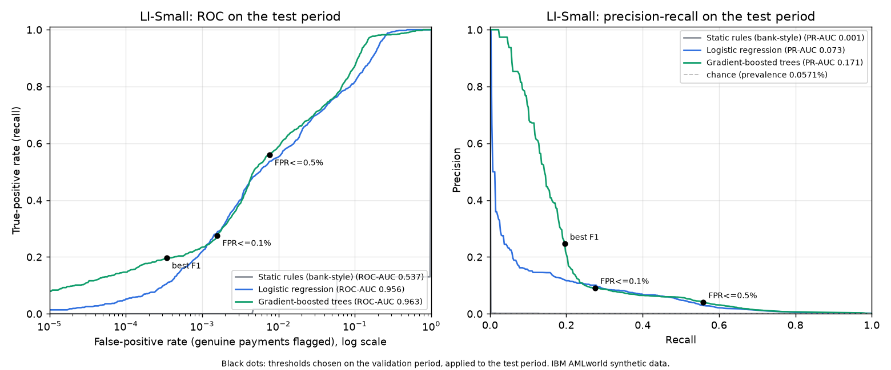

# IBM AMLworld evaluation: real-time suspicious-payment detection

> **Data:** IBM AMLworld (Altman et al., NeurIPS 2023): published synthetic data, not bank data. Generated 2026-11-04T20:55:35+00:00 by `scripts/evaluation/evaluate_ibm_temporal.py`; raw numbers in `docs/evaluation/ibm/results.json`.

**Problem statement:** identify suspicious transactions in real time while minimising false alerts for genuine customers. So every feature uses only earlier minutes, and results are reported at false-alert budgets as well as at the best-F1 point.

## HI-Small

### Preprocessing applied

| Step | Result |
|---|---|
| Schema check (11 named columns) | passed |
| Rows read / used | 5,078,345 / 5,078,345 |
| Invalid rows (bad time, amount, label or id) | 0 (0 laundering), kept out and counted |
| Blank values | 0 |
| Exact duplicate rows | 9 (0 laundering), kept and flagged |
| Self-transfers | 591,212 (11 laundering), kept, used as a feature |
| Timestamps normalised | 2022-09-01 00:00:00 to 2022-09-18 16:18:00 (18 days) |
| Account ids | bank + account, trimmed and upper-cased: 515,088 accounts |
| Currencies to US dollars | 15 currencies, rates taken from the file's own cross-currency payments |
| Laundering rows / rate | 5,177 / 0.102% |
| Typologies matched | 3,208 of 5,177 laundering rows |
| Point-in-time features | 32 features, each from strictly earlier minutes; labels never used as features |

### Chronological split (minute boundaries, no overlap)

| Split | Period | Payments | Laundering | Rate |
|---|---|---|---|---|
| train | 2022-09-01 00:00:00 to 2022-09-06 13:33:00 | 3,046,186 | 2,296 | 0.075% |
| validation | 2022-09-06 13:34:00 to 2022-09-08 16:08:00 | 1,015,300 | 1,083 | 0.107% |
| test | 2022-09-08 16:09:00 to 2022-09-10 23:59:00 | 1,015,751 | 1,143 | 0.113% |
| tail after ordinary traffic ends | 2022-09-11 00:05:00 to 2022-09-18 16:18:00 | 1,108 | 655 | 59.116% |

The generator stops producing ordinary payments after the main period; the trailing days are mostly laundering, which would make detection look easier than it is. They are kept out of the test metrics and reported on their own below.

### Test-period results (thresholds chosen on validation)

| Model | ROC-AUC | PR-AUC | Operating point | Precision | Recall | F1 | False-positive rate | False alerts per 10k genuine |
|---|---|---|---|---|---|---|---|---|
| Static rules (bank-style) | 0.532 | 0.001 | best F1 | 0.6% | 2.0% | 0.009 | 0.402% | 40.2 |
| Static rules (bank-style) | 0.532 | 0.001 | FPR<=0.1% | 0.7% | 0.1% | 0.002 | 0.014% | 1.4 |
| Static rules (bank-style) | 0.532 | 0.001 | FPR<=0.5% | 0.6% | 2.0% | 0.009 | 0.402% | 40.2 |
| Logistic regression | 0.974 | 0.203 | best F1 | 18.1% | 44.4% | 0.257 | 0.227% | 22.7 |
| Logistic regression | 0.974 | 0.203 | FPR<=0.1% | 20.7% | 37.8% | 0.267 | 0.163% | 16.3 |
| Logistic regression | 0.974 | 0.203 | FPR<=0.5% | 9.6% | 66.6% | 0.168 | 0.706% | 70.6 |
| Gradient-boosted trees | 0.974 | 0.445 | best F1 | 61.2% | 38.8% | 0.475 | 0.028% | 2.8 |
| Gradient-boosted trees | 0.974 | 0.445 | FPR<=0.1% | 30.6% | 52.1% | 0.386 | 0.133% | 13.3 |
| Gradient-boosted trees | 0.974 | 0.445 | FPR<=0.5% | 11.2% | 68.7% | 0.192 | 0.616% | 61.6 |

Gradient boosting at the best-F1 point, 95% bootstrap intervals on test: precision 58.6%-64.8%, recall 36.4%-41.2%, F1 0.450-0.498. Validation: ROC-AUC 0.983, PR-AUC 0.527.

**Confusion matrices (gradient boosting, test period)**

| Operating point | TP | FP | FN | TN |
|---|---|---|---|---|
| best F1 | 444 | 281 | 699 | 1,014,327 |
| FPR<=0.1% | 596 | 1,353 | 547 | 1,013,255 |
| FPR<=0.5% | 785 | 6,247 | 358 | 1,008,361 |

**Accounts (test period):** an account's score is its highest payment score; it is positive if it took part in any laundering payment.

| Model | ROC-AUC | PR-AUC | Precision | Recall | F1 |
|---|---|---|---|---|---|
| Static rules (bank-style) | 0.570 | 0.007 | 2.8% | 4.9% | 0.035 |
| Logistic regression | 0.957 | 0.202 | 20.2% | 36.6% | 0.261 |
| Gradient-boosted trees | 0.961 | 0.415 | 54.5% | 35.7% | 0.431 |

**Recall by laundering typology (gradient boosting, test period)**

| Typology | Laundering payments | Recall at best F1 | Recall at FPR<=0.5% |
|---|---|---|---|
| BIPARTITE | 52 | 61.5% | 86.5% |
| CYCLE | 65 | 61.5% | 92.3% |
| FAN-IN | 71 | 45.1% | 87.3% |
| FAN-OUT | 74 | 85.1% | 97.3% |
| GATHER-SCATTER | 147 | 69.4% | 93.9% |
| RANDOM | 45 | 53.3% | 88.9% |
| SCATTER-GATHER | 123 | 69.9% | 94.3% |
| STACK | 106 | 55.7% | 92.5% |
| (not in patterns file) | 460 | 1.3% | 33.5% |

**Wind-down tail (reported apart):** at the best-F1 threshold, recall 67.6%, precision 98.2% on 655 laundering and 453 ordinary payments.

**Speed:** model inference for one payment p50 2.55 ms, p95 3.29 ms; batch 435,323 payments/s. Feature lookups are per-account state reads in production and are not included.

**Model choice:** {'max_leaf_nodes': 127, 'class_weight': 'balanced'} (best validation PR-AUC of 4 settings).

## LI-Small

### Preprocessing applied

| Step | Result |
|---|---|
| Schema check (11 named columns) | passed |
| Rows read / used | 6,924,049 / 6,924,049 |
| Invalid rows (bad time, amount, label or id) | 0 (0 laundering), kept out and counted |
| Blank values | 0 |
| Exact duplicate rows | 8 (0 laundering), kept and flagged |
| Self-transfers | 804,477 (3 laundering), kept, used as a feature |
| Timestamps normalised | 2022-09-01 00:00:00 to 2022-09-17 15:28:00 (17 days) |
| Account ids | bank + account, trimmed and upper-cased: 705,907 accounts |
| Currencies to US dollars | 15 currencies, rates taken from the file's own cross-currency payments |
| Laundering rows / rate | 3,565 / 0.051% |
| Typologies matched | 1,022 of 3,565 laundering rows |
| Point-in-time features | 32 features, each from strictly earlier minutes; labels never used as features |

### Chronological split (minute boundaries, no overlap)

| Split | Period | Payments | Laundering | Rate |
|---|---|---|---|---|
| train | 2022-09-01 00:00:00 to 2022-09-06 13:30:00 | 4,153,991 | 1,813 | 0.044% |
| validation | 2022-09-06 13:31:00 to 2022-09-08 16:05:00 | 1,385,006 | 827 | 0.060% |
| test | 2022-09-08 16:06:00 to 2022-09-10 23:59:00 | 1,384,829 | 791 | 0.057% |
| tail after ordinary traffic ends | 2022-09-11 00:39:00 to 2022-09-17 15:28:00 | 223 | 134 | 60.090% |

The generator stops producing ordinary payments after the main period; the trailing days are mostly laundering, which would make detection look easier than it is. They are kept out of the test metrics and reported on their own below.

### Test-period results (thresholds chosen on validation)

| Model | ROC-AUC | PR-AUC | Operating point | Precision | Recall | F1 | False-positive rate | False alerts per 10k genuine |
|---|---|---|---|---|---|---|---|---|
| Static rules (bank-style) | 0.537 | 0.001 | best F1 | 0.2% | 1.6% | 0.004 | 0.456% | 45.6 |
| Static rules (bank-style) | 0.537 | 0.001 | FPR<=0.1% | 0.2% | 1.6% | 0.004 | 0.456% | 45.6 |
| Static rules (bank-style) | 0.537 | 0.001 | FPR<=0.5% | 0.2% | 1.6% | 0.004 | 0.456% | 45.6 |
| Logistic regression | 0.956 | 0.073 | best F1 | 8.6% | 30.6% | 0.135 | 0.185% | 18.5 |
| Logistic regression | 0.956 | 0.073 | FPR<=0.1% | 10.0% | 27.9% | 0.147 | 0.144% | 14.4 |
| Logistic regression | 0.956 | 0.073 | FPR<=0.5% | 4.4% | 51.7% | 0.082 | 0.638% | 63.8 |
| Gradient-boosted trees | 0.963 | 0.171 | best F1 | 24.6% | 19.6% | 0.218 | 0.034% | 3.4 |
| Gradient-boosted trees | 0.963 | 0.171 | FPR<=0.1% | 9.1% | 27.6% | 0.137 | 0.158% | 15.8 |
| Gradient-boosted trees | 0.963 | 0.171 | FPR<=0.5% | 4.0% | 55.9% | 0.075 | 0.761% | 76.1 |

Gradient boosting at the best-F1 point, 95% bootstrap intervals on test: precision 21.7%-28.5%, recall 17.1%-23.3%, F1 0.192-0.250. Validation: ROC-AUC 0.974, PR-AUC 0.247.

**Confusion matrices (gradient boosting, test period)**

| Operating point | TP | FP | FN | TN |
|---|---|---|---|---|
| best F1 | 155 | 475 | 636 | 1,383,563 |
| FPR<=0.1% | 218 | 2,183 | 573 | 1,381,855 |
| FPR<=0.5% | 442 | 10,529 | 349 | 1,373,509 |

**Accounts (test period):** an account's score is its highest payment score; it is positive if it took part in any laundering payment.

| Model | ROC-AUC | PR-AUC | Precision | Recall | F1 |
|---|---|---|---|---|---|
| Static rules (bank-style) | 0.568 | 0.004 | 1.3% | 4.6% | 0.020 |
| Logistic regression | 0.936 | 0.087 | 9.1% | 36.0% | 0.145 |
| Gradient-boosted trees | 0.945 | 0.177 | 22.8% | 19.9% | 0.212 |

**Recall by laundering typology (gradient boosting, test period)**

| Typology | Laundering payments | Recall at best F1 | Recall at FPR<=0.5% |
|---|---|---|---|
| BIPARTITE | 38 | 73.7% | 84.2% |
| CYCLE | 19 | 68.4% | 84.2% |
| FAN-IN | 7 | 28.6% | 85.7% |
| FAN-OUT | 27 | 77.8% | 88.9% |
| GATHER-SCATTER | 32 | 68.8% | 84.4% |
| RANDOM | 20 | 75.0% | 90.0% |
| SCATTER-GATHER | 46 | 52.2% | 73.9% |
| STACK | 19 | 84.2% | 100.0% |
| (not in patterns file) | 583 | 2.4% | 45.6% |

**Wind-down tail (reported apart):** at the best-F1 threshold, recall 70.9%, precision 96.9% on 134 laundering and 89 ordinary payments.

**Speed:** model inference for one payment p50 2.58 ms, p95 3.27 ms; batch 586,363 payments/s. Feature lookups are per-account state reads in production and are not included.

**Model choice:** {'max_leaf_nodes': 31, 'class_weight': None} (best validation PR-AUC of 4 settings).

## What these numbers are and are not

- IBM AMLworld is synthetic data from IBM's generator, independent of MuleCatch's own simulator. It is not bank data; real precision depends on the real fraud rate and on real behaviour.
- Thresholds and model settings were chosen on the validation period only; the test period was scored once.
- The models here are new candidates trained on point-in-time features. MuleCatch's current mule detector was built for structured smurfing and, on the same data, flagged 0 of 136 laundering payments (docs/buildx/05-evaluation.md 7.8); it is not re-scored here.
- Laundering in the test period can belong to attempts that started in the validation period; that is how a deployed system meets it, so it is kept.
