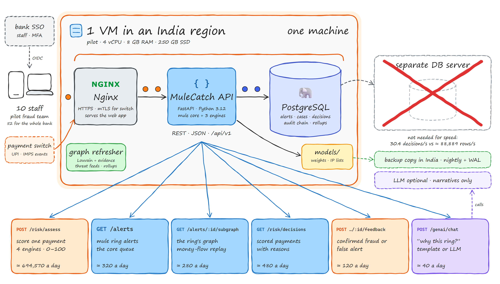
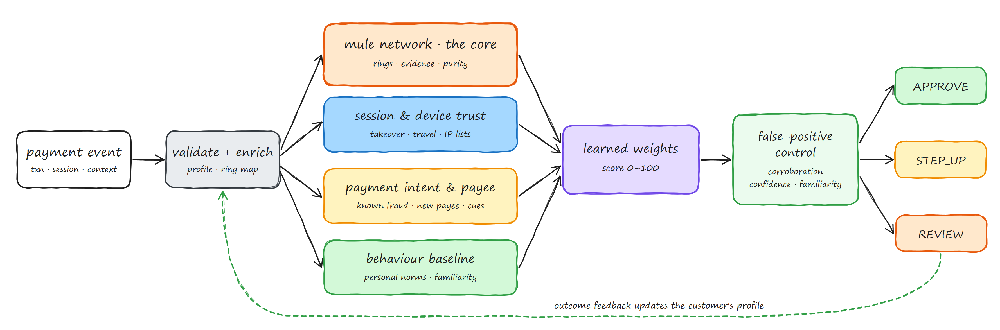
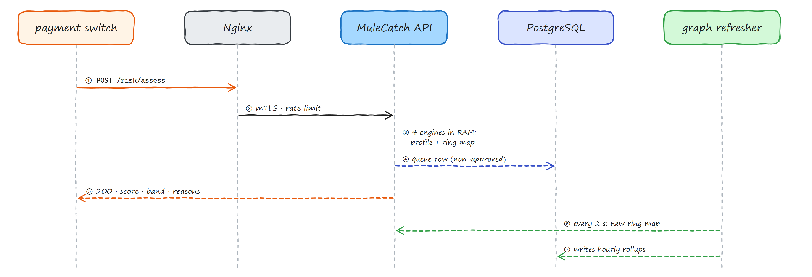
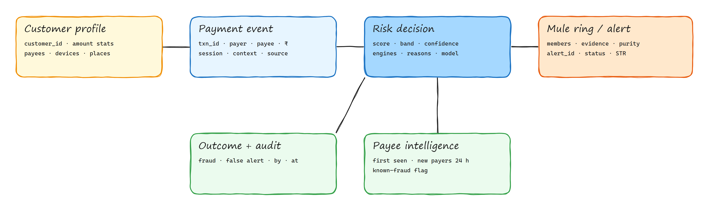
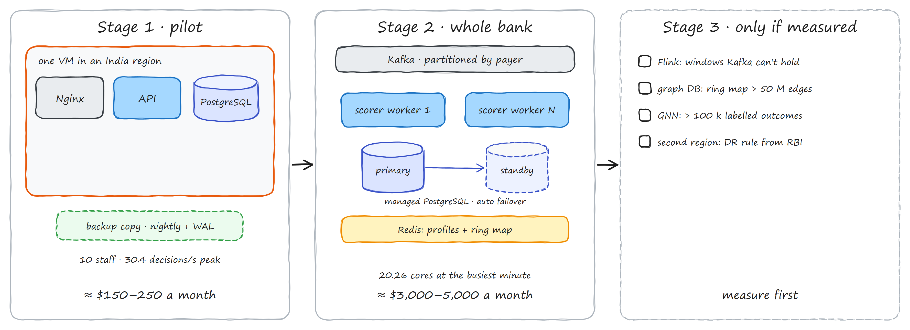

# MuleCatch risk engine: system design

> Generated with the **sketch-system-design** skill. The formatted page with the hand-drawn diagrams is
> [`system-design/MuleCatch-System-Design.html`](system-design/MuleCatch-System-Design.html)
> (PDF: [`MuleCatch-System-Design.pdf`](system-design/MuleCatch-System-Design.pdf)). This Markdown copy is generated
> from it by `system-design/evidence/html_to_md.py`, so the two never disagree. Every number comes from
> `system-design/evidence/workload_model.py` or `capacity_benchmark.py`.
>
> Labels: **[V]** verified or measured · **[A]** assumption · **[P]** proposal · **[E]** exists today · **[?]** unknown.

## Where each part of the brief is answered

| Brief asks for | Section |
|---|---|
| Existing architecture assessment | §7 Audit of today's system |
| Proposed enhanced architecture | §1 One-page picture, §6.2 Unified pipeline |
| Component-level architecture | §6.1 Box by box, §6.3 The four engines |
| End-to-end data flow | §6.2 Unified pipeline, §6.6 Main request path |
| Real-time event processing | §4 How many requests, §6.6, §6.14 Growth path |
| Mule detection integration | §6.3.1 Mule network: the core |
| The three new engines | §6.3.2 Session, §6.3.3 Payment intent & beneficiary, §6.3.4 Behaviour |
| ML model and feature engineering | §6.5 Scoring, bands and the model |
| Database and storage design | §6.7 Data model, §4.6 Storage |
| API specifications | §6.8 API |
| External integrations | §6.9 Real data sources and provenance |
| Risk scoring and decision logic | §6.5 Scoring, bands and the model |
| False-positive prevention | §6.4 False-positive control, §5 Base rate, §7.2 |
| Security, privacy and access control | §6.10 Security, privacy and access |
| Scalability and performance | §2 Numbers, §4, §6.14 Growth path, §6.15 Cost |
| Monitoring, logging and feedback | §6.11 Monitoring, logging and feedback |
| Deployment architecture | §6.13 Deployment |
| Testing and validation | §6.12 Testing and evaluation |

## 1 · The whole system on one page

- **Orange dots** are requests: payment events from the bank's switch, and staff using the web app. **Blue dots** are database queries.
- Everything inside the orange box is **one server**: Nginx ends TLS and serves the web app; the API runs the mule core and the three new engines and returns a 0–100 score with reasons; PostgreSQL holds alerts, cases, non-approved decisions and the audit chain; the **graph refresher** rebuilds the mule-ring map every 2 seconds so no payment waits for it; `models/` holds the learned weights and the downloaded IP lists.
- **The crossed-out box:** a separate database server adds nothing for speed. The pilot's busiest minute is 30.4 decisions a second; the decision log took ≈ 88,889 durable row appends a second on this machine ([4.8](#requests), SQLite stand-in).
- **Outside the box:** the bank's single sign-on and payment switch, a backup copy in India, and an optional language model that only writes case narratives and never touches a score.
- The six boxes at the bottom are the busiest calls, with pilot volume per day. Orange = writes, blue = reads, purple = AI. All calls are in [section 4.5](#requests).
- **Why not today's host:** the public demo runs on Railway, which has no India region. RBI requires payment-system data to be stored only in India, so the bank pilot needs an Indian region ([D01](#plan)). The demo uses synthetic data only.

## 2 · The numbers at a glance

The pilot comes first: shadow-scoring 5 % of the UPI payments sent by a bank the size of Indian Overseas Bank. The small text shows the whole bank. The derivation is in section 4.

| Measure | Pilot | Detail |
| --- | --- | --- |
| Staff using the app | 10 | whole bank 52 · larger bank 148 [A] |
| Payments scored per day | ≈ 694,570 | whole bank ≈ 13,891,409 [V] NPCI volumes, [A] share |
| Average, around the clock | 8.0 a second | one every 124 ms · whole bank 160.8 a second |
| Busiest minute | ≈ 30.4 /s | whole bank 607.7 /s · larger bank 1,823.2 /s |
| Payments that interrupt a customer | ≈ 3 % | target share for step-up + review ≈ 20,837 a day [A] |
| CPU for scoring | 1.01 cores | at the 20 ms target · 2.7 cores with today's scorer, measured here |
| Decision log a year | 6.8 GB | non-approved only · 225.6 GB if every decision is kept |
| Base-rate check | 16% | precision if the false-positive rate is 0.5 % at 1-in-1,000 fraud [A] |
| Headroom for the decision log | ≈ 2,900× | ≈ 88,889 durable appends/s measured vs 30.4 at our busiest minute |

**What this means:** for the pilot, one machine is plenty, and the database is not the bottleneck. The work is in the per-payment scoring path (today it costs 46–108 ms a payment, measured here) and in keeping genuine customers out of the review queue: at realistic fraud rates, a 0.5 % false-positive rate would put 3,469 genuine payments in front of investigators every day.

## 3 · Requirements: what the platform must do

### 3.1 Who uses it

| Role | Pilot | Whole bank | Where the number comes from | Uses the platform to… | Device |
| --- | --- | --- | --- | --- | --- |
| Payment switch (system) | 1 | 1 | [V] one per bank | send each payment with its session context; receive a score, band and reasons | server, mTLS |
| Investigator | 6 | 40 | [A] fraud-operations team size | work the mule-ring queue, open decisions, add evidence, mark outcomes | laptop |
| Supervisor | 2 | 8 | [A] | decide complaints, approve STRs, confirm or reverse holds | laptop |
| Admin | 2 | 4 | [A] | thresholds, feeds, model versions, user access, STR submission | laptop |
| Partner (telecom, courier) | — | — | [E] complaint evidence API | post evidence onto open complaint cases | server |
| People | 10 | 52 |  | | |

### 3.2 What it must do (functional)

| ID | Requirement | When | Today |
| --- | --- | --- | --- |
| F1 | Find mule rings in the payment network (Louvain communities, multi-scale smurf evidence, ring purity) | Must | [E] `detection/`, `services/realtime_scorer.py` |
| F2 | Score each payment against the network; never block on one weak signal | Must | [E] mule only · [P] unified |
| F3 | Alert queue, triage, investigation, escalation, STR draft → approve → submit, audit chain | Must | [E] |
| F4 | Complaint desk with RBI liability rules, deadline clocks and a partner evidence API | Must | [E] |
| F5 | **Session integrity & device trust:** new or shared device, emulator, IP reputation, impossible travel, session discontinuity, takeover sequence, behavioural biometrics where supplied | Must | [E] account-level device profiler · [P] the rest |
| F6 | **Payment intent & beneficiary intelligence:** mule-network correlation, known-fraud accounts, beneficiary reputation and age, new or just-added beneficiary, scam context (call, coaching, keywords, collect requests) | Must | [E] scam detectors exist but are not connected · [P] |
| F7 | **Adaptive behaviour & false-positive control:** per-customer baselines, personal thresholds, familiarity with the beneficiary, time, place and device, confidence, feedback | Must | [E] batch baseline only · [P] |
| F8 | One 0–100 score per payment with bands APPROVE · STEP_UP · REVIEW, requiring corroboration for REVIEW | Must | [P] |
| F9 | Plain reasons for 100 % of decisions, with each engine's share of the score | Must | [P] |
| F10 | Outcome feedback (confirmed fraud / false alert) that updates the customer's baseline and the measured false-alert rate | Must | [E] feedback store, threshold never applied · [P] |
| F11 | Live decision stream for the dashboard, real and synthetic sources kept apart and labelled | Must | [E] mule stream · [P] unified stream |
| F12 | Evaluation module: recall, precision, FPR, FDR, PR-AUC, latency, review rate, per-segment FPR, drift, on a time-separated test set | Must | [E] mule benchmarks · [P] |
| F13 | Real feeds: Bitcoin mempool, UN sanctions list, Tor exit list, Spamhaus DROP | Should | [E] first two · [P] last two |
| F14 | Live connection to the bank's switch and NPCI data | Later | [?] needs a bank sponsor and NPCI access |
| F15 | Device geolocation and keystroke biometrics | Later | [?] needs the bank's mobile SDK; IP geolocation needs a licensed database |

### 3.3 How well it must do it (non-functional)

| Quality | Target [P] | Why / how |
| --- | --- | --- |
| Load | pilot 30.4 decisions/s at the busiest minute; design for 3× that | Section 4 |
| Speed | decision p95 ≤ 200 ms server-side (the brief's target); staff pages p95 ≤ 500 ms | the switch waits for the answer; a UPI payment has a few seconds end to end |
| Detection | targets only: recall ≥ 95 %, precision ≥ 90 %, FPR ≤ 0.5 % | never shown as results; section 6 explains why precision is measured on the REVIEW band |
| Explainability | 100 % of decisions carry reasons and per-engine contributions | RBI FREE-AI expectations; investigator trust |
| Availability | pilot 99.9 % (≈ 43 min down a month); whole bank 99.99 % (≈ 4 min) | if the engine is down the switch falls back to its own rules ([D04](#plan)) |
| No lost work | decisions RPO ≤ 5 min, RTO ≤ 1 h (pilot) | WAL archiving; the switch keeps its own transaction record |
| Security | bank SSO for staff, mTLS + service account for the switch, role checks on every call, audit chain | [6.10](#security) |
| Data residency | payment data, logs and backups only in India | RBI directive on storage of payment system data (2018) |
| Privacy | no raw biometrics stored, account numbers pseudonymised outside the bank, minimum fields | DPDP Act 2023 |
| Cost | pilot ≤ $250 a month of infrastructure | [Cost](#cost) |

### 3.4 Constraints and what is out of scope

- No live bank, UPI or NPCI data is available to the team. Every labelled result is on synthetic data and says so; the only real data are the public Bitcoin mempool, exchange rates, the UN sanctions list and the two IP lists.
- The engine never declines a payment by itself. It returns a band; holding or declining follows the bank's policy ([D03](#plan)).
- Kept as they are: the mule core, alerts, triage, complaints, return fraud, compliance and the GenAI module (advisory only).
- Deferred until measured: Apache Flink, a Neo4j cluster, a GPU graph neural network ([6.14](#growth)).

## 4 · How many requests will the platform get?

A back-of-envelope estimate, built bottom-up from public UPI volumes and measurements on this machine. Every figure comes from `evidence/workload_model.py`. Change an assumption there and re-run it.

### 4.1 Start from what actually happens

| Fact | Value | Source |
| --- | --- | --- |
| UPI payments across India, September 2026 | 24.07 billion a month (≈ 9,164 a second on average) | [V] NPCI data via a news report (third party) |
| UPI payments sent by Indian Overseas Bank, May 2025 | 298.9 million a month | [V] NPCI remitter table via a third-party reproduction |
| UPI growth, year on year | 28 % | [V] January 2026 report |
| Today's mule scorer, per payment, audit laptop | p50 165 ms · p95 264 ms | [V] `docs/buildx/05-evaluation.md` 7.6b |
| Today's mule scorer, this machine, synthetic history of 1,667 payments | 46 ms cached · 108 ms when the graph is rebuilt (every 10th payment) · 53 ms mean | [V] `evidence/capacity_benchmark_result.json` |
| Decision log row on disk (3 indexes, explanations for non-approved rows) | 890 bytes | [V] same benchmark, 1,000,000 rows |

### 4.2 From what happens to API calls

| What happens | Calls it makes |
| --- | --- |
| A customer sends a UPI payment | 1 × `POST /api/v1/risk/assess` from the switch (session context included) |
| An investigator opens the queue | 1 × `GET /api/v1/alerts` (mule rings) or `GET /api/v1/risk/decisions` (scored payments) |
| Opens one case | `GET /alerts/:id` + `GET /alerts/:id/subgraph`, or `GET /risk/decisions/:id` |
| Records an outcome | 1 × `POST /risk/decisions/:id/feedback` |
| Watches the live view | 1 × `GET /risk/stream` (server-sent events, one connection) |

### 4.3 Requests per person per day

| Role | Pilot people | Requests per person per day | Pilot total per day |
| --- | --- | --- | --- |
| Investigator | 6 | 260 | 1,560 |
| Supervisor | 2 | 180 | 360 |
| Admin | 2 | 60 | 120 |
| Staff, pilot | 10 | ≈ 204 | 2,040 |
| Payment switch, pilot | — | — | 694,570 |

Staff traffic is under 0.3 % of the total. The payment stream sizes the system.

### 4.4 From per day to per second

1. **Spread over the day:** UPI runs around the clock, so 694,570 ÷ 86,400 s = **8.0 payments a second**, one every 124 ms.
2. **Busiest hour:** a busy day (1.4× average) with 7.5 % of it in the evening peak hour gives **20.3 a second**.
3. **Busiest minute:** 1.5× the busiest hour (machine traffic is smoother than people), so **≈ 30.4 a second**. Whole bank: 607.7 a second.
4. **Staff burst:** all 10 pilot staff opening the dashboard in the same 10 seconds adds about 3 requests a second.
5. **Little's law:** 30.4 a second × 0.05 s ≈ 1.5 decisions in flight at the busiest minute (whole bank 30.4).
6. **CPU:** at the 20 ms target, 30.4 × 0.02 s ÷ 60 % utilisation = **1.01 cores**. With today's scorer: 2.7 cores (measured here) or 8.4 (audit laptop). Whole bank: 20.26 cores at target, 53.6 with today's scorer measured here, 167.1 on the audit laptop.

### 4.5 Per endpoint

| Endpoint | What it does | Kind | Pilot / day | Whole bank / day | Server CPU [A] | p95 target |
| --- | --- | --- | --- | --- | --- | --- |
| `POST /risk/assess` | score one payment, all engines | write | 694,570 | 13,891,409 | 20 ms | 200 ms |
| `GET /risk/decisions` | decision feed, filters | read | 480 | 2,800 | 5 ms | 300 ms |
| `GET /alerts/:id` | one mule alert | read | 440 | 2,720 | 5 ms | 300 ms |
| `GET /alerts` | mule alert queue | read | 320 | 1,880 | 8 ms | 300 ms |
| `GET /risk/decisions/:id` | one decision with full explanation | read | 300 | 1,840 | 3 ms | 300 ms |
| `GET /alerts/:id/subgraph` | ring graph | read | 280 | 1,760 | 15 ms | 500 ms |
| `POST /risk/decisions/:id/feedback` | outcome → profile update | write | 120 | 720 | 10 ms | 300 ms |
| `POST /genai/chat` | case question (template answers today) | AI | 40 | 240 | 50 ms | 10 s |
| `GET /risk/metrics`, `/risk/feeds` | admin views | read | 60 | 120 | 10 ms | 500 ms |
| Total |  |  | 696,610 | 13,903,489 |  |  |

### 4.6 Storage and network

| What | Pilot / year | Whole bank / year | 10 years, whole bank | Where it lives |
| --- | --- | --- | --- | --- |
| Every decision, 890 bytes each | 225.6 GB | 4,512.6 GB | 45.13 TB | not kept in full ([D02](#plan)) |
| Non-approved decisions only (≈ 3 %) | 6.8 GB | 135.4 GB | 1.4 TB | PostgreSQL, partitioned by month |
| Approved decisions | hourly counters + a 1 % sample for drift checks | | | PostgreSQL rollup table |
| Customer profiles | ≈ 2 KB per active customer (amount stats, known beneficiaries, devices, places) | | | RAM now · Redis at stage 2 |
| Network in at the busiest minute | 0.03 MB/s | 0.55 MB/s | — | 900 bytes per event |

**Where the terabytes come from:** keeping every approved decision row. Storing only the ≈ 3 % that interrupted a customer, plus counters and a sample, cuts the whole bank's log from 4.5 TB to 135 GB a year. The bank's core system remains the record of every payment.

### 4.7 The AI assistant's share

- About 40 case questions a day in the pilot. Today they get template answers; with a model switched on that is about 1,200 questions a month, a few dollars of tokens at a hypothetical $1 / $4 per million tokens, and 3–10 s per answer spent waiting on the model, not on this server. Chat never feeds a score, so it does not change the machine size.

### 4.8 Sanity check: benchmark and our own test

| Measured here [V] | p50 | p95 | Meaning for us |
| --- | --- | --- | --- |
| Today's mule scorer, graph rebuilt | 108.45 ms | 136.91 ms | too slow to run on every payment at whole-bank volume |
| Today's mule scorer, cached graph | 46.41 ms | 69.87 ms | still recomputes evidence for the whole window on every payment |
| Decision log: 100 durable appends | 1.125 ms | 1.597 ms | ≈ 88,889 rows a second; the database is not the limit |
| Recent non-approved page (50 rows of 1,000,000) | 1.557 ms | 2.344 ms | queue pages are instant with a partial index |
| One decision by id | 0.02 ms | 0.035 ms | — |
| Metrics for the last 7 days, scanning rows | 681.517 ms | 757.593 ms | use hourly rollups instead of scanning |

Synthetic data, one desktop core, SQLite standing in for PostgreSQL. A cloud vCPU is about 2× slower and PostgreSQL adds about 3× to database times; even at 6× the log has ≈ 480× headroom over the pilot's busiest minute.

## 5 · The fundamentals behind each choice

For each idea: what it is, what it means for this platform, and what we decide.

| Fundamental | What it means here | Decision |
| --- | --- | --- |
| **Machine client** | The main caller is the bank's payment switch, not a person. It needs a fast, predictable answer and a stable contract. | One versioned call, `POST /api/v1/risk/assess`, with a typed schema and a fixed response shape. |
| **Idempotency** | The switch may retry. Scoring the same payment twice must not double-count it in a customer's profile. | `txn_id` is the idempotency key; a repeat returns the stored decision. |
| **Event time vs arrival time** | Late or replayed events must be judged by when they happened. Today's device profiler uses the wall clock (`device_profiler.py:154`). | Every window and velocity in the new engines uses the event's own timestamp. |
| **Ordering and partitioning** | A customer's profile must see their payments in order. | At stage 2 the stream is partitioned by payer, so one worker owns each customer. |
| **Stateless workers, external state** | Scoring code is replaceable; profiles and ring maps are the state. | Profiles in RAM for the pilot, Redis at stage 2; the ring map is rebuilt by the refresher. |
| **Hot path vs background work** | Louvain and full evidence take 46–108 ms. A payment cannot wait for them. | The refresher rebuilds the ring map every 2 s; payments read it in O(1). |
| **Base rate** | With 1 fraud in 1,000 payments, a 0.5 % false-positive rate gives 16% precision: 3,469 genuine payments challenged a day against 695 frauds. | Two tiers: STEP_UP absorbs uncertainty cheaply; REVIEW must run near 0.01 % FPR, and its precision is the one we report. |
| **Corroboration** | Independent signals agreeing is far stronger than one strong-looking signal. | REVIEW needs two engines above 0.4, or one decisive fact (confirmed mule ring, known-fraud account, sanctions match). |
| **Calibration** | A score of 70 should mean the same thing every day. | Learned logistic weights over engine outputs; thresholds set on a calibration window, checked on a later test window. |
| **Latency percentiles** | The switch cares about the slowest calls, not the average. | Report p50 and p95 per call; the 200 ms target is p95. |
| **Little's law** | 30.4 a second × 0.05 s ≈ 1.5 in flight at the pilot's busiest minute. | One process with a few workers is enough for the pilot. |
| **Scale up vs scale out** | Pilot: 1.01 cores. Whole bank: 20.26 cores. | One VM now; stateless scoring workers behind a payer-partitioned stream at stage 2. |
| **Caching** | Profiles, ring map and IP lists are read on every payment. | In-process caches with a version stamp; IP lists refreshed every 6 h with the last good copy kept. |
| **Fail open or closed** | If the engine is down, blocking every payment harms every customer. | The switch times out after 300 ms and applies its own rules; the engine records the gap ([D04](#plan)). |
| **Backups vs replication** | A replica copies mistakes instantly; a backup lets you go back. | Nightly backup + WAL archive in India; a standby only at stage 2, for uptime. |
| **Authentication vs authorisation** | Knowing who calls is not the same as allowing the call. | SSO + role checks for staff; mTLS + a service role for the switch; feedback needs investigator or above. |
| **Data residency** | RBI requires payment-system data to be stored only in India. | Pilot in an Indian region; the Railway demo carries synthetic data only. |
| **Observability** | We must see latency, bands, false-alert feedback and drift, not only CPU. | Prometheus counters and histograms per engine and band; daily drift check on the score distribution. |

## 6 · Architecture in detail

The one-page picture, box by box, then the engine that sits inside the API box.

### 6.1 Box by box

| Box | Its job | Choice and settings [P] | If it fails |
| --- | --- | --- | --- |
| **Nginx** | front door for staff and the switch | TLS 1.2+; mTLS client certificate for the switch; 1 MB body limit on `/risk/*`, 50 MB on CSV upload; per-client rate limits; forwards the real client IP | the switch times out after 300 ms and uses its own rules ([D04](#plan)) |
| **MuleCatch API** | validates events, runs the four engines, returns a band with reasons, serves the dashboards | FastAPI, one process with 4 workers for the pilot; engines hold profiles and the ring map in RAM; decisions buffered and written every 100 ms | restart from the last ring map and profiles rebuilt from the decision log; health check at `/ready` |
| **Graph refresher** | rebuilds the mule-ring map off the hot path; refreshes the IP lists; writes hourly rollups | Louvain + multi-scale evidence over the last 5,000 material payments every 2 s, or after 25 new payments, whichever comes first; Tor list and Spamhaus DROP every 6 h | payments keep using the last good ring map; its age is shown on `/risk/metrics` |
| **PostgreSQL** | alerts, cases, complaints, STRs, audit chain, non-approved decisions, hourly rollups | new `risk_decisions` and `risk_rollups` tables added with an additive migration; monthly partitions at stage 2 | decisions queue in memory for up to 5 min; scoring continues |
| **models/** | learned weights and cached IP lists | weights as reviewed JSON, never a pickle; each file carries a version and SHA-256 | built-in default weights load and the version says so |

### 6.2 The unified pipeline

The brief's twelve steps map onto this picture: **ingestion** (`POST /risk/assess`, the trusted `POST /risk/events` batch, the live stream, or Kafka at stage 2) → **validation and enrichment** (typed schema, provenance stamp, profile and ring-map lookups) → **feature extraction** inside each engine → the **mule core** and the **three new engines** → **aggregation** (learned weights) → **0–100 score** → **explanation** → **band and action** → **feedback**.

### 6.3 The four engines

Each engine returns a score from 0 to 1, a confidence, and a list of reasons. Every reason has a code, plain text, a strength and a kind: **weak** (context), **strong** (evidence) or **decisive** (a confirmed fact). The same fact is counted in one engine only, so that "two engines agree" really means two independent things.

### 6.3.1 Mule network: the core [E] extended

The existing per-payment scorer (`services/realtime_scorer.py`) and its ring rules (`detection/ring_decision.py`) stay as they are and keep serving `/score` and the live mule stream. The unified engine reuses the same functions through a **ring map** that the graph refresher rebuilds every 2 s, so a payment reads ring membership and evidence in O(1) instead of recomputing them (46–108 ms today).

| Code | What it checks | Kind |
| --- | --- | --- |
| MN01 | payer or payee carries its own mule evidence (multi-scale smurf score ≥ 0.30) | strong, scaled by the evidence |
| MN02 | payer or payee is in a ring that passes `ring_is_flaggable` (size ≥ 3, purity ≥ 30 %, strength ≥ 0.5) | decisive |
| MN03 | payee is a member of an open mule alert in the alert queue | strong |

### 6.3.2 Session integrity & device trust [P]

Builds on the existing `DeviceProfiler` (device count, sharing, emulator flags) and adds what happens *in the session*. The stolen-credentials case in the brief is caught by SD06–SD08 and SD10 even when the device is the customer's own.

| Code | What it checks | Kind |
| --- | --- | --- |
| SD01 | device never seen for this customer | weak |
| SD02 | device used by 3 or more other customers | strong |
| SD03 | emulator, rooted or automation flags in the fingerprint | strong |
| SD04 / SD05 | IP on the Tor exit list / inside a Spamhaus DROP block (real lists) | strong |
| SD06 | impossible travel: faster than 900 km/h since the last session | strong |
| SD07 | device or IP changed inside the same session | strong |
| SD08 | takeover sequence within 30 min: credential, SIM or phone-number change → login from a new device or place → payee added → payment | strong (0.85) |
| SD09 | remote-access tool active during the payment | strong |
| SD10 | typing rhythm far from the customer's own (only when the app supplies it) | weak |

### 6.3.3 Payment intent & beneficiary intelligence [P]

Looks at where the money is going and why. It reads the mule core's ring map for one-hop links but leaves ring membership itself to MN02. It connects the existing `ScamVictimDetector`, which has no API today. The detector's age-based signal (SV05) is **not** used, because age is context and never evidence.

| Code | What it checks | Kind |
| --- | --- | --- |
| BI01 | payee is a known-fraud account: confirmed through feedback, or named in a fraud complaint | decisive |
| BI02 | payee sent to or received from members of a flagged ring (one hop) | strong |
| BI03 | payee received from 5 or more different new payers in 24 h | strong |
| BI04 | payee first seen less than 7 days ago | weak |
| BI05 / BI06 | first payment to this payee / payee added less than 30 min ago | weak / strong |
| BI07 | customer on a call or being coached during the payment (scam detector SV01, SV02) | strong |
| BI08 | scam phrases in the payment note (scam detector SV06) | strong |
| BI09 | collect request or QR payment to an unknown payee | weak |
| BI10 | payee name matches the UN sanctions list (real list, fuzzy match ≥ 0.85) | decisive |

### 6.3.4 Adaptive customer behaviour [P]

Keeps a small profile per customer, updated after every committed payment: amount statistics on a log scale (median and spread), the hours they pay, their payees with counts and usual amounts, their devices and places. It answers two questions: **is this unusual for this person**, and **how familiar is this payment**.

| Code | What it checks | Kind |
| --- | --- | --- |
| BH01 | amount far above the customer's own normal (robust z ≥ 3 and above their 99th percentile) | strong, scaled |
| BH02 | more payments in the last hour than 3× the customer's usual busiest hour | strong |
| BH03 | an hour this customer almost never uses (under 2 % of their history) | weak |
| BH04 | a city this customer has not paid from before | weak |
| FC01 | familiar payee: 3 or more earlier payments, and this amount within 3× of the usual to them | familiarity |
| FC02 / FC03 | known device and usual place / usual hour | familiarity |

**Confidence** grows with history: min(1, payments ÷ 30) × min(1, days ÷ 14). A new customer has low confidence, which pushes uncertain cases to step-up rather than review.

### 6.4 False-positive control

**The rule of the platform:** one weak or unusual thing never interrupts a customer, and one strong thing on its own never holds a payment. Holding needs agreement between independent engines or a confirmed fact.

| Control | How it works | Example |
| --- | --- | --- |
| **Familiarity dampening** | Weak reasons are multiplied by (1 − familiarity). Strong and decisive reasons are not. | Customer A pays ₹80,000 to the payee they pay every month: the new-device and odd-hour reasons fade. |
| **Corroboration** | REVIEW needs at least two engines at 0.4 or more. Otherwise the score is capped at 69 and the band is STEP_UP. | A big payment from a new phone with no other evidence asks for re-confirmation; it is not held. |
| **Decisive facts** | MN02, BI01 and BI10 set a floor of 85 and REVIEW, whatever the familiarity. | A long-standing payee who is now in a confirmed mule ring is still held. |
| **Confidence** | REVIEW with confidence under 0.35 becomes STEP_UP unless a decisive fact is present. | A two-day-old customer with an unusual amount is asked to confirm. |
| **Anomaly ≠ fraud** | Behaviour reasons describe "unusual for you". The text says so, and they never reach REVIEW alone. | A festival purchase spree is a step-up at most. |
| **Step-up, not block** | STEP_UP means extra verification: payee name shown, PIN re-entry, a cooling-off warning for large first payments ([D03](#plan)). | — |
| **Feedback** | A confirmed false alert adds the payee, device and place to the customer's trusted set. Confirmed fraud adds the payee to the known-fraud list (BI01). | The same false alert does not repeat for that customer. |
| **Separate measurement** | FPR, the share of genuine payments stepped up, and the REVIEW-band precision are reported separately from recall. | [6.12](#testing) |

### 6.5 Scoring, bands and the model

- **Engine score:** noisy-OR of its reasons, 1 − Π(1 − strength), after familiarity dampening.
- **Features for the model (10):** the four engine scores, familiarity, the number of engines at 0.4 or more, new payee, new device, the amount ÷ the customer's median on a log scale, and confidence.
- **Model:** L2 logistic regression. Each feature's contribution is weight × value in log-odds, so the explanation is exact. Weights are trained on the calibration window of the labelled synthetic set and stored as reviewed JSON. A gradient-boosted model is trained alongside for comparison and adopted only if it beats the logistic model on the later test window ([D05](#plan)).
- **Score** = round(100 × probability), then the false-positive controls above.
- **Bands** (configurable): APPROVE below 40 · STEP_UP 40–69 · REVIEW 70 and above. A DECLINE band exists but is switched off unless the bank's policy turns it on ([D03](#plan)).
- **Explanation:** the band, the score, the confidence, each engine's contribution in points, the reasons in plain language, and "why not higher" (for example "one engine only: verify, don't hold").

### 6.6 The main request path

- **Time:** steps ① to ⑤ are in memory; the database write is buffered and flushed every 100 ms, so it never sits on the switch's path.
- **Duplicates:** a repeated `txn_id` returns the stored decision without touching the profile.
- **Untrusted callers:** `POST /risk/assess` from staff scores without changing profiles ("what-if"). Only the trusted path (`POST /risk/events`, service role) commits. The existing mule scorer follows the same rule.
- **Dashboards:** the decision feed and metrics read the log and the rollups, never the hot path.

### 6.7 Data model

- **IDs:** `decision_id` is a random UUID; `txn_id` comes from the switch and is unique.
- **History:** decisions are append-only; an outcome is a separate dated record, and every outcome also goes into the existing audit hash chain.
- **Profiles** are derived data: they can be rebuilt from the last 60 days of committed events, so they need no backup of their own.
- **Restricted data:** raw fingerprints and typing rhythms are reduced to flags and one number per session before storage; IP addresses are kept only on non-approved decisions.
- **Migration:** the two new tables are added by the existing additive `ensure_tables` step under its advisory lock; no existing table changes.

### 6.8 API

| Call | Who | What |
| --- | --- | --- |
| `POST /api/v1/risk/assess` | staff (what-if) · service (commit) | score one payment; body = payment + optional `session` and `context`; returns `decision_id`, `score`, `band`, `confidence`, `engines`, `reasons`, `explanation`, `latency_ms` |
| `POST /api/v1/risk/events` | admin / service | trusted ingest of up to 500 events; commits to profiles and the ring window; idempotent on `txn_id` |
| `GET /api/v1/risk/decisions` | staff | recent decisions; filters `band`, `min_score`, `source`, `limit` ≤ 200 |
| `GET /api/v1/risk/decisions/{id}` | staff | one decision with its full explanation |
| `POST /api/v1/risk/decisions/{id}/feedback` | investigator, supervisor, admin | outcome `CONFIRMED_FRAUD` or `FALSE_ALERT` with a note; updates profiles and payee intelligence; audited |
| `GET /api/v1/risk/metrics` | staff | live counters by band, engine and source, latency p50 / p95, outcomes, ring-map age, plus the latest offline evaluation (labelled) |
| `GET /api/v1/risk/stream?source=demo|live` | staff, guest (demo only) | server-sent events of unified decisions: `demo` = labelled synthetic journeys, `live` = real Bitcoin payments (no session data, so that engine reports "no data") |
| `GET /api/v1/risk/scenarios`, `POST …/{name}/run` | staff | the brief's worked examples, run through the real engine on synthetic customers |
| `GET /api/v1/risk/feeds` | staff | each external list: source URL, last fetched, entries, stale or not |
| `GET /api/v1/risk/config` | staff | bands, thresholds and the model version in force |

Errors use the existing envelope: 401 not signed in · 403 role not allowed · 404 unknown id · 409 `txn_id` reused with different content · 422 invalid body · 429 rate limited.

### 6.9 Real data sources and provenance

| Source | Real or simulated | Used for | Status |
| --- | --- | --- | --- |
| Bitcoin mempool (mempool.space) + USD→INR rate | real, public | live stream through the mule core, payee and behaviour engines | [E] mule only · [P] unified |
| UN Security Council consolidated list | real, public | BI10 payee name screening | [E] screening · [P] wired into BI10 |
| Tor exit-node list (check.torproject.org) | real, public | SD04 | [P] |
| Spamhaus DROP (drop_v4.json) | real, public | SD05 | [P] |
| Fraud complaints and confirmed outcomes | bank's own (demo cases are synthetic) | BI01 known-fraud accounts | [E] complaints · [P] link |
| Labelled customer journeys | **simulated**, labelled | demo stream, scenarios, training and evaluation | [P] |
| Bank payment switch, NPCI / UPI data | not available | production input | [?] needs a bank sponsor |
| Device SDK (fingerprint, location, typing) | not available | SD03, SD06, SD10 | [?] the bank's mobile app |
| IP geolocation database | not available | place from IP | [?] licensed database ([D06](#plan)) |

Every event carries `source` (`api`, `events`, `synthetic`, `live-bitcoin`), the event's own timestamp, and the time it was received. The dashboard shows SYNTHETIC or REAL on every view. A feed that fails keeps its last good copy, is marked stale after 24 h, and is never replaced by invented data.

### 6.10 Security, privacy and access

| Role | Sees | Can change | Can't |
| --- | --- | --- | --- |
| Investigator | alerts, decisions, explanations, cases | case status, notes, evidence, decision outcomes | thresholds, ingest, STR submission |
| Supervisor | as investigator | as investigator + complaint decisions, STR approval | thresholds, ingest |
| Admin | everything, incl. feeds and config | as supervisor + trusted ingest, STR submission | — |
| Payment switch (service) | its own decisions | assess and commit payments | any staff view |
| Guest (demo only) | synthetic demo stream and dashboards | nothing | any real data; off in production |

- Access is checked in the API on every call; database roles mirror it at stage 2 (row-level security on decisions by branch, [D07](#plan)).
- The two auth fixes shipped this week stay in: the role is known right after sign-in, and token refresh works.
- Open security items from the audit ([section 7](#audit)) are listed with fixes; the production start-up check gains two rules: refuse `ENV` values other than `development` or `production`, and refuse a guest login in production.

### 6.11 Monitoring, logging and feedback

- **Metrics:** decisions by band, engine and source; latency histogram per engine; ring-map age; feed freshness; feedback counts; false-alert rate (= false alerts ÷ decisions with an outcome).
- **Drift:** a daily population-stability index on the score distribution against the calibration window; above 0.2 it raises an admin alert.
- **Logs:** one structured line per non-approved decision (ids, band, reason codes, no personal data); approved decisions only in counters.
- **Feedback loop:** outcomes update profiles at once; weights are retrained offline on a later window and promoted only when the time-separated test improves ([D05](#plan)).

### 6.12 Testing and evaluation

- **Unit tests** per engine and per false-positive rule, including the brief's three scenarios as fixed cases.
- **API tests** for roles, validation, idempotency and feedback.
- **Evaluation module** (`scripts/evaluation/evaluate_unified.py`): about 60 days of labelled synthetic journeys; days 1–45 warm the profiles up, days 46–52 calibrate the weights and thresholds, days 53–60 are the test. It reports recall, precision of the REVIEW band, FPR, false discovery rate, PR-AUC, share of genuine payments stepped up, review rate, fraud amount caught, time to detection, latency p50 / p95, FPR per customer segment, and drift. It compares four systems: static rules, mule core alone, the unified engine without false-positive control, and the full unified engine.
- **Honesty rule:** targets are shown as targets; results are labelled "synthetic, time-separated"; the IBM AMLworld result for the mule core (0 % found) stays quoted until features for cycles and pass-through exist.
- **End to end:** a browser test signs in, runs the scenarios and checks the bands and reasons on screen.

### 6.13 Deployment

- **Demo (today):** one Railway service builds the React app and the API into one image (`railway/Dockerfile`), demo mode, synthetic data plus the real public feeds. No Indian region, so no bank data.
- **Pilot:** one VM in an Indian region using the existing `docker-compose.prod.yml` (Nginx, API, PostgreSQL), with the graph refresher as a second process in the API container.
- **Whole bank:** the existing Kubernetes base (`infra/k8s/`) plus Kafka partitioned by payer, scoring workers, Redis for profiles, managed PostgreSQL with a standby.

### 6.14 How it grows

Stage 1 is the pilot on one machine. Stage 2 adds a stream and more scoring workers because one bank's whole UPI flow needs about 20 cores at the busiest minute; the standby database is there for uptime, not speed. Stage 3 items come in only when a measured trigger fires.

### 6.15 Cost

| Monthly [A] | Demo (Railway) | Stage 1 · pilot | Stage 2 · whole bank |
| --- | --- | --- | --- |
| Compute | ≈ $5–20 (one service) | 4 vCPU / 8 GB VM in India ≈ $120–180 | 4 × 8 vCPU scoring nodes + refresher ≈ $1,500–2,500 |
| Database and storage | in memory | 250 GB SSD + backups ≈ $30–60 | managed PostgreSQL with standby ≈ $800–1,200 |
| Stream and cache | — | — | managed Kafka + Redis ≈ $700–1,300 |
| Total | ≈ $5–20 | ≈ $150–250 | ≈ $3,000–5,000 |

**Staff time is the main cost.** The figures are order-of-magnitude list prices for Indian cloud regions and need verifying with the bank's cloud provider. Model validation, the bank's sign-off and switch integration take more effort than the hardware.

### 6.16 Technology choices

| Choice | Why | Also fine / left out until… |
| --- | --- | --- |
| Python 3.12 + FastAPI [E] | the whole detection stack is already Python | — |
| In-process engines, ring map rebuilt in the background | keeps the decision in RAM; meets the 20 ms CPU target | a separate refresher process when the GIL shows in p95 |
| Logistic regression, JSON weights | exact explanations, reviewable, no pickle | gradient boosting if it wins on the later test window |
| PostgreSQL [E] | already the app's store; ≈ 88,889 appends/s measured on the stand-in | — |
| Kafka [E] code, not deployed | needed at stage 2 for partitioning and replay | left out of the pilot: the switch calls HTTPS |
| Redis [E] optional today | shared profiles across workers | left out of the pilot: one process holds them |
| Neo4j [E] optional today | investigation graph | not on the scoring path |
| Flink | — | left out until windows exceed what one worker per partition holds |

## 7 · Audit: today's system

Read-only review of the repository at `f22e7f2`, plus measurements on this machine. It answers "what already exists" before anything new is added.

### 7.1 What already exists and is reused

| ID | Part | Where | Reused for |
| --- | --- | --- | --- |
| S01 | Per-payment mule scorer with ring gates [E] | `backend/services/realtime_scorer.py`, `backend/detection/ring_decision.py` | MN01–MN02 through the ring map |
| S02 | Batch mule pipeline, alerts, triage, subgraph replay [E] | `backend/detection/pipeline.py`, alerts routes | MN03; stays the primary dashboard |
| S03 | Device profiler (account level) [E] | `models/device/device_profiler.py` | SD02, SD03 inputs |
| S04 | Scam victim detector and dual-risk engine, not connected to any API [E] | `models/scam/` | BI07, BI08 |
| S05 | UN sanctions screening with fuzzy matching [E] | `backend/services/screening_service.py` | BI10 |
| S06 | Complaint desk with the mule link and an evidence API [E] | `backend/complaints/` | BI01 known-fraud accounts |
| S07 | Real Bitcoin feed and the synthetic replay [E] | `backend/services/live_feed.py`, `realtime_demo.py` | the unified live stream |
| S08 | Honest evaluation harness and report [E] | `scripts/evaluation/`, `docs/buildx/05-evaluation.md` | the method for the unified evaluation |

### 7.2 The number that needs a decision first

| Figure | Value | Meaning |
| --- | --- | --- |
| Brief's targets: FPR ≤ 0.5 %, precision ≥ 90 %, recall ≥ 95 % | targets | not all reachable on the same alert set at realistic fraud rates |
| Precision at 0.5 % FPR, 1 fraud in 1,000 payments [A] | 16% | 3,469 genuine payments challenged per pilot day against 695 frauds |
| FPR needed for 90 % precision | 0.0106 % | about 73 genuine payments a pilot day |

**Proposed reading of the targets** ([D08](#plan)): the 0.5 % ceiling applies to all interruptions (STEP_UP + REVIEW) of genuine payments; the 90 % precision applies to the REVIEW band. The bank's real fraud rate is needed to confirm it.

### 7.3 Problems found in today's app

| # | Where | Problem [V] | Fix |
| --- | --- | --- | --- |
| 1 | `backend/services/realtime_scorer.py:231` | evidence for the whole window is recomputed on every payment: 46 ms even with a cached graph, measured here | ring map rebuilt by the refresher; O(1) lookups on the hot path (this design) |
| 2 | `backend/services/realtime_scorer.py:46` | Louvain rebuild every 10 committed payments: 108 ms at p50; 167.1 cores for the whole bank on the audit laptop | time-based refresh in the background |
| 3 | `models/device/device_profiler.py:154` | "recent" device switches are counted against the wall clock, not the event time | the session engine uses event time |
| 4 | `models/scam/victim_detector.py:241` | age raises risk (SV05) — a fairness problem if used as evidence | not used by the unified engine |
| 5 | `backend/detection/pipeline.py:511` | the feedback threshold is stored but never read, so "active learning" has no effect | feedback now changes profiles and payee intelligence directly |
| 6 | `backend/repositories/pg_alert_repository.py:59` | storing a batch deletes every alert first; harmless in memory, data loss once PostgreSQL is on | upsert by `alert_id` before enabling PostgreSQL ([D09](#plan)) |
| 7 | `backend/services/detection_service.py:227` | "retrain" clears the dataset; in production it stores an empty alert list | block in production until fixed |
| 8 | `backend/core/config.py:142` | any `ENV` other than exactly `production` turns on demo mode | allow only `development` / `production` |
| 9 | `infra/security/auth.py:28` | JWT secret read from the environment separately from the validated settings | one source of truth |
| 10 | `backend/core/rate_limiter.py:22` | rate limits keyed on the client IP; behind a proxy everyone shares one | proxy headers on (done for Railway) and key by user |
| 11 | `backend/api/v1/routes/ingest.py:91` | seeding Kafka needs only a signed-in user | admin only, demo only |
| 12 | `models/explainability/shap_explainer.py:63` | the "SHAP" panel explains a hand-weighted stand-in, not the real score | unified explanations are exact log-odds contributions |
| 13 | `backend/api/app.py:167` | metrics labelled by raw URL path, so every alert id is a new series | label by route template |
| 14 | `backend/services/audit_service.py:53` | chain check loads only the newest 100,000 entries, so it reports a break after that | verify in pages from the start |
| 15 | `backend/services/genai_capabilities/triage.py:115` | "not high risk" parses as HIGH | structured output only |
| 16 | `backend/services/genai_capabilities/models.py:24` | account pseudonyms are an unsalted 8-hex SHA-256: reversible by trying account numbers | keyed HMAC |
| 17 | `docs/buildx/05-evaluation.md` 7.8 | the mule core finds 0 % of laundering in IBM AMLworld | cycle and pass-through features (the payee engine adds pass-through) |

### 7.4 What the data cannot answer

- The bank's real fraud rate, real false-alert rate, and how customers react to a step-up. These need the bank's labelled history and a shadow-mode pilot.
- Whether typing rhythm or device location help: no device SDK data exists for the team.

## 8 · AI assistant

Numbers come from the engines and the database; the language model, when switched on, only phrases answers. It never sets or changes a score.

| Path | Answers | How | Source of truth |
| --- | --- | --- | --- |
| ① Decision facts | "why was this payment held?" | reads the stored explanation of the decision | the decision record and its model version |
| ② Case facts | ring members, flows, reason codes | fixed read-only calls to the alert and subgraph APIs | the alert and its audit trail |
| ③ Rules and procedures | "what does RBI say about zero liability?" | the complaint desk's rule texts | the rule version and its citation |

Today the assistant runs in template mode ([E] ); the deployed image has no model SDKs. Switching a model on is [D10](#plan), and it must run in an approved Indian region, with account numbers replaced by keyed pseudonyms.

## 9 · Plan and decisions

### 9.1 Roadmap

| Stage | Work | Done when |
| --- | --- | --- |
| 1 · now | ring map + three engines + aggregator + false-positive control; API; decision log; threat feeds; labelled simulator | unit and API tests pass; brief's scenarios give the expected bands |
| 2 · now | evaluation module with time-separated test; learned weights | report written with all metrics, labelled synthetic |
| 3 · now | dashboard: unified decision feed, explanation, three engine panels, scenarios, model performance | browser test passes against the running app |
| 4 · bank pilot | shadow mode on 5 % of UPI payments in an Indian region; outcomes from investigators | 4 weeks of measured FPR and REVIEW precision |
| 5 · scale | Kafka, scoring workers, Redis, PostgreSQL standby | p95 ≤ 200 ms at 607.7 decisions/s in a load test |

### 9.2 Decisions needed

| ID | Question | Proposed until decided |
| --- | --- | --- |
| D01 | Where does the bank pilot run? | an Indian cloud region; Railway stays a synthetic-data demo |
| D02 | Keep every decision, or only non-approved ones? | non-approved in full, approved as counters + 1 % sample |
| D03 | What does STEP_UP do, and may the engine ever decline? | step-up = payee name + PIN re-entry + cooling-off warning; no automatic decline |
| D04 | What happens if the engine is down? | the switch applies its own rules after 300 ms; gaps are logged |
| D05 | When may new weights go live? | only when the later test window improves and an admin approves |
| D06 | Buy an IP geolocation database? | no for the demo; use device location from the bank app in the pilot |
| D07 | Branch-level data access? | all staff see all decisions in the pilot; row-level security at stage 2 |
| D08 | How are the brief's targets read? | FPR ceiling on all interruptions; precision on the REVIEW band |
| D09 | Turn on PostgreSQL in the demo? | only after the alert-wipe fix (#6) |
| D10 | Switch on a language model? | no until an Indian-region model is approved |

## 10 · Files and sources

- `MuleCatch-System-Design.html`: this page, self-contained. `MuleCatch-System-Design.pdf`: the same page for printing. `MuleCatch-System-Design-overview.png`: the one-page picture.
- `../SYSTEM_DESIGN.md`: the same design as Markdown, kept in the repository's `docs/` folder.
- `evidence/workload_model.py` → `workload_model_result.json`, `expected_strings.json`: every number in sections 2 and 4.
- `evidence/capacity_benchmark.py` → `capacity_benchmark_result.json`: the measurements in 4.8.
- `evidence/render.mjs`, `evidence/check_page.py`: the render and the page checks.

### External sources

- [UPI volumes, September 2026](https://startuptalky.com/india-upi-transactions-september-2026/) — third-party report of NPCI data; verify against NPCI.
- [Top UPI remitter banks, May 2025](https://hellobanker.in/top-banks-in-upi-payments-for-may-2025-check-sbi-pnb-bob-hdfc-icici-rank/) — third-party reproduction of NPCI's table; verify against NPCI.
- [UPI growth, January 2026](https://entrackr.com/news/upi-sets-new-monthly-record-with-217-bn-transactions-in-january-11063663) — third party.
- [Tor exit-node list](https://check.torproject.org/torbulkexitlist) and [Spamhaus DROP](https://www.spamhaus.org/drop/) — the two IP lists used by SD04 and SD05.
- [RBI: Storage of Payment System Data (2018)](https://www.rbi.org.in/Scripts/NotificationUser.aspx?Id=11244) — the data-residency rule.

Proposal for review: not an approved design, quote or deployment. Verified facts, assumptions and proposals are marked V, A and P. Only synthetic data and public sources were used; nothing left this machine except public web lookups with generic queries.
