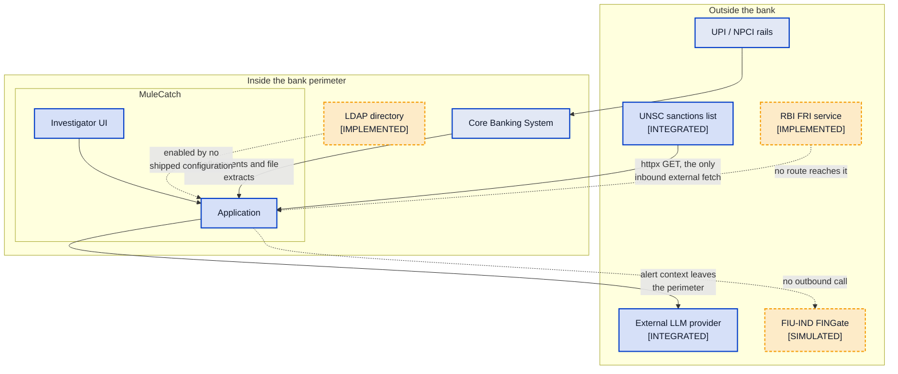

# MuleCatch — Context and Scope

---

## Document control

| Field | Value |
|---|---|
| Purpose | What problem MuleCatch addresses, who uses it, which external systems it touches, and where its boundaries lie |
| Audience | All readers — this is the orientation document for the technical set |
| Built from | Forensic code inventories: `api-surface`, `compliance-str`, `platform-infra`, `security-controls`, `streaming-ingest` |
| Codebase | `master` @ `a7b05bf` |
| Method | Actors are taken from the real role constants; integration status is taken from the code that implements each connection |
| Related | [System architecture](02-SYSTEM-ARCHITECTURE.md) · [Compliance and controls](10-COMPLIANCE-AND-CONTROLS.md) · [End-to-end](12-END-TO-END-ARCHITECTURE.md) · [Delta register](11-DELTA-REGISTER.md) |

**Status legend.** `[VALIDATED]` reachable and covered by real non-mock tests · `[INTEGRATED]`
reachable from a registered route · `[IMPLEMENTED]` code exists but nothing registered reaches it ·
`[SIMULATED]` executes but its external effect is synthesised locally · `[PLANNED]` target state.

---

## 1. The problem

A money mule is an account used to receive and move the proceeds of fraud. The account holder may be
complicit, or may be a victim recruited under false pretences — a distinction that matters because the
two require opposite institutional responses.

Three properties of the Indian digital payments environment make mule detection structurally hard:

**Speed.** UPI settles in seconds and operates continuously. Funds received at 02:00 can be layered
through four accounts and withdrawn before any batch review runs. Detection that operates on a daily
cycle is detecting history.

**Volume.** Retail payment volumes make any detector with a high false-positive rate operationally
unusable. The binding constraint is investigator capacity, not compute, which makes precision an
operational requirement rather than a quality metric.

**Networks, not accounts.** Mule activity is collective by construction. A single account in a
50-account ring may look entirely ordinary in isolation — modest balances, plausible counterparties,
no threshold breaches. The ring is visible only in the relationships. This is the observation the
entire architecture is built around, and it is why the platform is graph-centric.

Conventional static-threshold monitoring struggles on all three. Thresholds are public knowledge and
therefore evadable; they examine accounts individually; and they generate volume proportional to how
conservatively they are set. MuleCatch's response is to combine several independent views — rules,
behavioural baselines, temporal structure, network topology, device identity and machine learning —
so that evading one does not evade the system, and to make every alert explainable so that a human
retains the decision.

---

## 2. Actors

Taken from `ROLE_PERMISSIONS` ([auth.py:69-110](../../infra/security/auth.py#L69-L110)) — these are
the roles that actually exist, not an idealised set.

| Actor | Role constant | What they can do | Notes |
|---|---|---|---|
| Investigator | `INVESTIGATOR` | View alerts, update status and notes, create STR drafts | 7 permissions |
| Supervisor | `SUPERVISOR` | Investigator scope plus STR approval and escalation resolution | 9 permissions |
| Administrator | `ADMIN` | Full access, STR submission and acknowledgement | 13 permissions |
| Compliance officer | `READONLY` | View alerts, KPI and onboarding assessments | 3 permissions — read-only |
| Internal audit | `AUDITOR` | **Nothing** | Referenced in `READ_ROLES` but absent from `ROLE_PERMISSIONS`, so it resolves to an empty permission list. See [09](09-SECURITY-ARCHITECTURE.md) §2.1 |
| Customer | — | No interface | No customer-facing portal, grievance or unfreeze path exists |
| Regulator | — | No direct access | Receives output via STR filing, which is currently simulated |

Two observations. There is **no distinct regulatory filing officer** — STR submission requires
`ADMIN`, conflating a technical administrator with the person who accepts responsibility for a
regulatory filing. In a bank those are different people. And **the customer is not an actor at all**,
which becomes material given RBI's expectations around remediating wrongly restricted accounts.

---

## 3. External systems and their real integration status

| System | Direction | Status | Evidence |
|---|---|---|---|
| **CBS** | Inbound | `[INTEGRATED]` | A **file and parser path**, not a live connection — [cbs_parser.py](../../backend/ingest/cbs_parser.py) plus Kafka events and CSV upload. There is no CBS API client anywhere |
| **UPI / NPCI** | Inbound, indirect | `[INTEGRATED]` via CBS | MuleCatch never talks to the rails. It sees transactions after CBS posts them |
| **UNSC sanctions list** | Outbound fetch | `[INTEGRATED]` | `httpx.get` at [unsc_fetcher.py:52](../../backend/services/screening/unsc_fetcher.py#L52) — the **only** outbound fetch in the repository |
| **FIU-IND FINGate** | Outbound | **`[SIMULATED]`** | No call of any kind. The reference is minted locally from a UUID at [str_service.py:83](../../backend/services/str_service.py#L83). No FINGate URL, credential or certificate setting exists among 56 config fields |
| **RBI FRI** | Outbound | `[IMPLEMENTED]` | `FRIClient` at [fri_scorer.py:79](../../models/india/fri_scorer.py#L79); its only importer is an uninjected provider at [deps.py:498](../../backend/api/deps.py#L498) |
| **LDAP directory** | Outbound | `[IMPLEMENTED]` | [ldap_client.py](../../infra/ldap/ldap_client.py). `ldap_enabled` is `false` or absent in every shipped configuration |
| **External LLM** | **Outbound, data egress** | `[INTEGRATED]` | Anthropic, OpenAI or Gemini via [backend/genai/](../../backend/genai/). See §4 |

### 3.1 The four connections a reader must not misread

**FINGate submission is simulated.** The STR lifecycle is real — states, role-gated transitions, PDF
generation, persistence. The transmission is not. The repository is internally honest about this: the
docstrings say `(simulated)` and the README already states that portal submission requires
reporting-entity credentials and schema acceptance testing. No claim of regulatory filing capability
should be made anywhere on the strength of this code.

**CBS integration is a file format, not a connection.** MuleCatch parses CBS extracts and consumes
Kafka events that something else must publish. Standing up a live feed is bank integration work that
does not exist in this repository.

**FRI and LDAP are built but unreachable.** Both are complete enough to look integrated in a code
review and neither is wired into any shipped configuration.

**Alert context leaves the bank perimeter.** The narrative and forensic-analysis capabilities call an
external LLM provider. This is the only path by which customer-adjacent data exits, and it is the one
integration that a data-residency review will focus on. It is discussed in §4.

---

## 4. Trust boundaries and data egress

| Boundary | What crosses it | Control |
|---|---|---|
| Internet → ingress | Investigator sessions | TLS, JWT, RBAC |
| CBS → MuleCatch | Transaction and account data | Inside the perimeter |
| MuleCatch → UNSC source | An outbound HTTPS request | SSRF protection on the configured URL; production validator rejects insecure schemes |
| **MuleCatch → LLM provider** | **Alert context for narrative generation** | **Leaves the perimeter** |
| MuleCatch → FIU-IND | Nothing today | — |

The LLM egress needs an explicit institutional decision before a pilot, not a technical one. Three
questions must be answered on the record: what fields are included in the prompt; whether the provider
retains or trains on submitted content; and whether a fully local narrative path is required for
production. The platform does have a template-based fallback, which means a no-egress configuration is
achievable — but it is not currently the default, and the three GenAI tuning settings
(`genai_temperature`, `genai_max_tokens`, `genai_timeout_seconds`) are declared in config and never
read by any code, so the LLM call is less configurable than it appears.

---

## 5. Scope

### In scope

- Onboarding mule-risk assessment, entity resolution and sanctions screening
- Post-onboarding transaction monitoring across rule, behavioural, temporal, graph, device and ML layers
- Community-level alert generation with reason codes, attribution and narrative
- Investigator triage, review, notes, escalation and graph visualisation
- STR preparation, role-gated approval and PDF generation
- Hash-chained audit logging of a defined subset of actions
- Operational monitoring via Prometheus and Grafana

### Out of scope

- **Executing account actions.** No freeze, block, debit-restriction or unfreeze capability exists.
  MuleCatch informs a decision; something else must act on it
- **Cross-institution tracing.** A bank sees only its own legs of a chain. This is a data limitation,
  not a product deficiency, and it bounds what layering detection can achieve
- **Customer-facing processes.** No grievance, dispute or remediation path
- **Case management.** No ownership, SLA timers, evidence attachment or case linking — see
  [07](07-INVESTIGATOR-WORKFLOW.md) §1
- **Regulatory transmission.** Simulated, as above
- **Model governance operations.** No independent validation, calibration, champion/challenger
  operation or fairness assessment — see [10](10-COMPLIANCE-AND-CONTROLS.md)

### Explicitly not claimed

Three statements that appear in surrounding project documentation should not be carried into a bank
review on the strength of this codebase: that the platform is production-ready; that it is FIU-IND
schema compatible; and that it achieves any specific false-positive or investigation-time reduction.
The first is a readiness judgement the bank must make, the second requires acceptance testing that has
not occurred, and the third is unmeasured — the "75% investigation time reduction" figure originates as
a database column default at [init.sql:127](../../infra/database/init.sql#L127).

---

## 6. Deployment context assumptions

| Assumption | Basis |
|---|---|
| Deployed inside the bank perimeter | Data-residency expectations for AML workloads; manifests are cloud-agnostic |
| Single institution, single tenant | No tenant identifier exists in any schema or API |
| Investigator-scale concurrency, not retail-scale | No pagination on list endpoints; single safe replica — see [08](08-PLATFORM-AND-DEPLOYMENT.md) §1 |
| Batch or near-real-time, not true streaming | Micro-batch consumption with no event-time semantics |
| Human acts on every alert | No automated action path exists by design |

The single-tenant assumption is worth making explicit because it is invisible in the code: there is no
tenant column anywhere, and the `lru_cache` singletons share detection state process-wide. A
multi-entity deployment — a bank group with separate subsidiaries — would require design change, not
configuration.

---

## 7. What this section establishes

MuleCatch addresses a real and well-characterised problem, and its graph-centric response is the right
architectural instinct for it. The actor model is sound apart from two gaps: `AUDITOR` cannot read
anything, and there is no distinct regulatory filing officer.

The scope statement matters more than usual here, because the gap between what the platform *contains*
and what it *connects to* is wide. Four integrations look present and are not: FINGate is simulated,
CBS is a file format, and FRI and LDAP are unwired. One integration is present and needs an
institutional decision: alert context leaves the bank perimeter to an external LLM provider.

A reader should carry two things forward. Detection and investigation are genuinely built. External
integration and regulatory transmission are, with one exception, not.
