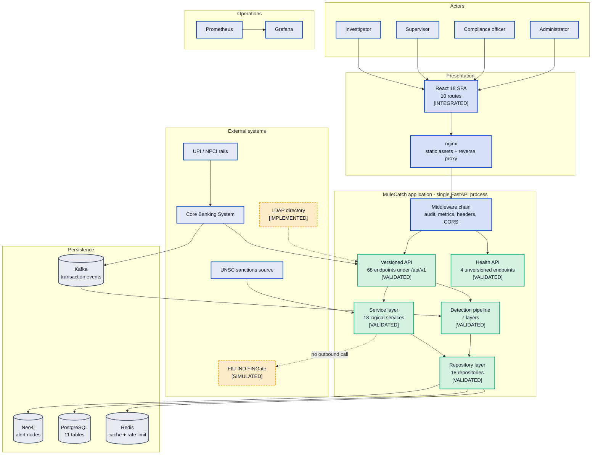

# MuleCatch — System Architecture

**Contains Diagram 1 (High-Level System Architecture) and Diagram 2 (Enterprise Component Diagram).**

---

## Document control

| Field | Value |
|---|---|
| Purpose | The layered architecture of MuleCatch as built, and the component inventory with reachability status |
| Audience | Bank technical reviewers, maintaining engineers, security architects |
| Built from | Forensic code inventories: `api-surface`, `service-data-layer`, `detection-engine`, `graph-layer`, `frontend`, `platform-infra` |
| Codebase | `master` @ `a7b05bf` |
| Method | Every component below was located in source before being described. Each claim carries a `file:line` citation |
| Related | [Data architecture](03-DATA-ARCHITECTURE.md) · [Detection engine](04-DETECTION-ENGINE.md) · [Graph layer](05-GRAPH-LAYER.md) · [Platform and deployment](08-PLATFORM-AND-DEPLOYMENT.md) · [End-to-end](12-END-TO-END-ARCHITECTURE.md) · [Delta register](11-DELTA-REGISTER.md) |

**Status legend.** `[VALIDATED]` reachable from a registered route and covered by real non-mock
tests · `[INTEGRATED]` reachable from a route registered in
[router.py](../../backend/api/v1/router.py) or [App.js](../../frontend/src/App.js) ·
`[IMPLEMENTED]` code exists but no registered route reaches it · `[PLANNED]` target state, not in
the codebase.

---

## 1. Architectural style: a modular monolith

MuleCatch runs as **one Python process**. There is a single application factory at
[app.py:32](../../backend/api/app.py#L32), a module-level instance at
[app.py:219](../../backend/api/app.py#L219), and one backend container image
([backend/Dockerfile](../../backend/Dockerfile)). Every "service" named in this document is a
*logical* boundary — a class in `backend/services/` — not a separately deployed unit.

This must be stated plainly because the surrounding documentation and the component names invite the
opposite reading. There is no API gateway, no service mesh, no inter-service RPC, and no per-service
database. Requests enter one process and are served by in-process function calls.

### Diagram 1 — High-Level System Architecture

---

## 2. The layers

### 2.1 Presentation — React 18 SPA

Ten routes, all but `/login` wrapped in `ProtectedRoute`
([App.js:73-82](../../frontend/src/App.js#L73-L82)): `/login`, `/` dashboard, `/queue`,
`/alert/:alertId`, `/network`, `/analytics`, `/compliance`, `/data-import`, `/risk-operations`,
`/benchmarks`. Graph visualisation uses cytoscape with the cola layout; charts use recharts and d3
([package.json](../../frontend/package.json)).

`ProtectedRoute` gates on authentication only — there is **no role-based gating in the UI**
([ProtectedRoute.js:9-36](../../frontend/src/auth/ProtectedRoute.js#L9-L36)). Authorisation is
enforced server-side alone, so a low-privilege user is shown controls whose backend calls will fail.

### 2.2 Edge — nginx

Serves static assets and reverse-proxies the API. One consequential configuration finding:
[nginx.prod.conf:103-106](../../frontend/nginx.prod.conf#L103-L106) proxies `/internal/metrics`
publicly, despite the Kubernetes ingress having been hardened to remove that exposure and despite the
endpoint's own source comment claiming Docker-network-only reachability
([app.py:185-194](../../backend/api/app.py#L185-L194)). The endpoint carries no authentication.

### 2.3 Application — middleware chain

Starlette's `add_middleware` inserts at position zero, so the **last registered is outermost**. The
effective order is:

| Position | Middleware | Registered |
|---|---|---|
| Outermost | `ServerErrorMiddleware` | Starlette built-in |
| 2 | `audit_middleware` | [app.py:200-202](../../backend/api/app.py#L200-L202) |
| 3 | `metrics_middleware` | [app.py:163-173](../../backend/api/app.py#L163-L173) |
| 4 | `SecurityHeadersMiddleware` | [app.py:99-101](../../backend/api/app.py#L99-L101) |
| 5 | `CORSMiddleware` | [app.py:76-82](../../backend/api/app.py#L76-L82) |
| 6 | `ExceptionMiddleware` | Starlette built-in |
| Innermost | `AsyncExitStackMiddleware` → router | Starlette built-in |

**Architectural consequence.** An unhandled 500 raised inside `ServerErrorMiddleware` sits *outside*
the audit, metrics, security-header and CORS layers. Such a response is therefore not audited, not
counted in metrics, and carries neither security headers nor CORS headers. For a system whose audit
trail is a regulatory control, the class of event most worth recording is the class least likely to
be recorded.

`SlowAPIMiddleware` is **never installed** — a repo-wide search returns no registration — so the
`default_limits=['100/minute']` declared at
[rate_limiter.py:24](../../backend/core/rate_limiter.py#L24) is inert. Only endpoints carrying an
explicit `@limiter.limit` decorator are limited; eight have no limit at all, including all three ROI
routes and `/api/v1/ingest/stream`. Separately, limits key on `request.client.host` while uvicorn runs
without `--proxy-headers` ([Dockerfile:60-65](../../backend/Dockerfile#L60-L65)), so behind nginx
every caller shares a single bucket keyed on the nginx container IP.

### 2.4 Application — API surface

74 endpoints total: 4 unversioned health endpoints mounted directly on the app
([app.py:206-208](../../backend/api/app.py#L206-L208)), 2 metrics endpoints
([app.py:178](../../backend/api/app.py#L178), [:187](../../backend/api/app.py#L187)), and 68 under
`/api/v1` via [router.py:27-92](../../backend/api/v1/router.py#L27-L92).

The router uses **two mounting conventions**, documented in its own docstring at
[router.py:30-33](../../backend/api/v1/router.py#L30-L33).

Twelve modules receive prefixed sub-routers ([:37-83](../../backend/api/v1/router.py#L37-L83)):
`auth`, `alerts`, `feedback`, `escalations`, `compliance`, `graph`, `ingest`, `roi`, `csv-upload`,
`onboarding`, `screening`, `benchmark`.

Five embed their own prefix and mount on the v1 root
([:86-90](../../backend/api/v1/router.py#L86-L90)): `detection`, `kpi`, `audit`, `genai`, `device`.

`health.py` is the only route module absent from `router.py`, and it is **not** orphaned — it is
mounted unversioned in the app factory. All 17 other modules are registered.

Two defects in the surface itself:

- **`GET /api/v1/device/stats` is unreachable**, shadowed by `GET /api/v1/device/{account_id}`
  registered earlier at [device.py:68](../../backend/api/v1/routes/device.py#L68). FastAPI matches in
  registration order, so `stats` is consumed as an `account_id`.
- **No endpoint declares `response_model`** anywhere under `backend/api`. The OpenAPI schema
  therefore documents no response bodies, which materially reduces the value of the generated
  contract for an integrating team.

The response envelope is built in [response.py](../../backend/core/response.py):
`success_response` ([:12-22](../../backend/core/response.py#L12-L22)) yields
`{success, data, error: null, timestamp}`; `error_response`
([:50-69](../../backend/core/response.py#L50-L69)) yields
`{success: false, data: null, error: {code, message, details}, timestamp}`. `paginated_response`
([:25-47](../../backend/core/response.py#L25-L47)) is **dead code** — zero call sites — which means
no endpoint in the system paginates.

Seven custom exceptions in [exceptions.py](../../backend/core/exceptions.py) map to HTTP status in
[error_handlers.py:25-32](../../backend/core/error_handlers.py#L25-L32). `ServiceUnavailableError` is
mapped to 503 but never raised anywhere.

### 2.5 Application — dependency injection

[deps.py](../../backend/api/deps.py) provides 68 `lru_cache`-memoised providers
([:46-569](../../backend/api/deps.py#L46-L569)) consumed via `Depends(...)`. The `lru_cache`
decoration makes every provider a **process-wide singleton**, which is the mechanism by which
stateful components such as the device profiler come to share mutable state across all requests and
all tenants. See [08-PLATFORM-AND-DEPLOYMENT.md](08-PLATFORM-AND-DEPLOYMENT.md) for the scaling
consequence.

A material number of these providers are **orphans** — constructed by a provider that no route
injects. `CaseAssemblyAgent` ([deps.py:531-538](../../backend/api/deps.py#L531-L538)) and
`NarrativeAgent` ([:541-545](../../backend/api/deps.py#L541-L545)) are two examples; the
`models/` orphans are catalogued in [04-DETECTION-ENGINE.md](04-DETECTION-ENGINE.md).

### 2.6 Domain — service layer

Eighteen services in [backend/services/](../../backend/services/). Sixteen are reachable from a
registered route. Two are not: `CaseAssemblyAgent` and `NarrativeAgent`, both under
`services/investigation/`, have no route and no caller outside `deps.py`.

### 2.7 Persistence — repository layer

Eighteen repositories implementing a **dual-implementation pattern**: an in-memory variant and a
`pg_*` PostgreSQL variant, selected at injection time by whether `POSTGRES_URL` is set. Two
important asymmetries:

- **`AlertRepository` and `DatasetRepository` have no PostgreSQL variant at all**
  ([deps.py:178-180](../../backend/api/deps.py#L178-L180),
  [:213-215](../../backend/api/deps.py#L213-L215)). Alerts persist via `PersistenceLayer`
  (Neo4j with in-memory fallback) plus a Redis shared list — never to PostgreSQL. The system's
  primary business object is therefore the one object with no relational durability.
- **`PgSTRRepository` and `PgEscalationRepository` are `[IMPLEMENTED]`, not `[INTEGRATED]`** — their
  approve and resolve paths raise before completing. So in the PostgreSQL configuration, the STR
  approval and escalation resolution flows do not work.

### Diagram 2 — Enterprise Component Diagram

```mermaid
flowchart TB
    subgraph z_ui["Presentation [INTEGRATED]"]
        c_dash["Dashboard"]
        c_queue["Alert queue"]
        c_detail["Alert detail + XAI"]
        c_net["Network / graph view"]
        c_roi["Analytics / ROI"]
        c_comp["Compliance portal"]
        c_imp["Data import"]
        c_risk["Risk operations"]
        c_bench["Benchmarks"]
    end

    subgraph z_api["API layer"]
        a_auth["auth"]
        a_alerts["alerts"]
        a_graph["graph"]
        a_det["detection"]
        a_comp["compliance + STR"]
        a_onb["onboarding"]
        a_scr["screening"]
        a_fb["feedback + escalations"]
        a_ops["kpi, roi, audit, device, genai, ingest, benchmark"]
    end

    subgraph z_svc["Service layer"]
        s_alert["AlertService"]
        s_det["DetectionService"]
        s_str["STRService"]
        s_onb["OnboardingService"]
        s_scr["ScreeningService"]
        s_audit["AuditService"]
        s_ent["EntityResolutionService"]
        s_inv["Investigation agents<br/>[IMPLEMENTED]"]
    end

    subgraph z_eng["Detection and analytics"]
        e_pipe["DetectionPipeline"]
        e_rules["RuleEngine<br/>20 indicators"]
        e_graph["Louvain + centrality"]
        e_xai["SHAP + narrative"]
    end

    subgraph z_repo["Repository layer"]
        r_mem["In-memory repositories"]
        r_pg["pg_ repositories"]
        r_pers["PersistenceLayer"]
    end

    c_dash & c_queue & c_detail --> a_alerts
    c_net --> a_graph
    c_roi --> a_ops
    c_comp --> a_comp
    c_imp --> a_ops
    c_risk --> a_onb & a_scr
    c_bench --> a_ops

    a_auth --> s_audit
    a_alerts --> s_alert
    a_det --> s_det
    a_comp --> s_str
    a_onb --> s_onb --> s_ent
    a_scr --> s_scr
    a_fb --> s_alert

    s_det --> e_pipe --> e_rules & e_graph & e_xai
    s_alert --> e_xai
    s_alert & s_str & s_onb & s_scr & s_audit --> r_mem & r_pg
    s_alert --> r_pers

    classDef integrated fill:#D6E0F8,stroke:#013CC8,stroke-width:2px,color:#0F172A
    classDef implemented fill:#FDEBC8,stroke:#F59E0B,stroke-width:2px,stroke-dasharray:5 3,color:#0F172A
    classDef validated fill:#D3F2E0,stroke:#0E9F6E,stroke-width:2px,color:#0F172A

    class c_dash,c_queue,c_detail,c_net,c_roi,c_comp,c_imp,c_risk,c_bench integrated
    class a_auth,a_alerts,a_graph,a_det,a_comp,a_onb,a_scr,a_fb,a_ops validated
    class s_alert,s_det,s_str,s_onb,s_scr,s_audit,s_ent,e_pipe,e_rules,e_graph,e_xai,r_mem,r_pg,r_pers validated
    class s_inv implemented
```

---

## 3. Architectural decisions

### Decision: a modular monolith rather than microservices

- **Why it exists.** One FastAPI process with internal layering, deployed as a single image.
- **Why it is required.** The detection pipeline is a tightly coupled sequence in which seven
  analytic layers share one in-memory transaction graph and feature set. Splitting them across
  process boundaries would require serialising that graph per hop, which would dominate the compute.
- **Alternatives considered.** Microservices per analytic engine; a separate streaming service; a
  detection service plus a case-management service, which is the most defensible split.
- **Advantages.** No distributed-transaction problem across alert creation and audit write; one
  deployment artifact; local function calls instead of network hops; far simpler operations for a
  first bank deployment.
- **Trade-offs.** No independent scaling of detection versus investigation traffic; a single failure
  domain; one release cadence; and the deployment cannot exceed one replica safely while in-process
  singleton state persists.
- **Scalability considerations.** Vertical first. Horizontal scaling requires evicting the process-local
  mutable state described in §2.5 and [08](08-PLATFORM-AND-DEPLOYMENT.md).
- **Security considerations.** A single trust zone means one compromise exposes the whole surface,
  with no internal segmentation to slow lateral movement. Compensating controls are RBAC and the audit
  chain — both incomplete today; see [09](09-SECURITY-ARCHITECTURE.md).
- **Future improvements.** The lowest-coupling extraction is case management and STR workflow, which
  shares only the alert identifier with detection. Extract that first, behind the existing
  `/api/v1` contract. `[PLANNED]`

### Decision: uniform response envelope, no `response_model`

- **Why it exists.** All handlers return `{success, data, error, timestamp}` via
  [response.py](../../backend/core/response.py).
- **Why it is required.** A single client-side error-handling path, and an error shape that cannot
  leak an exception trace.
- **Alternatives considered.** Bare payloads with HTTP status as the sole signal; RFC 7807 problem
  details, which is the better-standardised choice for an enterprise integration.
- **Advantages.** Uniform client handling; a stable place to add correlation identifiers.
- **Trade-offs.** Success is signalled twice, in the status code and the body, which can disagree.
  Because no handler declares `response_model`, the OpenAPI contract documents no response bodies at
  all, and `paginated_response` being dead code means no endpoint paginates — a real constraint for
  an alert queue that will grow.
- **Scalability considerations.** Absent pagination, list endpoints return unbounded collections.
  This will become the first practical scaling failure under real alert volumes.
- **Security considerations.** The envelope correctly avoids leaking internals. But unhandled 500s
  escape it entirely, as shown in §2.3.
- **Future improvements.** Declare `response_model` per endpoint; implement pagination on all list
  endpoints; adopt RFC 7807 for errors. `[PLANNED]`

### Decision: dual repository implementations selected by configuration

- **Why it exists.** Each repository has an in-memory and a `pg_*` form, chosen by `POSTGRES_URL`.
- **Why it is required.** It permits demonstration without infrastructure while keeping a durable path.
- **Alternatives considered.** SQLite as the single dev backend; testcontainers so tests always run
  against real PostgreSQL; an ORM abstraction over one implementation.
- **Advantages.** Fast tests; a zero-infrastructure demonstration mode.
- **Trade-offs.** This is the most consequential trade-off in the codebase. Two implementations of
  one contract diverge, and here they have: `PgSTRRepository` and `PgEscalationRepository` raise on
  their approve and resolve paths, so the configuration a bank would actually deploy is the one whose
  STR approval flow is broken — while tests pass against the in-memory variant. A dual
  implementation is only safe when the same test suite runs against both.
- **Scalability considerations.** In-memory variants cannot be shared across replicas, reinforcing the
  single-replica constraint.
- **Security considerations.** Demonstration seeding is gated on `demo_mode`
  ([deps.py:306-308](../../backend/api/deps.py#L306-L308)), correctly preventing seeded credentials in
  production.
- **Future improvements.** Run the existing suite against both implementations in CI; fix the two
  raising paths; add the missing PostgreSQL variants for alerts and datasets. `[PLANNED]`

### Decision: `lru_cache` singletons for dependency injection

- **Why it exists.** 68 providers in `deps.py` are memoised with `lru_cache`.
- **Why it is required.** Avoids reconstructing clients and models per request.
- **Alternatives considered.** Request-scoped construction; an explicit application-state container
  on `app.state`; a DI framework with declared lifetimes.
- **Advantages.** Trivially simple; effective for genuinely stateless collaborators and expensive
  clients.
- **Trade-offs.** It makes lifetime implicit. Stateless clients and *stateful accumulators* receive
  identical treatment, so components such as the device profiler silently become process-wide shared
  mutable state. It also conceals orphans: a provider with no consumer looks identical to one with
  many.
- **Scalability considerations.** Directly responsible for the single-replica constraint.
- **Security considerations.** Shared mutable state across requests is a cross-tenant contamination
  risk in a multi-branch deployment.
- **Future improvements.** Separate stateless singletons from stateful components; move accumulator
  state to Redis with explicit keys; delete orphaned providers. `[PLANNED]`

---

## 4. What this section establishes

The architecture is coherent and conventionally layered, and the layering is real rather than
nominal — routes do delegate to services, services to repositories, repositories to stores. The
weaknesses are not structural. They are three specific things: **implicit lifetimes** that turn
convenience singletons into shared mutable state, **divergent dual implementations** where the
production-shaped path is the less-tested one, and **an audit and metrics boundary drawn inside the
error boundary** so the most serious failures go unrecorded.

All three are addressable without redesign. They are recorded with severity in
[11-DELTA-REGISTER.md](11-DELTA-REGISTER.md).
