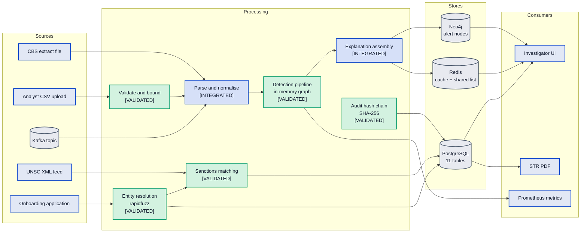
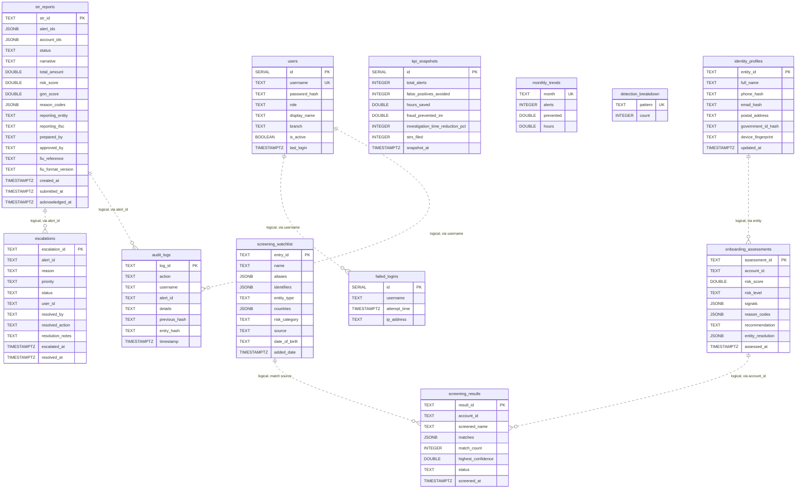

# MuleCatch — Data Architecture

**Contains Diagram 3 (Data Flow Diagram) and Diagram 13 (Database Relationship Diagram).**

---

## Document control

| Field | Value |
|---|---|
| Purpose | Every store MuleCatch writes to, what lands in it, and how personal data is classified and protected |
| Audience | Bank technical reviewers, data architects, security architects, privacy reviewers |
| Built from | Forensic code inventories: `service-data-layer`, `graph-layer`, `streaming-ingest`, `security-controls` |
| Codebase | `master` @ `a7b05bf` |
| Method | The relational schema below is transcribed from [init.sql](../../infra/database/init.sql), not summarised. Each claim carries a `file:line` citation |
| Related | [System architecture](02-SYSTEM-ARCHITECTURE.md) · [Graph layer](05-GRAPH-LAYER.md) · [Security architecture](09-SECURITY-ARCHITECTURE.md) · [Delta register](11-DELTA-REGISTER.md) |

**Status legend.** `[VALIDATED]` reachable and covered by real non-mock tests · `[INTEGRATED]`
reachable from a registered route · `[IMPLEMENTED]` code exists but nothing registered reaches it ·
`[PLANNED]` target state.

---

## 1. Polyglot persistence: four stores, four access patterns

| Store | Purpose | What actually lands in it | Status |
|---|---|---|---|
| PostgreSQL | Durable operational records and the audit chain | 11 tables — STR reports, audit logs, escalations, screening, onboarding, identity profiles, KPI, users | `[INTEGRATED]` |
| Neo4j | Investigation graph | **Alert nodes only** in practice — see §4 | `[INTEGRATED]` |
| Redis | L1/L2 cache, shared alert list, rate-limit counters, propensity scores | Cached alert payloads, cross-worker alert list | `[VALIDATED]` |
| Kafka | Transaction event transport | JSON transaction messages, no schema contract | `[INTEGRATED]` |

### Diagram 3 — Data Flow Diagram

---

## 2. Relational schema

Eleven tables, defined in [init.sql](../../infra/database/init.sql) and mirrored in SQLAlchemy
metadata at [postgres.py](../../backend/infra/database/postgres.py).

### Diagram 13 — Database Relationship Diagram

The relationships drawn below are **logical only**. See §3 for why that distinction matters.

### Indexes

| Index | Table | Declared in |
|---|---|---|
| `idx_str_status` | `str_reports(status)` | [init.sql:26](../../infra/database/init.sql#L26) |
| `idx_audit_alert` | `audit_logs(alert_id)` | [init.sql:39](../../infra/database/init.sql#L39) |
| `idx_audit_action` | `audit_logs(action)` | [init.sql:40](../../infra/database/init.sql#L40) |
| `idx_audit_ts` | `audit_logs(timestamp DESC)` | [init.sql:41](../../infra/database/init.sql#L41) |
| `idx_esc_status` | `escalations(status)` | [init.sql:57](../../infra/database/init.sql#L57) |
| `idx_screen_account` | `screening_results(account_id)` | [init.sql:70](../../infra/database/init.sql#L70) |
| `idx_watchlist_source` | `screening_watchlist(source)` | [init.sql:85](../../infra/database/init.sql#L85) |
| `idx_watchlist_name` | `screening_watchlist(LOWER(name))` | [init.sql:86](../../infra/database/init.sql#L86) |
| `idx_onboard_account` | `onboarding_assessments(account_id)` | [init.sql:100](../../infra/database/init.sql#L100) |
| `idx_onboard_risk` | `onboarding_assessments(risk_level)` | [init.sql:101](../../infra/database/init.sql#L101) |
| 4 × `idx_identity_*` | `identity_profiles` phone, email, gov id, device | [init.sql:115-118](../../infra/database/init.sql#L115-L118) |
| `idx_failed_logins_user` | `failed_logins(username, attempt_time)` | [init.sql:167](../../infra/database/init.sql#L167) |

---

## 3. Three schema-level findings

**No foreign key exists anywhere in the schema.** All eleven tables are standalone; `alert_id`,
`account_id` and `username` are plain `TEXT` with no `REFERENCES` clause. Referential integrity is
therefore entirely an application concern. For an AML system this has a specific consequence: an
`audit_logs` row or an `escalations` row can reference an `alert_id` that does not exist, and nothing
at the database level prevents or detects it. Evidentiary records that may need to be produced to a
regulator have no enforced link to the alert they describe.

**Indexes exist in the DDL but not in the SQLAlchemy metadata.** Every index above is declared only in
`init.sql`, which is mounted as a container entrypoint script at
[docker-compose.yml:13](../../docker-compose.yml#L13). A deployment bootstrapped by
`ensure_tables()` alone gets the tables and none of the indexes. The most consequential omission is
`idx_audit_ts` on `timestamp DESC` — precisely the index that `latest_hash()` and `find_all()` need
([pg_audit_repository.py:84](../../backend/repositories/pg_audit_repository.py#L84),
[:98](../../backend/repositories/pg_audit_repository.py#L98)). Since `latest_hash()` is called on
**every** audit write to obtain the previous chain link, an unindexed audit table degrades the write
path for the entire system as the table grows.

**Three `escalations` columns are never written.** `resolved_action`
([init.sql:52](../../infra/database/init.sql#L52)) appears nowhere in the codebase outside the two
schema definitions. `resolution_notes` ([:53](../../infra/database/init.sql#L53)) is never written
because the service sends `supervisor_notes` instead
([escalation_service.py:78](../../backend/services/escalation_service.py#L78)). `user_id`
([:50](../../infra/database/init.sql#L50)) is never populated. The schema therefore promises a
supervisor-resolution audit trail that the application does not record.

And one finding that belongs in the compliance discussion as much as here:
`kpi_snapshots.investigation_time_reduction_pct` is declared `INTEGER NOT NULL DEFAULT 75`
([init.sql:127](../../infra/database/init.sql#L127)). The "75% investigation time reduction" figure is
not a measurement. It is a database column default, surfaced through the ROI dashboard as though it
were an outcome. It is recorded as `TARGET — UNVALIDATED` in
[11-DELTA-REGISTER.md](11-DELTA-REGISTER.md).

---

## 4. Graph store: what is actually persisted

This is the most important distinction in the data architecture, and it is easy to miss.

Neo4j is described throughout the project as the transaction graph. In the running system it holds
**alert nodes**. The client exposes a full graph write API — `create_account`, `create_transaction`,
`create_transactions_batch`, `link_shared_device`, `link_devices_batch`, `link_shared_ip`,
`link_ips_batch` — and **every one of those methods has zero callers**. So do the read-side traversal
methods `get_account_subgraph`, `get_cluster_subgraph`, `get_community_members` and
`get_recent_transactions`.

Furthermore `ensure_indexes`
([neo4j_client.py:488](../../backend/graph_engine/neo4j_client.py#L488)) appears exactly once in the
repository — its own definition. It is never invoked from the application lifespan
([app.py:36-61](../../backend/api/app.py#L36-L61)) or anywhere else, so **no Neo4j index or
constraint is ever created**.

The graph analytics that genuinely run — Louvain community detection, centrality, pass-through
analysis — operate on structures assembled **in memory inside the detection pipeline** for the
duration of one batch, then discarded. The correct reading is therefore:

> Neo4j is an alert store with graph capability available but unwired. The analysed graph is
> transient and in-process. It is not the persisted graph.

Full treatment, including the node and relationship schema the client *would* create, is in
[05-GRAPH-LAYER.md](05-GRAPH-LAYER.md).

---

## 5. Cache and shared state

`CacheManager` implements two tiers: an `OrderedDict` LRU with TTL and a lock
([cache_manager.py:15](../../backend/cache/cache_manager.py#L15)) in front of Redis
([:58](../../backend/cache/cache_manager.py#L58)). Its **only** consumer is `AlertService`
([deps.py:230](../../backend/api/deps.py#L230)); no other service is cached.

Redis also carries the cross-worker alert list via two key constants in
[cache_keys.py:3-4](../../backend/repositories/cache_keys.py#L3-L4), used by the alert and dataset
repositories. This is what allows multiple uvicorn workers to see a common alert set, and it is
covered by real tests
([test_cross_worker_persistence.py:108-157](../../backend/tests/test_cross_worker_persistence.py#L108-L157)).

`PropensityStore` is `[IMPLEMENTED]` and non-functional in two ways: no route reaches its provider
([deps.py:445-456](../../backend/api/deps.py#L445-L456)), and `get_top_risk` sorts only its in-process
dictionary and never scans Redis
([propensity_store.py:93-100](../../backend/cache/propensity_store.py#L93-L100)). Per-account scores
survive a restart under a 30-day TTL; the top-risk view does not.

---

## 6. Personal data classification

| Field | Storage form | Protection | Citation |
|---|---|---|---|
| Phone | One-way hash | Hashed before persistence | [init.sql:108](../../infra/database/init.sql#L108) |
| Email | One-way hash | Hashed before persistence | [init.sql:109](../../infra/database/init.sql#L109) |
| Government ID | One-way hash | Hashed before persistence | [init.sql:111](../../infra/database/init.sql#L111) |
| Device fingerprint | Plaintext | None | [init.sql:112](../../infra/database/init.sql#L112) |
| **Full name** | **Plaintext**, normalised | **None** | [init.sql:107](../../infra/database/init.sql#L107) |
| **Postal address** | **Plaintext**, normalised | **None** | [init.sql:110](../../infra/database/init.sql#L110) |
| Account identifier | Plaintext throughout | None | e.g. `str_reports.account_ids` |
| Login IP | Plaintext | None | [init.sql:165](../../infra/database/init.sql#L165) |
| PAN | Not modelled | — | absent from the schema |
| Aadhaar | Not modelled | — | absent from the schema |

The hashing of phone, email and government ID is a genuinely good design choice — it preserves the
linkage capability that mule detection needs (spotting reuse across applications) while discarding the
recoverable value. The schema comment at
[init.sql:103-104](../../infra/database/init.sql#L103-L104) shows this was deliberate.

Full name and postal address are the exception, and the reason is architectural rather than careless:
entity resolution matches them with `rapidfuzz.fuzz.WRatio`
([entity_resolution_service.py:57](../../backend/services/entity_resolution_service.py#L57),
[:63](../../backend/services/entity_resolution_service.py#L63)), which requires cleartext. Fuzzy
matching and hashing are mutually exclusive. So the two most directly identifying attributes are the
two stored unprotected — a real tension between a detection requirement and a confidentiality
obligation, not an oversight.

What is absent, verified: **no field-level encryption or tokenisation** of any kind — no `pgcrypto`,
no KMS, no vault. There is no masking of these fields in API responses or logs, no defined retention
or deletion policy, and no legal-hold mechanism. PAN and Aadhaar are not modelled at all, so a
production deployment ingesting them would be extending this schema without an established protection
pattern to follow.

---

## 7. Architectural decisions

### Decision: polyglot persistence across four stores

- **Why it exists.** Neo4j for relationships, PostgreSQL for records, Redis for cache and shared
  state, Kafka for transport.
- **Why it is required.** The access patterns genuinely differ. Multi-hop relationship traversal in
  SQL requires recursive CTEs that become unreadable and slow past two or three hops; an append-only
  hash-chained audit log needs relational durability that a graph store handles poorly.
- **Alternatives considered.** PostgreSQL only, using recursive CTEs plus the `ltree` or `pgRouting`
  extensions; Neo4j only, holding operational records as nodes; PostgreSQL plus an in-memory graph
  library such as networkx, with no graph database at all.
- **Advantages.** Each store is used for what it is good at; the audit chain gets ACID guarantees;
  Redis makes multi-worker operation possible.
- **Trade-offs.** Four stores to operate, back up, secure and keep consistent, with no distributed
  transaction spanning them. And on current evidence the trade is not being paid for: because the
  graph write API is unwired, the third alternative — in-memory graph analytics with no graph
  database — is very close to what the system actually does. Neo4j is being operated as an alert
  store.
- **Scalability considerations.** Alerts have no PostgreSQL variant at all, so the primary business
  object depends on Neo4j-or-memory plus Redis. Absent pagination, list endpoints will degrade before
  any store does.
- **Security considerations.** Four stores means four authentication and transport surfaces. TLS is
  enforced per-hop only when configured, and the production validator does check several of these; see
  [09](09-SECURITY-ARCHITECTURE.md).
- **Future improvements.** Either wire the graph write path so Neo4j earns its place, or drop it and
  keep the in-memory analytics — the present middle position carries the operational cost without the
  benefit. Add a PostgreSQL alert repository. `[PLANNED]`

### Decision: hash sensitive identifiers, keep names and addresses in cleartext

- **Why it exists.** Phone, email and government ID are hashed; name and address are not.
- **Why it is required.** Exact-match linkage works on hashes; fuzzy-match linkage does not.
- **Alternatives considered.** Deterministic encryption with a searchable index; blind indexing with
  phonetic keys such as Soundex or Double Metaphone computed before hashing; tokenisation with a
  separate vault holding the cleartext; performing fuzzy matching inside a trusted enclave.
- **Advantages.** Hashed fields materially reduce breach impact while preserving the reuse detection
  that mule onboarding rings expose.
- **Trade-offs.** The unprotected fields are the most identifying ones, and they are indexed for
  matching, which means they must remain queryable.
- **Scalability considerations.** `WRatio` over cleartext is O(n) per comparison against the candidate
  set; blind indexing on phonetic keys would both narrow the candidate set and remove the cleartext
  requirement.
- **Security considerations.** A database compromise yields names and addresses directly. There is no
  encryption at rest at the field level and no masking in logs.
- **Future improvements.** Phonetic blind indexing is the strongest available option: hash a phonetic
  key for candidate generation, then fuzzy-match only within the narrowed set, holding cleartext in a
  separately controlled store. `[PLANNED]`

### Decision: SHA-256 hash-chained audit log in PostgreSQL

- **Why it exists.** Each `audit_logs` row carries `previous_hash` and `entry_hash`
  ([init.sql:35-36](../../infra/database/init.sql#L35-L36)).
- **Why it is required.** An AML control must be able to show that its decision record has not been
  altered after the fact.
- **Alternatives considered.** Append-only table permissions with no chain; a write-once external log
  service; periodic notarisation of a chain digest to an external authority; database-native temporal
  tables.
- **Advantages.** Detects retrospective modification and deletion of interior rows using only
  PostgreSQL and `hashlib`. Cheap and self-contained.
- **Trade-offs.** A chain proves internal consistency, not authenticity. Anyone able to write to the
  table can recompute the entire chain, because nothing anchors it outside the database. It is
  tamper-*evident* against a careless attacker, not tamper-*proof* against a privileged one.
- **Scalability considerations.** Every write reads `latest_hash()` first, serialising audit writes —
  and doing so against an unindexed `timestamp DESC` scan in any deployment bootstrapped without
  `init.sql`.
- **Security considerations.** Two coverage gaps matter more than the design: authentication events
  are unchained, and the **entire STR lifecycle is unchained** — a search of
  [str_service.py](../../backend/services/str_service.py) for `audit` returns nothing. For a filing
  workflow, the absence of a tamper-evident record of who approved and submitted an STR is the single
  most consequential control gap in the system.
- **Future improvements.** Chain the STR lifecycle and authentication events; anchor a periodic chain
  digest externally; revoke `UPDATE` and `DELETE` on the table for the application role. `[PLANNED]`

---

## 8. What this section establishes

The store choices are sound in principle and the identifier-hashing design is better than most
prototypes achieve. Three things need attention before a pilot, all recorded with severity in
[11-DELTA-REGISTER.md](11-DELTA-REGISTER.md):

1. **The graph store is not doing the job it is described as doing.** Decide whether to wire it or
   remove it.
2. **Indexes and referential integrity live only in a container bootstrap script.** A deployment that
   does not run `init.sql` gets no indexes, and no deployment gets a single foreign key.
3. **The audit chain does not cover the filing workflow it exists to protect.**
