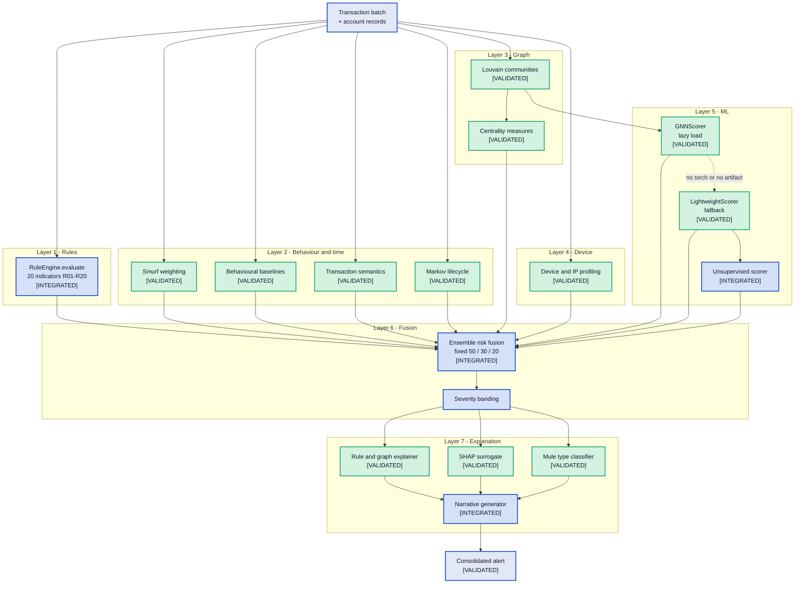
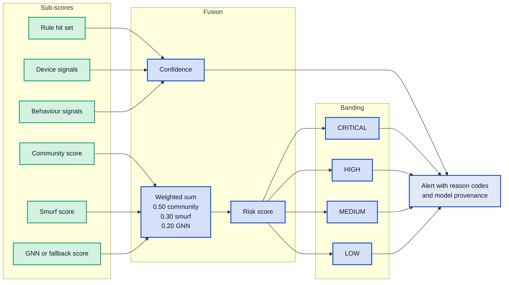

# MuleCatch — Detection Engine

**Contains Diagram 4 (Detection Pipeline) and Diagram 6 (Risk Scoring Flow).**

---

## Document control

| Field | Value |
|---|---|
| Purpose | Every detection layer, the complete rule enumeration, how scores are fused, and what the evidence base does and does not support |
| Audience | Bank technical reviewers, model risk management, maintaining engineers |
| Built from | Forensic code inventories: `detection-engine`, `tests-evidence`, `streaming-ingest` |
| Codebase | `master` @ `a7b05bf` |
| Method | The rule table is transcribed from [pipeline.py:173-279](../../backend/detection/pipeline.py#L173-L279), not summarised. Every threshold shown is the literal in the code |
| Related | [Graph layer](05-GRAPH-LAYER.md) · [AI and explainability](06-AI-AND-EXPLAINABILITY.md) · [Compliance and controls](10-COMPLIANCE-AND-CONTROLS.md) · [Delta register](11-DELTA-REGISTER.md) |

**Status legend.** `[VALIDATED]` reachable and covered by real non-mock tests · `[INTEGRATED]`
reachable from a registered route · `[IMPLEMENTED]` code exists but nothing registered reaches it ·
`[PLANNED]` target state.

---

## 1. Why a layered detector rather than one model

Mule detection has a structural property that shapes the architecture: **no single view of the data
is sufficient**, because the adversary controls different variables at different levels.

| Layer | What it sees that others cannot | Why the adversary struggles to evade it |
|---|---|---|
| Rules | Known regulatory red flags, precisely | Thresholds are public knowledge, so evasion is easy — but evasion itself leaves structure |
| Behavioural | Deviation from an account's own history | Requires the mule to imitate a specific customer, not just look "normal" |
| Temporal | Timing structure — bursts, structuring, consolidation | Timing is constrained by the underlying fraud economics, not by choice |
| Graph | Coordination across accounts | An account can look innocent alone; a network cannot look innocent collectively |
| Device | Shared operational infrastructure | Operating 300 accounts from separate devices is expensive |
| ML | Combinations no analyst enumerated | Generalises past the explicitly encoded patterns |
| Explanation | Nothing — it makes the rest reviewable | Preserves the human judgement that carries regulatory accountability |

Each layer covers a different evasion. A structuring detector alone is defeated by amounts just
outside the band; a graph detector alone misses the isolated single-use mule; a behavioural detector
alone has nothing to compare against on a seven-day-old account. Combining them is not
sophistication for its own sake — it is the minimum viable coverage.

The pipeline is orchestrated by `DetectionPipeline.run`
([pipeline.py:611](../../backend/detection/pipeline.py#L611)), reached via
`DetectionService.ensure_alerts`
([detection_service.py:86](../../backend/services/detection_service.py#L86)).

### Diagram 4 — Detection Pipeline

---

## 2. Layer 1 — the rule engine, in full

Declared in `RuleEngine.RULES` at
[pipeline.py:173-279](../../backend/detection/pipeline.py#L173-L279), evaluated at
[:281](../../backend/detection/pipeline.py#L281), invoked at
[:619](../../backend/detection/pipeline.py#L619).

**True count: 20 rules, R01–R20.** The class docstring at
[pipeline.py:170](../../backend/detection/pipeline.py#L170) states "19 behavioral patterns aligned
with RBI/RBIH MuleHunter framework" while 20 are defined — a documentation defect, recorded in the
delta register.

> **Update (rules-2026.2):** R07, R08, R09, R10, R11, R16 and R19 were removed after firing more on genuine accounts than on mules; see `docs/buildx/05-evaluation.md` §7.6f. Rows and line numbers below describe the earlier 20-rule set.

**No rule threshold is configurable.** `core/config.py` exposes exactly two detection thresholds —
`smurf_flag_threshold` ([config.py:84](../../backend/core/config.py#L84)) and
`onboarding_risk_threshold` ([:85](../../backend/core/config.py#L85)) — and neither is a rule
threshold. Every value below is a Python literal or module constant. Tuning any rule for a bank's
risk appetite requires a code change and a redeploy, which is a governance problem as much as an
engineering one: thresholds that a model risk committee must approve cannot be changed under change
control without shipping code.

| ID | Detects | Threshold constants | Line |
|---|---|---|---|
| R01 | Account age under 7 days | `7`; missing-age default `999` | [:178](../../backend/detection/pipeline.py#L178) |
| R02 | Outgoing transaction burst | `> 20` | [:183](../../backend/detection/pipeline.py#L183) |
| R03 | KYC pending with volume | `PENDING` + `> 5` outgoing | [:189](../../backend/detection/pipeline.py#L189) |
| R04 | Structuring below the ₹50k ceiling | `40000` / `50000` / min 3 txns / ratio `0.7` | [:303-314](../../backend/detection/pipeline.py#L303-L314) |
| R05 | Dormant account reactivation | `180` days, avg monthly `< 3`, `> 8` outgoing | [:201-205](../../backend/detection/pipeline.py#L201-L205) |
| R06 | Same-day pass-through | `>= 2` overlap days | [:332](../../backend/detection/pipeline.py#L332) |
| R07 | Fan-in then consolidation | senders `>= 3`, recipients `>= 1` | [:339](../../backend/detection/pipeline.py#L339) |
| R08 | Night-time high value | hours 23–05, `10000`, min 3 txns | [:350-353](../../backend/detection/pipeline.py#L350-L353) |
| R09 | Round-trip transfer | `>= 1` bidirectional pair | [:362](../../backend/detection/pipeline.py#L362) |
| R10 | Beneficiary addition spike | `>= 5` distinct recipients | [:368](../../backend/detection/pipeline.py#L368) |
| R11 | Cross-bank layering | `>= 3` recipient "banks" — **proxy, see §3** | [:379](../../backend/detection/pipeline.py#L379) |
| R12 | Identical amounts to many payees | `>= 3` recipients per amount | [:390](../../backend/detection/pipeline.py#L390) |
| R13 | Multi-city activity | `>= 3` cities | [:399](../../backend/detection/pipeline.py#L399) |
| R14 | Split transactions | `< 10000` each, min 5, total `> 100000` | [:406](../../backend/detection/pipeline.py#L406) |
| R15 | High-risk UPI handle | digit ratio `0.6`, min length `10` | [:416](../../backend/detection/pipeline.py#L416) |
| R16 | Intermediary-only behaviour | incoming `>= 3` and outgoing `>= 3` | [:423](../../backend/detection/pipeline.py#L423) |
| R17 | Velocity acceleration | `avg_monthly = 10` literal, factor `2` | [:428-430](../../backend/detection/pipeline.py#L428-L430) |
| R18 | Shared device across accounts | boolean, no numeric threshold | [:443-449](../../backend/detection/pipeline.py#L443-L449) |
| R19 | Rapid fund sweep | incoming `>= 10000`, outflow ratio `0.90` | [:461-464](../../backend/detection/pipeline.py#L461-L464) |
| R20 | 72-hour early-life anomaly | age `3` days, min 5 txns **or** ₹100000 | [:481-484](../../backend/detection/pipeline.py#L481-L484) |

---

## 3. Five rules whose names describe something the code does not compute

This is the most serious finding in the rule engine, because the rule *name* is not internal — it is
emitted verbatim as the reason code that reaches the investigator's screen and the STR narrative.

| Rule | Name asserts | Code actually does | Line |
|---|---|---|---|
| R02 | "in 24h" | Counts every outgoing transaction in the batch; **no timestamp filter** | [:299-300](../../backend/detection/pipeline.py#L299-L300) |
| R11 | "rapid" layering | Reads no timestamp at all | [:371-379](../../backend/detection/pipeline.py#L371-L379) |
| R13 | "multi-city in 24h" | Reads no timestamp at all | [:393-399](../../backend/detection/pipeline.py#L393-L399) |
| R17 | "txn rate doubling" | Compares a batch count against the constant `10` — not a rate | [:426-430](../../backend/detection/pipeline.py#L426-L430) |
| R19 | "cleared within hours" | Pure inflow/outflow ratio, no timestamp | [:453-464](../../backend/detection/pipeline.py#L453-L464) |

Because none of these five reads a timestamp, **the same account scores differently depending on how
the batch was cut.** A wider batch fires R02 and R13; a narrower one does not. The rule outcome is a
function of an operational parameter, not of customer behaviour.

Three further name-versus-code divergences:

- **R17 is functionally a duplicate of R02.** With `avg_monthly` fixed at `10` and a factor of `2`,
  the condition reduces to `outgoing > 20` — R02's exact test. Two rules fire on one signal, so the
  same behaviour is counted twice in the reason-code set and in any downstream count-based weighting.
- **R15 claims a fraud-pattern watchlist it does not have.** The docstring at
  [:410](../../backend/detection/pipeline.py#L410) says "known fraud patterns"; the implementation is
  a digit-ratio heuristic with no lookup of any kind. A legitimate handle like `9876543210@upi` fires.
- **R16 claims a self-use check it does not implement.** The docstring at
  [:420](../../backend/detection/pipeline.py#L420) says "never self-use"; the code tests only that
  incoming and outgoing both exceed three.

And **R11's bank identity is a string prefix.** Cross-bank layering is inferred from the first four
characters of the recipient account identifier. In synthetic data that correlates with the intended
bank; against real account numbers it is meaningless. Replacing it requires the real beneficiary-bank
field, IFSC, or payment-rail participant identifier.

### 3.1 Structural issues in the rule path

**Reason codes are f-strings.** Produced at [:287](../../backend/detection/pipeline.py#L287), the
code and its human description are fused into one string. There is no structured
`{code, description, evidence}` object anywhere in the rule path. Consequences: the investigator-facing
text cannot be changed without changing the machine-readable identifier; reason codes cannot be
counted or filtered reliably; and no rule carries its triggering evidence, so an investigator sees
*that* R07 fired but not *which* senders caused it.

**Evaluation is O(accounts × rules × transactions).** `evaluate`
([:281-293](../../backend/detection/pipeline.py#L281-L293)) loops accounts against 20 lambdas, and
most helpers rescan the whole transaction list — for example
[:300](../../backend/detection/pipeline.py#L300),
[:337-338](../../backend/detection/pipeline.py#L337-L338),
[:455-460](../../backend/detection/pipeline.py#L455-L460). At batch scale this is fine; at bank
volume it is the pipeline's first compute wall.

---

## 4. Layers 2 to 5 — the analytic engines

| Layer | Component | Invoked at | Status | Tests |
|---|---|---|---|---|
| 2 | Smurf / temporal weighting | [:622](../../backend/detection/pipeline.py#L622) | `[VALIDATED]` | yes |
| 2 | Behavioural baselines | [:625](../../backend/detection/pipeline.py#L625) | `[VALIDATED]` | 14 |
| 2 | Transaction semantics | [:628](../../backend/detection/pipeline.py#L628) | `[VALIDATED]` | 15 |
| 2 | Markov lifecycle scoring | [:634](../../backend/detection/pipeline.py#L634) | `[VALIDATED]` | 52 |
| 3 | Louvain community detection | [:593](../../backend/detection/pipeline.py#L593), [:637-640](../../backend/detection/pipeline.py#L637-L640) | `[VALIDATED]` | yes |
| 4 | Device / IP profiling | [:602](../../backend/detection/pipeline.py#L602), [:848-854](../../backend/detection/pipeline.py#L848-L854) | `[VALIDATED]` | 13 |
| 5 | GNN scorer, lazily loaded | [:493](../../backend/detection/pipeline.py#L493) | `[VALIDATED]` | 70 |
| 5 | Lightweight scorer, fallback | [:597](../../backend/detection/pipeline.py#L597), [:683](../../backend/detection/pipeline.py#L683) | `[VALIDATED]` | 6 |
| 5 | Unsupervised anomaly scorer | [:644](../../backend/detection/pipeline.py#L644) | `[INTEGRATED]` | 2 |

### 4.1 The GNN fallback chain

GNN scoring is **not unconditionally active**. `GNNScorer` is imported lazily at
[:493](../../backend/detection/pipeline.py#L493); when torch or a trained artifact is unavailable the
pipeline falls through to `LightweightScorer` and then to heuristic scoring. This is good engineering
— the system degrades rather than failing — but it means any statement of the form "MuleCatch uses
Graph Neural Networks" is conditional on a deployed, versioned model artifact. In a deployment
without one, the "20% GNN" term in the ensemble is being supplied by a different model than the name
implies.

### 4.2 Eleven analytic packages that nothing reaches

These exist, are tested in isolation, and are constructed by a `deps.py` provider that **no route
injects**. They are `[IMPLEMENTED]`, not part of the running detector:

`models/active_learning/drift_detector.py` · `models/typology/mule_classifier.py` ·
`models/typology/response_orchestrator.py` · `models/propensity/rolling_scorer.py` ·
`models/scam/victim_detector.py` · `models/scam/dual_risk_engine.py` ·
`models/india/fri_scorer.py` · `models/india/jan_dhan_detector.py` ·
`models/india/crypto_gaming_detector.py` · `models/india/upi_compliance.py` ·
`models/investigation/priority_scorer.py`

This includes the entire India-specific signal set — FRI, Jan Dhan, crypto/gaming, UPI compliance —
and the alert priority scorer. Alert prioritisation in the running system is severity banding, not
the priority model.

---

## 5. Layer 6 — risk fusion

Implemented at
[pipeline.py:1058-1118](../../backend/detection/pipeline.py#L1058-L1118), consumed by `_build_alert`
([:859](../../backend/detection/pipeline.py#L859)), invoked at
[:702](../../backend/detection/pipeline.py#L702).

### Diagram 6 — Risk Scoring Flow

The weights — **0.50 community, 0.30 smurf, 0.20 GNN** — are expert judgement encoded as constants.
They were not fitted to outcomes, they are not segment-specific, and the output is not probability
calibrated. Three consequences a model risk function will raise:

1. **The risk score is not a probability.** It cannot be compared against a loss threshold or used
   for expected-cost decisioning, only for ranking.
2. **The rule engine contributes no weight.** Twenty regulatory red flags inform the reason codes and
   confidence, but not the ranking score, which derives from three graph and temporal terms.
3. **Rule double-counting propagates.** R02 and R17 firing on one signal inflates any count-based
   contribution.

### 5.1 False positive reduction — what exists, and what is proven

Mechanisms that genuinely exist: community-level alerting consolidates many accounts into one
investigable case rather than emitting per-account noise; the confidence score allows triage below
the alert threshold; the feedback loop records investigator dispositions; and the explanation layer
reduces time-to-dismiss on a false positive even when it does not prevent it.

What is **not** established: any quantified false-positive reduction. `test_pipeline.py:74-86`
asserts only `fp_rate < 0.5` on synthetic legitimate accounts — a 50% tolerance. Four stored
benchmark runs flagged **every** legitimate account (`true_negatives: 0`). No alerts-per-day or
investigator-capacity analysis exists anywhere in the repository. The "40% false positive reduction"
claim must be read as a design hypothesis, not a result.

### 5.2 The learning loop is open

`ActiveLearningEngine` and `ThresholdConfig` are `[VALIDATED]` and reachable from the feedback routes,
and they compute adjusted thresholds. **The pipeline never reads them.** `DriftDetector` has no caller
outside its own test. So dispositions are captured and thresholds are computed, but nothing adapts.
Continuous learning is presently a data-collection capability.

---

## 6. Evidence base — stated without flattery

> **Update:** `data/benchmark_results.json` was regenerated with `scripts/regenerate_benchmark_results.py`. It now holds three clean runs, and the earlier 32 rows (duplicates, and cases with 0 true negatives) are gone. The figures below describe that earlier file. For current numbers see `docs/buildx/05-evaluation.md`.

All figures below come from [benchmark_results.json](../../data/benchmark_results.json) and the test
suite. Ranges are given because single figures would misrepresent the spread.

- **Five of ten cross-validation folds detected nothing at all** — TP 0, F1 0.0.
- **Two runs with identical parameters produced mean F1 of 0.4158 and 0.2291** — a 1.8× swing from
  randomness alone, because the synthetic generator seeds the global RNG once at import
  ([generator.py:15](../../data/synthetic/generator.py#L15)) so repeated calls diverge.
- **σ(F1) across folds is 0.28–0.36.** The harness computes these standard deviations
  (`runner.py:386-391`) and the UI never displays them, so the instability is invisible to a viewer.
- **Precision of 1.0 in the adversarial and CV runs is an artifact, not a strength.** It occurs
  because the pipeline emitted 0–1 alerts. It is evidence of very low sensitivity on split data, and
  reporting it as a low false-positive rate would be a misreading.
- **Predictions are set membership, not a threshold.** Every `account_id` appearing in any
  `alert.nodes` is predicted positive (`runner.py:136-139`). There is no operating-point sweep, no PR
  curve, and no threshold tuning — so the reported precision and recall are a single arbitrary point.
- **No PR-AUC, no calibration, no segment analysis, no capacity analysis** exist, although
  [MODEL_CARD.md](../MODEL_CARD.md) lists all four as required.
- **No metric on real data exists at all.** The one supplied bank file has no labels; the adapter
  correctly emits `GROUND_TRUTH_LABELS_ABSENT`.

Only **1 of 20 rules** has a direct test (R01, `test_pipeline.py:137-155`). The remaining 19 are
untested, so the rule engine — the layer whose output reaches investigators as regulatory
justification — is the least verified layer in the system.

---

## 7. Architectural decisions

### Decision: a multi-detector ensemble rather than a single model

- **Why it exists.** Seven complementary layers feed one fused score.
- **Why it is required.** Each layer covers an evasion the others miss, as set out in §1. A single
  model cannot see both isolated behavioural deviation and network coordination.
- **Alternatives considered.** A single gradient-boosted model over engineered features, which is the
  industry default and often very strong; a pure graph model; rules only, which is the incumbent
  baseline at most banks.
- **Advantages.** Broad typology coverage; graceful degradation; every layer contributes
  human-legible evidence.
- **Trade-offs.** Seven layers mean seven calibration surfaces and seven failure modes. Correlated
  layers double-count, as R02 and R17 demonstrate. A single well-calibrated model would very likely
  outperform an uncalibrated ensemble — the ensemble's advantage is explainability and coverage, not
  raw accuracy, and that distinction should be stated when comparing against a bank's baseline.
- **Scalability considerations.** O(accounts × rules × transactions) in the rule layer; community
  detection cost grows with batch graph size.
- **Security considerations.** Published thresholds are evadable, which is why the graph and device
  layers matter — they are the ones an adversary cannot cheaply avoid.
- **Future improvements.** Fit the ensemble weights against confirmed outcomes; remove the duplicate
  rule; calibrate the output to a probability. `[PLANNED]`

### Decision: fixed 50/30/20 fusion weights

- **Why it exists.** Constants at [pipeline.py:1058-1118](../../backend/detection/pipeline.py#L1058-L1118).
- **Why it is required.** Without labelled outcomes there is nothing to fit against, so expert
  judgement is the only available basis. As a starting position this is defensible and honest.
- **Alternatives considered.** Logistic regression stacking over the sub-scores; learning-to-rank on
  investigator dispositions; a Bayesian prior updated as outcomes arrive; cost-sensitive optimisation
  against a false-positive budget.
- **Advantages.** Transparent, auditable, trivially explainable to a supervisor, and stable.
- **Trade-offs.** Unfittable to a bank's actual mule population; identical weights across all customer
  segments; the score is not a probability; and no threshold governance record exists.
- **Scalability considerations.** None — the fusion itself is trivial arithmetic.
- **Security considerations.** Static weights are eventually inferable by an adversary probing the
  system.
- **Future improvements.** Stack on dispositions once a few hundred confirmed outcomes exist; add
  segment-specific thresholds; introduce champion/challenger so a new weighting can be evaluated in
  shadow before promotion; version and record every threshold change with its approval.
  `[PLANNED]`

### Decision: community-level alerting as the investigation unit

- **Why it exists.** Louvain communities become alerts, so one alert covers a network.
- **Why it is required.** Mule activity is inherently collective; per-account alerting fragments one
  case into dozens and multiplies investigator effort.
- **Alternatives considered.** Account-level alerting with post-hoc grouping; a dual track running
  both; hierarchical alerting with network alerts containing account alerts.
- **Advantages.** Matches how the fraud actually operates; one investigation covers the ring; the
  network *is* the evidence.
- **Trade-offs.** **This is the detector's principal blind spot.** A single-use mule, an account that
  cashes out immediately after one receipt, or a network whose other legs sit at another bank
  generates little internal connectivity and may not form a community at all. That is consistent with
  the benchmark evidence: five of ten folds detected nothing, which is what a community detector does
  when the split data leaves it too little structure to cluster.
- **Scalability considerations.** Community detection runs per batch on an in-memory graph, so results
  depend on batch composition — the same account may or may not cluster depending on the cut.
- **Security considerations.** An adversary who learns the system alerts on communities will
  deliberately avoid forming them, using one device and one account per operation.
- **Future improvements.** Add a parallel **account-level** track so isolated mules are covered, and
  reconcile the two into one queue with deduplication. This is the highest-value detection improvement
  available. `[PLANNED]`

### Decision: graceful degradation when ML dependencies are absent

- **Why it exists.** GNN → lightweight → heuristic fallback chain.
- **Why it is required.** Allows the platform to run without torch and to survive a missing artifact.
- **Alternatives considered.** Hard failure on a missing model, which is what a production model
  governance regime would normally require; a required model artifact in the container image.
- **Advantages.** Resilient; demonstrable anywhere; no hard dependency on a GPU or a large image.
- **Trade-offs.** **Silent capability degradation.** The system reports a risk score of the same shape
  whether it came from a trained GNN or a heuristic. For a regulated decision, "which model produced
  this score" must never be ambiguous. Alerts do now carry model and rule version provenance, which
  is the right mitigation, but the fallback should be a loud operational event rather than a quiet
  branch.
- **Scalability considerations.** The fallback is cheaper, so a degraded system is also a faster one —
  which makes the degradation harder to notice.
- **Security considerations.** An attacker able to remove or corrupt the model artifact silently
  weakens detection.
- **Future improvements.** Refuse to start in production without an approved model version — the
  production validator already checks `MODEL_VERSION`, so extend it to the artifact; emit a metric and
  an alert on every fallback. `[PLANNED]`

---

## 8. What this section establishes

The layered design is the right architecture for this problem and the engines are individually
well-built and, in several cases, genuinely well-tested — 52 tests on Markov scoring and 70 across
the GNN path are not token coverage.

Three things stand between this and a deployable control, all recorded in
[11-DELTA-REGISTER.md](11-DELTA-REGISTER.md):

1. **The rule layer says things the code does not do.** Five rules name time windows they never
   compute, one duplicates another, two have docstrings describing absent logic, and one infers bank
   identity from a string prefix. These reach investigators as regulatory justification.
2. **Nothing is calibrated.** The weights are judgement, the score is not a probability, and no
   real-data operating point exists.
3. **The loop is open.** Feedback is collected; nothing adapts.

None requires redesign. The rule fixes are small and local; calibration needs labelled data, not
code; closing the loop needs one wiring change and a governance decision about when a threshold may
move.
