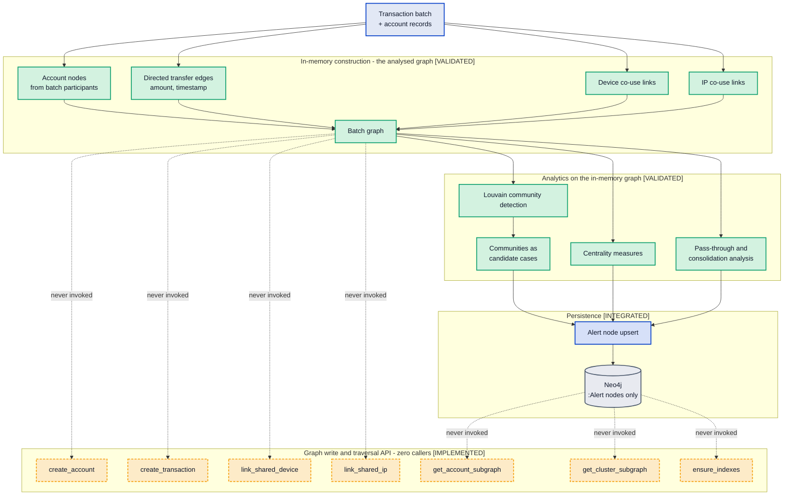

# MuleCatch — Graph Layer

**Contains Diagram 5 (Graph Construction Pipeline).**

---

## Document control

| Field | Value |
|---|---|
| Purpose | The graph model, how it is built, what community detection actually operates on, and how each mule typology maps to a graph or temporal mechanism |
| Audience | Bank technical reviewers, data architects, maintaining engineers |
| Built from | Forensic code inventories: `graph-layer`, `detection-engine`, `service-data-layer` |
| Codebase | `master` @ `a7b05bf` |
| Method | The schema below is reverse-engineered from the Cypher in [neo4j_client.py](../../backend/graph_engine/neo4j_client.py). Every claim carries a `file:line` citation |
| Related | [Data architecture](03-DATA-ARCHITECTURE.md) · [Detection engine](04-DETECTION-ENGINE.md) · [Delta register](11-DELTA-REGISTER.md) |

**Status legend.** `[VALIDATED]` reachable and covered by real non-mock tests · `[INTEGRATED]`
reachable from a registered route · `[IMPLEMENTED]` code exists but nothing registered reaches it ·
`[PLANNED]` target state.

---

## 1. The central distinction: two graphs, only one of which runs

MuleCatch has **two separate graph representations**, and conflating them is the single easiest way to
misread this architecture.

| | The analysed graph | The persisted graph |
|---|---|---|
| Where it lives | In process memory, inside the detection pipeline | Neo4j |
| Lifetime | One batch, then discarded | Durable |
| What it contains | Accounts, transaction edges, device and IP links for the batch | **`:Alert` nodes** |
| What runs on it | Louvain community detection, centrality, pass-through analysis | Alert list and detail reads |
| Status | `[VALIDATED]` | `[INTEGRATED]` |

Every piece of graph *analytics* in MuleCatch runs on the first. Every piece of graph *storage* uses
the second. The Neo4j client contains a complete graph write and traversal API — and it is unwired.

**Verified.** The following methods have **zero callers** anywhere in the repository:
`create_account` ([:89-115](../../backend/graph_engine/neo4j_client.py#L89-L115)),
`create_transaction` ([:126-157](../../backend/graph_engine/neo4j_client.py#L126-L157)),
`create_transactions_batch` ([:374-398](../../backend/graph_engine/neo4j_client.py#L374-L398)),
`link_shared_device` and `link_devices_batch`
([:161-170](../../backend/graph_engine/neo4j_client.py#L161-L170),
[:400-412](../../backend/graph_engine/neo4j_client.py#L400-L412)),
`link_shared_ip` and `link_ips_batch`
([:172-181](../../backend/graph_engine/neo4j_client.py#L172-L181),
[:414-426](../../backend/graph_engine/neo4j_client.py#L414-L426)),
`get_account_subgraph` ([:289-308](../../backend/graph_engine/neo4j_client.py#L289-L308)),
`get_cluster_subgraph` ([:310-327](../../backend/graph_engine/neo4j_client.py#L310-L327)),
`get_community_members` ([:329-336](../../backend/graph_engine/neo4j_client.py#L329-L336)),
`get_recent_transactions` ([:338-354](../../backend/graph_engine/neo4j_client.py#L338-L354)).

And `ensure_indexes` ([:488-502](../../backend/graph_engine/neo4j_client.py#L488-L502)) appears
exactly once in the repository — its own definition. It is never called from the application lifespan
([app.py:36-61](../../backend/api/app.py#L36-L61)) or anywhere else, so **no Neo4j index or constraint
is ever created**. The DDL it would run is:

```cypher
CREATE CONSTRAINT alert_id IF NOT EXISTS FOR (al:Alert) REQUIRE al.alert_id IS UNIQUE
CREATE INDEX alert_severity IF NOT EXISTS FOR (al:Alert) ON (al.severity)
CREATE INDEX alert_status IF NOT EXISTS FOR (al:Alert) ON (al.status)
CREATE INDEX alert_risk_score IF NOT EXISTS FOR (al:Alert) ON (al.risk_score)
```

Alert reads therefore run unindexed, and nothing enforces `alert_id` uniqueness.

### Diagram 5 — Graph Construction Pipeline



---

## 2. The Neo4j model as designed

Even unwired, the schema is worth documenting: it is the target state, and wiring it is a listed
remediation.

### 2.1 Node labels

| Label | Key | Properties | Written at runtime? | Citation |
|---|---|---|---|---|
| `:Alert` | `alert_id` | 16 including `severity`, `status`, `risk_score`, `account_count`, `reason_codes`, `shared_devices`, `shared_ips` | **Yes — the only one** | [:172-223](../../backend/graph_engine/neo4j_client.py#L172-L223) |
| `:Account` | `account_id` | 11 including key | No | [:89-115](../../backend/graph_engine/neo4j_client.py#L89-L115) |
| `:Transaction` | — | transaction attributes | No | [:126-157](../../backend/graph_engine/neo4j_client.py#L126-L157) |
| `:Device` | `device_id` | key only | No | [:141-145](../../backend/graph_engine/neo4j_client.py#L141-L145) |
| `:IPAddress` | `address` | key only | No | [:160-164](../../backend/graph_engine/neo4j_client.py#L160-L164) |
| `:WatchlistEntry` | `entry_id` | constraint declared in unused DDL | No | [:261](../../backend/graph_engine/neo4j_client.py#L261) |
| `:ScreeningResult` | `result_id` | constraint declared in unused DDL | No | [:262](../../backend/graph_engine/neo4j_client.py#L262) |

**The `:Transaction` node is structurally orphaned.** `create_transaction` creates a `:Transaction`
node and separately MERGEs `(src:Account)-[:SENT_TO]->(dst:Account)`, but **no relationship ever
connects `:Transaction` to `:Account`**
([:126-157](../../backend/graph_engine/neo4j_client.py#L126-L157)). If the write path were wired
today, transaction nodes would accumulate as disconnected islands while the usable transfer
information lived entirely on the `SENT_TO` relationship. This is a schema defect, not merely unused
code — wiring the write path without fixing it would produce an unqueryable graph.

### 2.2 Relationship types

| Type | Pattern | Properties | Citation |
|---|---|---|---|
| `SENT_TO` | `(:Account)-[:SENT_TO]->(:Account)` | `txn_id`, `amount`, `timestamp`, `pattern` | [:138-143](../../backend/graph_engine/neo4j_client.py#L138-L143), batch [:388-393](../../backend/graph_engine/neo4j_client.py#L388-L393) |
| `USES_DEVICE` | `(:Account)-[:USES_DEVICE]->(:Device)` in the app | none | [:166](../../backend/graph_engine/neo4j_client.py#L166), batch [:407](../../backend/graph_engine/neo4j_client.py#L407) |
| `USES_DEVICE` | `(:Transaction)-[:USES_DEVICE]->(:Device)` in the seeder | none | [seed_graph.py:90](../../data/seed_graph.py#L90) |
| `FROM_IP` | `(:Account)-[:FROM_IP]->(:IPAddress)` in the app | none | [:177](../../backend/graph_engine/neo4j_client.py#L177), batch [:421](../../backend/graph_engine/neo4j_client.py#L421) |
| `FROM_IP` | `(:Transaction)-[:FROM_IP]->(:IPAddress)` in the seeder | none | [seed_graph.py:94](../../data/seed_graph.py#L94) |

No other relationship type exists.

**Two consequential findings here.**

**The application and the seeder disagree about where devices attach.** The application links devices
to `:Account`; the seeder links them to `:Transaction`. The query that matters,
`find_accounts_by_device`, matches `(a:Account)-[:USES_DEVICE]->(d:Device {device_id: $device_id})`
([:238](../../backend/graph_engine/neo4j_client.py#L238)). Against seeded data that pattern matches
nothing, because the seeder never created an `:Account`-rooted `USES_DEVICE` edge. This is the
mechanism behind the observed behaviour that `find_flagged_neighbors` — the onboarding graph
cross-check reached from `/api/v1/onboarding/assess` — **returns all zeros in practice**. The
onboarding risk score is being computed with its graph signal permanently absent.

**`SENT_TO` is a multigraph edge.** All four properties sit inside the MERGE pattern
([:138-143](../../backend/graph_engine/neo4j_client.py#L138-L143)), so every distinct transaction
creates a *parallel* relationship between the same account pair rather than updating one. That is
arguably correct for AML — you want each transfer individually — but it means edge counts grow with
transaction volume, not with counterparty relationships, and any future degree-based query must
account for it.

### 2.3 There is no traversal

A search for variable-length and path patterns — `*1..`, `*..`, `SENT_TO*`, `shortestPath`,
`allShortestPaths` — returns **no matches anywhere in the repository**.

This matters because multi-hop traversal is the usual justification for choosing a graph database.
Layering detection, in the AML sense, is following funds across three, four, five hops. MuleCatch does
not do this in Cypher. What it calls layering is R11, a count of distinct recipient prefixes within a
single batch. The graph database is not being used for the capability that graph databases exist to
provide.

---

## 3. Typology coverage: claim versus mechanism

| Typology | Detected? | By what mechanism | Honest assessment |
|---|---|---|---|
| Pass-through | Yes | R06 same-day credit-debit overlap | Real, but calendar-day based rather than elapsed-time |
| Smurfing / structuring | Yes | R04 plus smurf-weighting engine | The strongest single detector in the system |
| Layering | **Partially** | R11 recipient-prefix count | Not multi-hop tracing. Bank identity is a string prefix |
| Fan-in | Yes | R07 senders ≥ 3 then forward | Real |
| Fan-out | Yes | R10 recipients ≥ 5, R12 identical amounts | Real |
| Dormant reactivation | Yes | R05 with 180-day dormancy | Real |
| Device sharing | Yes in-batch | R18 plus device profiler | Works on the in-memory graph. The Neo4j path is broken — §2.2 |
| IP sharing | Partially | Device profiler IP signals | No rule; contributes signals only |
| Account age | Yes | R01, R20 early-life anomaly | Real |
| Velocity | Yes | R02; R17 duplicates it | Neither reads a timestamp — see [04](04-DETECTION-ENGINE.md) §3 |
| Behaviour change | Yes | Behavioural baselines, Markov lifecycle | Genuinely well-tested — 52 tests on Markov scoring |
| Community coordination | Yes | Louvain on the in-memory graph | The platform's real differentiator |
| Centrality / bridging | Yes | Centrality measures in the pipeline | Computed in memory, not queried from Neo4j |
| **Cross-bank tracing** | **No** | — | Requires data the bank does not hold alone |
| **Isolated single-use mule** | **No** | — | Structural blind spot of community-level alerting |

The last two rows are the honest limits. Cross-bank tracing is not a MuleCatch deficiency — no single
bank can see the other legs — but it should not be claimed. The isolated mule is a genuine design gap
and is the reason an account-level detection track is the highest-value addition available.

---

## 4. Architectural decisions

### Decision: Louvain for community detection

- **Why it exists.** `LouvainClusterDetector`
  ([louvain_detector.py:115](../../models/community_detection/louvain_detector.py#L115)), invoked at
  [pipeline.py:593](../../backend/detection/pipeline.py#L593) and
  [:637-640](../../backend/detection/pipeline.py#L637-L640).
- **Why it is required.** Mule networks are dense subgraphs in an otherwise sparse transfer graph.
  Modularity maximisation finds exactly that shape without being told how many communities to expect.
- **Alternatives considered.** Label propagation, which is faster but less stable; Leiden, which fixes
  Louvain's known badly-connected-community defect and is the better modern choice; connected
  components, which is too coarse; spectral clustering, which needs *k* in advance; Infomap, which
  models flow and is arguably the best theoretical fit for money movement.
- **Advantages.** No *k* required; near-linear in practice; well understood and defensible to a
  supervisor; produces the natural investigation unit.
- **Trade-offs.** Louvain is **non-deterministic** — community assignment depends on node processing
  order — and has a known resolution limit that hides small communities inside larger ones. Small
  mule rings are precisely the small communities. Combined with per-batch execution, the same account
  can land in different communities on different runs, which is consistent with the benchmark
  instability documented in [04](04-DETECTION-ENGINE.md) §6.
- **Scalability considerations.** Runs per batch on the batch graph, so cost scales with batch size
  rather than total history. Running it against the full bank graph, which is what would surface
  cross-batch rings, is a materially different and much more expensive proposition.
- **Security considerations.** An adversary aware of community detection will structure operations to
  avoid forming communities — one device, one account, one hop.
- **Future improvements.** Move to **Leiden** for guaranteed well-connected communities and
  determinism; run at multiple resolutions to catch small rings; add an account-level track for
  non-clustering mules. `[PLANNED]`

### Decision: a graph database for the investigation store

- **Why it exists.** Neo4j is provisioned as a StatefulSet and wired through `PersistenceLayer`.
- **Why it is required.** The stated rationale is multi-hop relationship queries and subgraph evidence
  extraction for investigators.
- **Alternatives considered.** PostgreSQL with recursive CTEs; PostgreSQL plus in-memory networkx,
  which is very close to what the system actually does; a dedicated graph-analytics engine such as
  Neo4j GDS or a Spark GraphX job for periodic whole-graph analysis.
- **Advantages.** Natural fit for the domain; Cypher is far more readable than recursive SQL for
  path queries; strong investigator-facing visualisation ecosystem.
- **Trade-offs.** **On current evidence the rationale is unrealised.** No traversal query exists, the
  write API is unwired, no indexes are created, and the analytics run in memory. The system is paying
  the full operational cost of a fourth datastore — provisioning, backup, security, TLS, upgrade — for
  alert storage that PostgreSQL already handles for every other entity. This is the clearest
  cost-without-benefit position in the architecture.
- **Scalability considerations.** Unindexed alert reads degrade linearly. Wiring the transaction write
  path at bank volume would need batched writes and real index planning, neither of which exists yet.
- **Security considerations.** A fourth store is a fourth credential and transport surface. TLS is
  enforced by the production validator, which is correct.
- **Future improvements.** A binary decision, and it should be taken deliberately rather than by
  drift. **Either** wire the write path — fixing the orphaned `:Transaction` node and the
  `USES_DEVICE` source-label mismatch first, then calling `ensure_indexes` from the lifespan, then
  adding real multi-hop layering queries — **or** remove Neo4j, move alerts to PostgreSQL, and keep
  the in-memory analytics. Wiring it is the stronger option because multi-hop layering is a real AML
  requirement that nothing else in the system currently meets. `[PLANNED]`

### Decision: per-batch in-memory graph construction

- **Why it exists.** The pipeline assembles a graph per batch and discards it.
- **Why it is required.** Analytics need a graph; the persisted one is not populated; building in
  memory is immediate and needs no round trip.
- **Alternatives considered.** Persisting to Neo4j and running Neo4j GDS server-side; maintaining an
  incrementally updated graph in a long-lived process; periodic whole-graph batch analysis alongside
  incremental per-batch scoring.
- **Advantages.** Fast, simple, no I/O in the analytic path, no schema migration concerns.
- **Trade-offs.** **The graph has no memory.** A mule ring whose activity spans two batches is
  analysed as two unrelated fragments. This is the same defect that suppresses the consolidation
  signal when a receive-then-forward pattern splits across batches, and it is the deepest limitation
  in the current detection design — more consequential than any individual rule defect, because it
  bounds what the strongest layer can see.
- **Scalability considerations.** Memory grows with batch size; there is no incremental update path.
- **Security considerations.** An adversary who paces activity to straddle batch boundaries evades the
  graph layer entirely, and does not need to know the batch schedule precisely to benefit.
- **Future improvements.** Separate the two cadences: incremental per-account scoring on arrival, and
  periodic whole-graph community detection over a persisted graph. This is the architecture the
  streaming section also concludes is needed, and it is the single change that would most improve
  detection quality. `[PLANNED]`

---

## 5. What this section establishes

Community-level graph detection is genuinely MuleCatch's differentiator, the Louvain integration is
real and tested, and the typology coverage in §3 is broad. That is the honest positive.

The honest negative is that **the graph database is not doing graph work**. Three specific facts
establish it: no traversal query of any kind exists; the entire write and subgraph API has zero
callers; and no index is ever created. A fourth fact makes it worse than merely unused — the schema
contains a defect (`:Transaction` orphaned from `:Account`) and an inconsistency (`USES_DEVICE`
attached to different labels by the application and the seeder) which together mean the onboarding
graph cross-check silently returns zeros.

Two decisions follow, and both belong to the bank rather than to the code: **wire Neo4j or remove
it**, and **give the analysed graph a memory** so rings spanning batches are visible. Both are
recorded with severity in [11-DELTA-REGISTER.md](11-DELTA-REGISTER.md).
