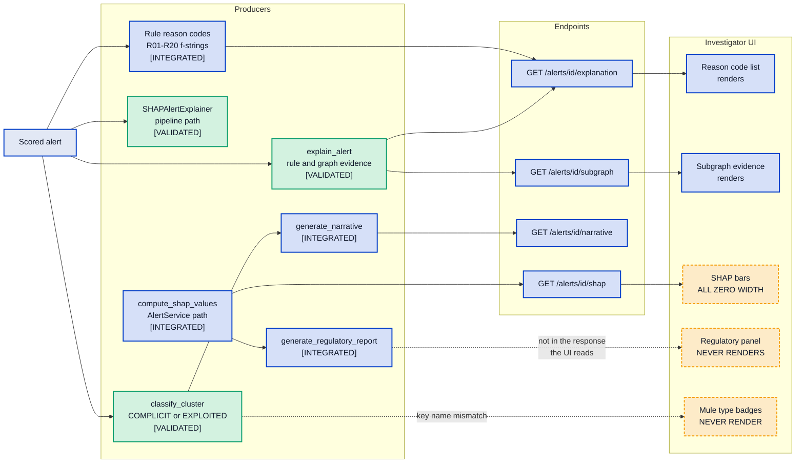

# MuleCatch — AI and Explainability

---

## Document control

| Field | Value |
|---|---|
| Purpose | Why graph learning was chosen over conventional tabular ML, how each explanation artifact is produced, and which of them actually reach the investigator |
| Audience | Model risk management, technical reviewers, compliance reviewers |
| Built from | Forensic code inventories: `explainability-ai`, `detection-engine`, `tests-evidence` |
| Codebase | `master` @ `a7b05bf` |
| Method | Every explanation artifact was traced from producer to consumer. Where the chain breaks, the break is documented with both line references |
| Related | [Detection engine](04-DETECTION-ENGINE.md) · [Graph layer](05-GRAPH-LAYER.md) · [Investigator workflow](07-INVESTIGATOR-WORKFLOW.md) · [Compliance and controls](10-COMPLIANCE-AND-CONTROLS.md) · [Delta register](11-DELTA-REGISTER.md) |

**Status legend.** `[VALIDATED]` reachable and covered by real non-mock tests · `[INTEGRATED]`
reachable from a registered route · `[IMPLEMENTED]` code exists but nothing registered reaches it ·
`[PLANNED]` target state.

---

## 1. Why graph learning rather than conventional tabular ML

The honest answer is not "because graphs are better". Gradient-boosted trees over well-engineered
features are a very strong baseline for fraud detection and would likely beat an uncalibrated graph
ensemble on raw accuracy. The case for graph methods rests on three properties that tabular models
cannot express, not on general superiority.

**Relational structure is the signal, not a feature of it.** A tabular model can consume
`n_distinct_senders` or `degree_centrality` as columns — but those are *summaries* of structure
computed by someone who decided in advance which summaries matter. The pattern that identifies a mule
ring is often the specific shape of the subgraph: a fan-in converging on two intermediaries which
forward to one exit account. Encoding shape as scalar features loses exactly the information that
distinguishes a coordinated ring from a busy merchant.

**The unit of interest is a set, not a row.** Tabular models classify rows. Mule detection needs to
classify *groups*. A model that scores accounts independently and is then aggregated is answering a
different question from one that scores the community.

**Label scarcity.** Confirmed mule labels are rare, late, and biased toward what the incumbent system
already caught. Unsupervised community detection needs no labels at all, which is why Louvain — not the
GNN — is the layer carrying the largest ensemble weight at 50%.

### Why Louvain specifically

Modularity maximisation finds dense subgraphs in a sparse graph without being told how many to expect,
which is the correct shape of the problem: the bank does not know how many rings it has. Alternatives
and their trade-offs are set out in [05-GRAPH-LAYER.md](05-GRAPH-LAYER.md) §4, including the
recommendation to move to **Leiden** for determinism and guaranteed well-connected communities.

### Where graph methods are weaker, stated plainly

They miss the isolated mule entirely — an account with one receipt and one cash-out forms no
community. They are non-deterministic under Louvain. They are more expensive to compute. And they are
harder to explain to a supervisor than a feature-importance list, which is precisely why the
explainability layer below is not optional decoration.

---

## 2. The explanation stack

| Artifact | Producer | Endpoint | Reaches the investigator? |
|---|---|---|---|
| Reason codes | Rule engine | `/explanation` | **Yes** |
| Rule and graph evidence | `explain_alert` ([explainer.py:743](../../backend/explainability/explainer.py#L743)) | `/explanation` | **Yes** — 25 tests |
| Subgraph evidence | `explain_alert` | `/subgraph` | **Yes** |
| Narrative | `generate_narrative` ([narrative_generator.py:68](../../backend/explainability/narrative_generator.py#L68)) | `/narrative` | Partially — §4 |
| SHAP attribution | `compute_shap_values` | `/shap` | **No — renders as zeros** |
| Regulatory report | `generate_regulatory_report` | none | **No — not in any response the UI reads** |
| Mule typology | `classify_cluster` | `/narrative` | **No — structurally null** |

---

## 3. Two different SHAP implementations

There are **two separate SHAP modules** with different feature sets and different weights:

| Module | Entry | Used by |
|---|---|---|
| [models/explainability/shap_explainer.py](../../models/explainability/shap_explainer.py) | `SHAPAlertExplainer.explain_alert` (`:349`) | The **detection pipeline**, at [pipeline.py:783](../../backend/detection/pipeline.py#L783) |
| [backend/explainability/shap_explainer.py](../../backend/explainability/shap_explainer.py) | `compute_shap_values` (`:158`) | **`AlertService` only**, at [alert_service.py:553](../../backend/services/alert_service.py#L553) |

The pipeline computes one attribution and stores it on the alert; the API endpoint computes a
*different* attribution on request. **Two explanations of the same alert can disagree**, and neither is
marked as authoritative. For a regulated decision this is a governance problem before it is an
engineering one: if an explanation is challenged, the bank must be able to say which computation
produced the one shown to the customer or the supervisor.

---

## 4. Four broken explanation chains

Each of these is a verified producer/consumer mismatch, not a stylistic observation. All four are the
same class of defect — a key name that differs between the code that writes it and the code that reads
it — and all four are one-line fixes.

**SHAP bars all render at zero width.** `ExplainabilityPanel` maps over `data.shap_results` reading
`item.shap_value`, `item.feature` and `item.importance` at flat top level
([ExplainabilityPanel.js:418-431](../../frontend/src/explainability/ExplainabilityPanel.js#L418-L431)).
The endpoint returns one entry **per account** with a nested `shap_values` list
([alert_service.py:559-565](../../backend/services/alert_service.py#L559-L565) →
`SHAPResult.to_dict` at
[shap_explainer.py:75-91](../../backend/explainability/shap_explainer.py#L75-L91)). So `item.feature`
is `undefined` and renders as empty, and `item.shap_value` is `undefined` so every bar computes to
zero width. The one payload shape that *does* match the frontend's expectation is the **error stub**
([alert_service.py:654-663](../../backend/services/alert_service.py#L654-L663)) — meaning the SHAP
panel only displays correctly when SHAP computation has failed. Separately, `waterfall_charts` is
computed at [:562-564](../../backend/services/alert_service.py#L562-L564) and no frontend file reads
it.

**The regulatory panel never renders.** The UI reads `data.regulatory_report` from the `/shap` response
([ExplainabilityPanel.js:401](../../frontend/src/explainability/ExplainabilityPanel.js#L401)), but
`get_shap` returns only `{alert_id, shap_results, waterfall_charts}`. Even if it were present, the
fields the UI expects — `regulatory.framework`, `model_description`, `feature_descriptions`,
`bias_assessment` — do not exist in the generator's output, which emits `model_type`,
`explainability_method`, `feature_list`, `top_contributing_features`, `base_score`, `confidence_score`
and `audit_trail` ([shap_explainer.py:477-495](../../models/explainability/shap_explainer.py#L477-L495)).
**There is no `bias_assessment` field anywhere in the repository.** The regulatory explanation report is
obtainable only by reading the raw alert payload.

**Mule typology is structurally always null.** `generate_narrative` reads
`mule_classification.get("classification")` and `.get("reasoning")`
([narrative_generator.py:96-98](../../backend/explainability/narrative_generator.py#L96-L98)), while
`classify_cluster` returns `cluster_classification` and `cluster_reasoning`
([mule_classifier.py:353-355](../../backend/detection/mule_classifier.py#L353-L355)). Both call sites
pass the `classify_cluster` output. So `narrative.mule_type` is always `None`, the mule-classification
paragraph at [:223-227](../../backend/explainability/narrative_generator.py#L223-L227) is never
appended, and two UI chips never render.

**The unit test passes while the integration is broken.** `test_explainability.py:154-163` asserts
correct behaviour by passing a hand-written dict using the `classification`/`reasoning` keys — the
shape the consumer expects but the producer never emits. The test validates the reader against a
fixture rather than against the writer. This is the most instructive finding in the document: it shows
how 461 passing tests can coexist with a broken user-visible feature, and it is the argument for
contract tests between producer and consumer rather than fixtures on each side.

Two further instances of the same class in the STR PDF: `str_pdf.py:150,157` read
`narrative["executive_summary"]` where the key is `executive_brief`
([narrative_generator.py:33](../../backend/explainability/narrative_generator.py#L33)), so the PDF's
executive summary section never prints; and `str_pdf.py:179-185` read `mule_type`, `type_confidence`
and `sophistication_level`, none of which `classify_cluster` emits — the last two appear nowhere in the
repository except `str_pdf.py`. The PDF's mule-classification section always prints N/A.

**Net effect.** Of seven explanation artifacts, three reach the investigator intact, one partially, and
three do not arrive at all. The explainability layer is substantially built and substantially
undelivered.

---

## 5. Narrative generation and its governance risk

`generate_narrative` produces an investigator-readable summary. The GenAI path can route through an
external provider — Anthropic, OpenAI or Gemini — via [backend/genai/](../../backend/genai/) with a
factory and retry logic, falling back to template generation when no API key is present.

Three governance points follow. **Content leaves the bank perimeter** on the LLM path; see
[01-CONTEXT-AND-SCOPE.md](01-CONTEXT-AND-SCOPE.md) §4. **The narrative is not the explanation** — it is
a rendering of the explanation, and if an LLM paraphrases a reason code inaccurately the investigator
sees a plausible sentence with no indication that it diverged. And **the LLM path is less configurable
than it appears**: `genai_temperature`, `genai_max_tokens` and `genai_timeout_seconds` are declared at
[config.py:107-109](../../backend/core/config.py#L107-L109) and in `.env.example`, and a repo-wide
search finds no code that reads any of the three.

The correct posture for a regulated deployment is that reason codes and SHAP attribution are the
authoritative explanation of record, and the narrative is a convenience layer that must be traceable
back to them. That posture is achievable here because the template fallback exists.

---

## 6. Why explainability is a regulatory requirement, not a feature

Three distinct obligations, each requiring something different:

**Contestability.** An adverse action against a customer must be explicable to that customer. "A model
scored you 0.87" is not an explanation. Reason codes tied to observable transaction facts are.

**Supervisory review.** A supervisor approving an STR is accepting personal responsibility for a
filing. They cannot do that on an opaque score. This is why the approval gate and the explanation layer
are the same control viewed from two sides — and why the `demo_user` approver defect in
[07](07-INVESTIGATOR-WORKFLOW.md) §4 undermines both.

**Retrospective reconstruction.** Months later, an examiner asks why this account was reported. The
answer must be reproducible from stored evidence, which requires that the explanation be *persisted*
with the alert and that the model version producing it be recorded. Alerts do now carry model and rule
version provenance, which is the right control. The two-SHAP-module ambiguity in §3 weakens it.

Against these, the current position is: reason codes are strong and reach the user; graph evidence is
strong and reaches the user; attribution is computed twice, ambiguously, and does not render; and the
regulatory report is generated and never delivered.

---

## 7. Architectural decisions

### Decision: SHAP for feature attribution

- **Why it exists.** `SHAPAlertExplainer` in the pipeline and `compute_shap_values` in the service.
- **Why it is required.** Attribution must be per-decision, not global. A supervisor needs to know what
  drove *this* alert.
- **Alternatives considered.** LIME, which is less stable; native GNNExplainer for the graph model,
  which would explain *subgraph* contribution rather than feature contribution and is arguably the more
  appropriate tool here; counterfactual explanation ("this alert would not have fired if…"), which is
  the most useful form for an investigator; and simple rule-hit lists, which the system already has.
- **Advantages.** Theoretically grounded, additive, widely accepted by model risk functions,
  well-tested here — 55 tests on the pipeline explainer.
- **Trade-offs.** SHAP explains the *surrogate*, not the graph model, so it attributes to engineered
  features rather than to the network structure that actually drove a community alert. That is a real
  limitation for a graph-centric detector: the most important reason may be "this account sits between
  two clusters", which no feature attribution expresses. And having two implementations means
  attribution is ambiguous.
- **Scalability considerations.** SHAP is computationally expensive; computing it per request on
  `/shap` rather than reusing the stored pipeline result doubles the cost and creates the disagreement.
- **Security considerations.** Attribution output describes model behaviour and could assist evasion if
  exposed beyond authorised roles. The endpoint is permission-gated.
- **Future improvements.** Collapse to one implementation, serve the stored pipeline result, and add
  **GNNExplainer** for subgraph-level attribution — which is what the architecture actually needs and
  currently lacks entirely. `[PLANNED]`

### Decision: reason codes as the stable investigator-facing contract

- **Why it exists.** Rules emit reason codes that flow to the UI, the narrative and the STR.
- **Why it is required.** A stable, human-legible vocabulary is what makes alerts comparable across
  time and reviewable by a supervisor.
- **Alternatives considered.** A structured `{code, description, evidence}` object; a versioned reason-
  code registry with regulatory mappings; free-text explanation only.
- **Advantages.** Simple, immediately legible, maps naturally onto regulatory red-flag language.
- **Trade-offs.** They are **f-strings** ([pipeline.py:287](../../backend/detection/pipeline.py#L287)),
  fusing the machine identifier with the human text. The text cannot be reworded without changing the
  identifier; codes cannot be reliably counted or filtered; and **no reason code carries its triggering
  evidence**, so an investigator learns that R07 fired but not which senders caused it. Worse, five
  rule names assert time windows the code never computes (see
  [04-DETECTION-ENGINE.md](04-DETECTION-ENGINE.md) §3) — so the reason code reaching a regulator can
  describe an analysis that did not occur.
- **Scalability considerations.** String construction per account per rule; negligible.
- **Security considerations.** Reason-code text discloses threshold values to anyone who can read an
  alert, which aids evasion.
- **Future improvements.** Move to a structured object with an evidence payload and a versioned
  registry; separate the code from its display text; correct the five misleading names before any
  regulator-facing use. `[PLANNED]`

---

## 8. What this section establishes

The choice of graph methods is well-reasoned and the reasoning survives scrutiny — relational shape,
group-level classification and label scarcity are real justifications, not fashion. The explanation
*producers* are genuinely strong: `explain_alert` with 25 tests, the pipeline SHAP explainer with 55,
graph evidence and reason codes both reaching the investigator intact.

The failure is in delivery. Three of seven explanation artifacts do not arrive, and all three fail for
the same trivial reason — a key name that differs between writer and reader. One of them, the SHAP
panel, renders correctly only when the computation has *failed*. A unit test passes over the broken
typology chain because it asserts against a fixture rather than against the producer.

The recommendation is therefore narrow and cheap: fix the four key names, collapse the two SHAP
implementations into one authoritative stored result, deliver the regulatory report through an endpoint
the UI actually reads, and add contract tests between producer and consumer so this class of defect
cannot recur. Then add GNNExplainer, because subgraph attribution is the one form of explanation this
graph-centric architecture genuinely needs and does not have. All are recorded in
[11-DELTA-REGISTER.md](11-DELTA-REGISTER.md).
