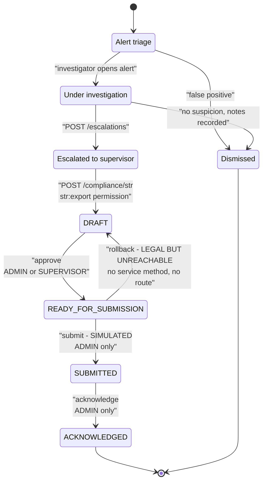
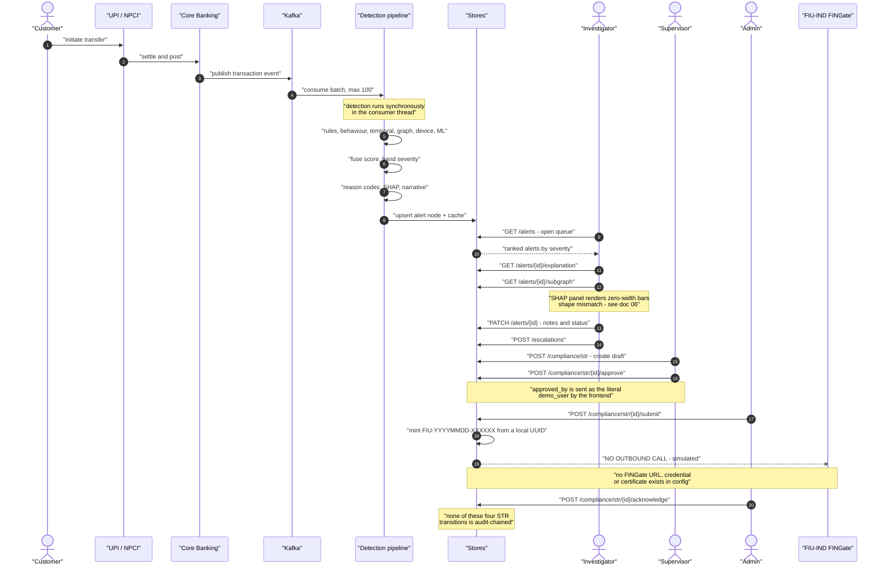

# MuleCatch — Investigator Workflow

**Contains Diagram 7 (Investigator Workflow / STR State Machine) and Diagram 10 (Sequence Diagram).**

---

## Document control

| Field | Value |
|---|---|
| Purpose | The human workflow from alert arrival to case closure and STR filing, with the implementation status of every step |
| Audience | Bank operations leads, compliance officers, technical reviewers |
| Built from | Forensic code inventories: `frontend`, `compliance-str`, `api-surface`, `explainability-ai` |
| Codebase | `master` @ `a7b05bf` |
| Method | The state machine below is transcribed from `VALID_TRANSITIONS`, and every role gate from the route decorator that enforces it |
| Related | [AI and explainability](06-AI-AND-EXPLAINABILITY.md) · [Security architecture](09-SECURITY-ARCHITECTURE.md) · [Compliance and controls](10-COMPLIANCE-AND-CONTROLS.md) · [Delta register](11-DELTA-REGISTER.md) |

**Status legend.** `[VALIDATED]` reachable and covered by real non-mock tests · `[INTEGRATED]`
reachable from a registered route · `[IMPLEMENTED]` code exists but nothing registered reaches it ·
`[PLANNED]` target state, not in the codebase.

---

## 1. Workflow step coverage

The requested workflow, step by step, against what exists.

| Step | Status | Implementation | Citation |
|---|---|---|---|
| Alert arrives | `[VALIDATED]` | Pipeline writes alert; queue reads it | [alerts.py:23-47](../../backend/api/v1/routes/alerts.py#L23-L47) |
| Prioritisation | `[INTEGRATED]` | Severity banding only — the priority **model** is unwired | [04](04-DETECTION-ENGINE.md) §4.2 |
| Review | `[INTEGRATED]` | Alert detail page | [App.js:76](../../frontend/src/App.js#L76) |
| Graph view | `[INTEGRATED]` | cytoscape + cola network view | [App.js:77](../../frontend/src/App.js#L77) |
| Reason codes | `[INTEGRATED]` | Emitted as f-strings, no structured evidence | [pipeline.py:287](../../backend/detection/pipeline.py#L287) |
| Timeline | `[INTEGRATED]` | Alert detail component | — |
| Evidence — narrative, SHAP, subgraph | `[INTEGRATED]` | Endpoints exist; **three render broken** | [06](06-AI-AND-EXPLAINABILITY.md) |
| Comments / notes | `[INTEGRATED]` | Alert status and notes update | [alerts.py:49-67](../../backend/api/v1/routes/alerts.py#L49-L67) |
| **Assignment / ownership** | `[PLANNED]` | No owner field, no assignment endpoint, no work queue | — |
| Supervisor review | `[INTEGRATED]` | STR approve, role-gated | [compliance.py:132-146](../../backend/api/v1/routes/compliance.py#L132-L146) |
| **Freeze / account action** | `[PLANNED]` | No freeze endpoint or state exists | — |
| Escalation | `[INTEGRATED]` | Create, list, resolve | [escalations.py:22-57](../../backend/api/v1/routes/escalations.py#L22-L57) |
| STR filing | `[SIMULATED]` | Full lifecycle; **no outbound transmission** | §3 |
| Closure | `[INTEGRATED]` | Alert status update | [alerts.py:49-67](../../backend/api/v1/routes/alerts.py#L49-L67) |
| **SLA timers** | `[PLANNED]` | No timer, no due date, no breach detection | — |
| **Evidence attachment** | `[PLANNED]` | No file upload or document store on a case | — |
| **Maker-checker** | `[PLANNED]` | Partially defeated in practice — see §4 | — |
| **Linked-case deduplication** | `[PLANNED]` | No case linking or dedup logic | — |
| **Customer grievance / unfreeze** | `[PLANNED]` | Entirely absent | — |

Nine of nineteen steps are `[PLANNED]`. The implemented core — triage, review, explain, escalate,
report — is real and coherent. What is missing is **case management**: ownership, deadlines,
attachments, and the customer-facing remediation path that RBI's expectations around wrongly frozen
accounts make necessary.

---

## 2. The STR state machine

Four states, defined at
[str_repository.py:16](../../backend/repositories/str_repository.py#L16):
`DRAFT`, `READY_FOR_SUBMISSION`, `SUBMITTED`, `ACKNOWLEDGED`.

Note that `VALID_STATUSES` is **declared but never referenced** by any code — a grep returns only its
two definition lines and no consumers. `VALID_TRANSITIONS` is the sole enforcement authority.

### Diagram 7 — Investigator Workflow and STR State Machine

### Transition matrix

| From | To | Service method | Route | Guard | Rate limit |
|---|---|---|---|---|---|
| — | `DRAFT` | `create_str` | `POST /compliance/str` | `str:export` → ADMIN, SUPERVISOR, INVESTIGATOR | 30/min |
| — | `DRAFT` | `create_str` in a loop | `POST /compliance/str-export` | `str:export` | 30/min |
| `DRAFT` | `READY_FOR_SUBMISSION` | `approve_for_submission` ([str_service.py:67-78](../../backend/services/str_service.py#L67-L78)) | `POST /compliance/str/{id}/approve` | `require_role("ADMIN","SUPERVISOR")` | 30/min |
| `READY_FOR_SUBMISSION` | `SUBMITTED` | `submit` ([:80-93](../../backend/services/str_service.py#L80-L93)) | `POST /compliance/str/{id}/submit` | `require_role("ADMIN")` | 10/min |
| `READY_FOR_SUBMISSION` | `DRAFT` | **none** | **none** | — | — |
| `SUBMITTED` | `ACKNOWLEDGED` | `acknowledge` ([:95-105](../../backend/services/str_service.py#L95-L105)) | `POST /compliance/str/{id}/acknowledge` | `require_role("ADMIN")` | 10/min |
| `ACKNOWLEDGED` | terminal | — | — | — | — |

**The rollback transition is unreachable.** `READY_FOR_SUBMISSION → DRAFT` is legal in the transition
table but no service method calls `update_status(..., "DRAFT", ...)` — the only call sites are
[:69](../../backend/services/str_service.py#L69), [:84](../../backend/services/str_service.py#L84)
and [:97](../../backend/services/str_service.py#L97). So a supervisor who approves an STR in error has
no route back to draft. For a report that carries legal weight, an approval that cannot be withdrawn
is a governance defect, not just a missing feature.

**A missing STR returns the wrong status code.** Because the service raises `ValueError` for both an
illegal transition and an unknown identifier, a request for a non-existent STR surfaces as HTTP 400
`INVALID_TRANSITION` rather than 404 ([str_service.py:75-76](../../backend/services/str_service.py#L75-L76),
[:90-91](../../backend/services/str_service.py#L90-L91),
[:102-103](../../backend/services/str_service.py#L102-L103)).

---

## 3. Diagram 10 — Sequence: payment to filed report

---

## 4. Four defects in the filing path

These are the findings a bank reviewer will care about most, because they concern the integrity of a
regulatory filing record rather than detection quality.

**The approver identity is a hardcoded literal.** The compliance portal sends
`approved_by: user || 'demo_user'` and calls it with the literal string `'demo_user'`
([CompliancePortal.js:30](../../frontend/src/compliance_portal/CompliancePortal.js#L30),
[:130](../../frontend/src/compliance_portal/CompliancePortal.js#L130)). The authenticated principal is
**not** used. So the `approved_by` field on every STR — the field that records which human accepted
responsibility for a report to the financial intelligence unit — is populated with a placeholder. The
role gate correctly ensures *a* supervisor performed the action; the record does not capture *which*.
This defeats the maker-checker control in the only place it is actually implemented.

**The STR lifecycle is not audit-chained.** A search of
[str_service.py](../../backend/services/str_service.py) for `audit` returns nothing. Create, approve,
submit and acknowledge produce no hash-chained audit record. The only trace of a submission is a
Python log line at [:92](../../backend/services/str_service.py#L92). Combined with the previous
finding, there is no tamper-evident record of who approved or submitted any report.

**The API response and the persisted record never share an identifier.** The STR generator returns a
payload with `str_id` in the form `STR_XXXXXXXX`, and `STRService.create_str` mints a *different*
identifier `STR-XXXXXXXXXX` ([str_service.py:32](../../backend/services/str_service.py#L32)). The
generator's id is discarded. A caller that stores the returned id cannot later retrieve the record.

**The generator and the repository disagree about the initial state.** The generator reports status
`READY_FOR_SUBMISSION` while the repository forces `DRAFT`
([str_repository.py:34](../../backend/repositories/str_repository.py#L34)). A client trusting the
response believes the report is approved when it is not.

And one workflow-shaping observation: `POST /compliance/str-export` **creates STR drafts as a side
effect**, in a loop ([compliance.py:43-57](../../backend/api/v1/routes/compliance.py#L43-L57)). An
export action silently generates regulatory report drafts. That is a surprising coupling for an
endpoint whose name implies a read.

---

## 5. Data provenance in the interface

The frontend contains hard-coded fallback data paths: the alert queue can fall back to demo alerts and
the ROI view to fixed metrics. The consequence for operations is more important than the code smell —
**an investigator cannot reliably tell live data from fallback data on screen.** A dashboard that
looks functional while its backend is unavailable is convenient for a demonstration and dangerous in
production, because the failure mode is silent and the displayed content is plausible.

This is compounded by the ROI figure discussed in [03](03-DATA-ARCHITECTURE.md) §3: the "75%
investigation time reduction" shown in the analytics view originates as a database column default
([init.sql:127](../../infra/database/init.sql#L127)), not a measurement.

The required control is an explicit provenance indicator on every data surface — live, uploaded,
synthetic, or fallback — visible without interpretation. `[PLANNED]`

---

## 6. Architectural decisions

### Decision: human-in-the-loop as a hard requirement

- **Why it exists.** No automated action follows an alert. Every consequential step requires a person.
- **Why it is required.** Freezing a customer's account is an adverse action with legal consequence and
  a contestability obligation. An AML control that acts autonomously transfers accountability to a
  model that cannot hold it.
- **Alternatives considered.** Auto-freeze above a score threshold; auto-file STRs above a threshold;
  tiered automation where low-risk dispositions are automated and high-risk escalate.
- **Advantages.** Accountability rests with an identifiable person; every decision is reviewable;
  explanations have a purpose because a human consumes them.
- **Trade-offs.** Throughput is bounded by investigator capacity, which makes the false-positive rate
  an operational constraint rather than a quality metric — and no capacity analysis exists anywhere in
  the repository, so the bound is unknown.
- **Scalability considerations.** The binding constraint is human, not computational. Absent
  pagination on list endpoints, the queue is also technically unbounded.
- **Security considerations.** The control depends entirely on the identity record being trustworthy —
  which the `demo_user` defect breaks, and which the missing audit chaining makes unverifiable.
- **Future improvements.** Capture structured dispositions with reason taxonomy; add capacity
  modelling so a threshold change can be expressed as an alerts-per-day impact. `[PLANNED]`

### Decision: role-gated state transitions with an escalating privilege ladder

- **Why it exists.** Draft requires `str:export`, approval requires SUPERVISOR, submission and
  acknowledgement require ADMIN.
- **Why it is required.** Separation of duties: the person who prepares a report must not be the person
  who files it.
- **Alternatives considered.** Permission-based gating throughout, which the codebase already has the
  vocabulary for; a formal maker-checker table recording both identities; delegated approval with
  time-boxed authority.
- **Advantages.** Simple, legible, and the ladder is correctly ordered.
- **Trade-offs.** Gating is **inconsistent**: a dedicated `str:approve` permission exists for exactly
  ADMIN and SUPERVISOR ([auth.py:75](../../infra/security/auth.py#L75),
  [:89](../../infra/security/auth.py#L89)) and is never enforced — approval is gated by role name
  instead. Two authorisation mechanisms coexist for one decision, and the more expressive one is dead.
  Separately, requiring ADMIN to submit conflates a *technical* administrator with a *regulatory*
  filing officer; those are different people in a bank.
- **Scalability considerations.** ADMIN-only submission is an operational bottleneck at volume.
- **Security considerations.** With `AUTH_ENABLED=false` — the default — every guard is a no-op and
  every caller is ADMIN. The production validator rejects this only when `ENV=production`.
- **Future improvements.** Enforce `str:approve`; introduce a distinct `COMPLIANCE_OFFICER` role for
  filing rather than reusing ADMIN; record both maker and checker identities from the authenticated
  principal; restore the rollback transition. `[PLANNED]`

---

## 7. What this section establishes

The investigation core is genuinely built: triage, review, graph, explanation, notes, escalation and a
correctly ordered STR approval ladder all exist and the STR state machine is properly enforced through
a transition table with real tests.

The gaps cluster in two places. **Case management is absent** — no ownership, no SLA, no attachments,
no linking, no customer remediation path — which is nine of nineteen workflow steps. And **the filing
record has four integrity defects**: a placeholder approver identity, no audit chaining, mismatched
identifiers, and an initial-state disagreement.

The second cluster matters more than its size suggests. Detection defects degrade accuracy; filing
record defects degrade the evidentiary value of the output, which is the part a regulator examines.
All four are small, local fixes, and all are recorded in
[11-DELTA-REGISTER.md](11-DELTA-REGISTER.md).
