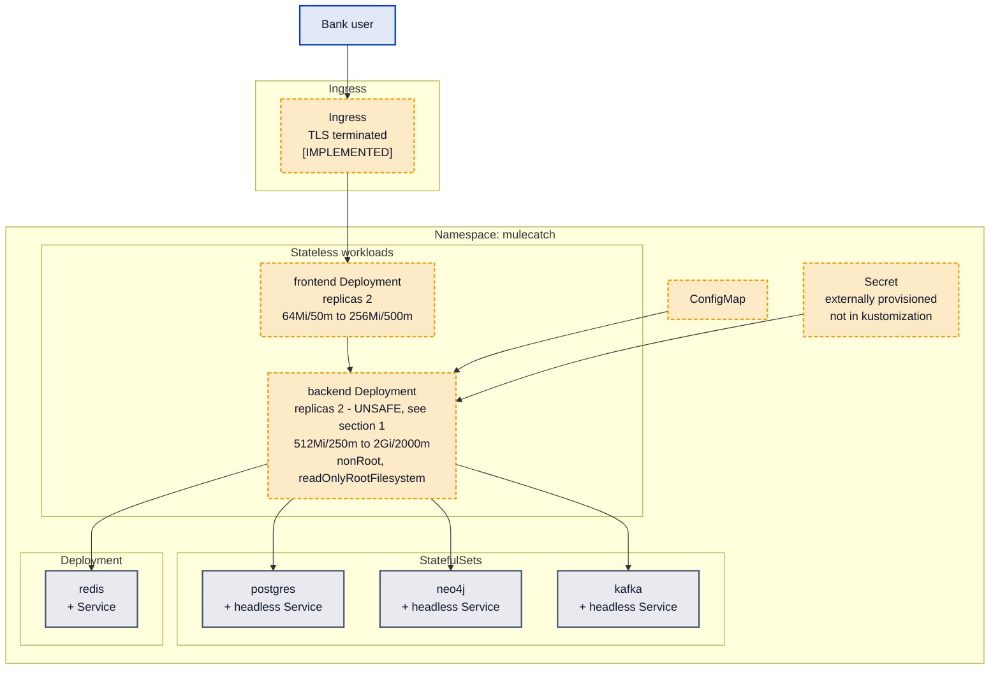
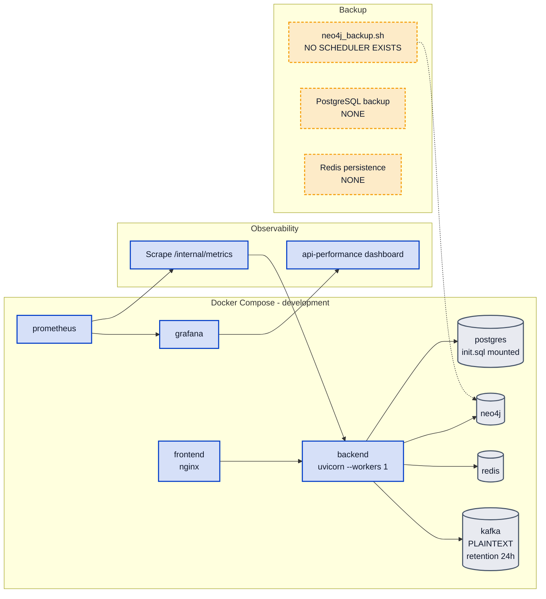
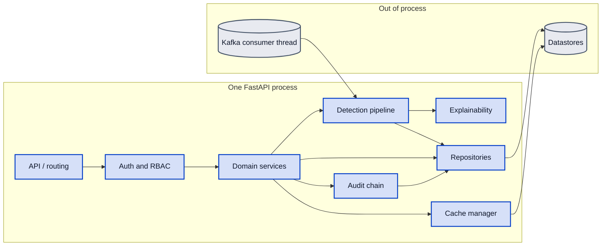
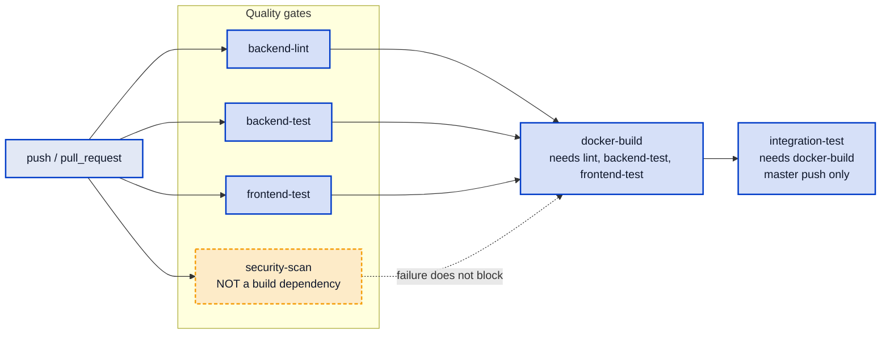

# MuleCatch — Platform and Deployment

**Contains Diagram 8 (Deployment Architecture), Diagram 11 (Infrastructure), Diagram 12 (Logical Component Interaction) and Diagram 14 (CI/CD Pipeline).**

---

## Document control

| Field | Value |
|---|---|
| Purpose | The real runtime topology in Compose and Kubernetes, environment strategy, availability, scaling limits, disaster recovery, and the CI pipeline with its gates |
| Audience | Bank platform engineering, SRE, security architects, release management |
| Built from | Forensic code inventories: `platform-infra`, `api-surface`, `streaming-ingest`, `service-data-layer` |
| Codebase | `master` @ `a7b05bf` |
| Method | Manifest values are transcribed, not summarised. Every claim carries a `file:line` citation |
| Related | [System architecture](02-SYSTEM-ARCHITECTURE.md) · [Security architecture](09-SECURITY-ARCHITECTURE.md) · [Delta register](11-DELTA-REGISTER.md) |

**Status legend.** `[VALIDATED]` reachable and covered by real non-mock tests · `[INTEGRATED]`
exercised by a running system or CI · `[IMPLEMENTED]` declared but never executed in any verified path
· `[PLANNED]` target state.

---

## 1. The binding constraint: replica count versus in-process state

This has to come first, because it invalidates the deployment as declared.

The backend Deployment specifies **`replicas: 2`**
([backend-deployment.yaml:10](../../infra/k8s/base/backend-deployment.yaml#L10)), and uvicorn runs with
`--workers 1` ([Dockerfile:60-65](../../backend/Dockerfile#L60-L65)) so horizontal capacity is intended
to come from pod replicas. That is a sound pattern in general.

It is **unsafe for this application today**, because several components hold mutable state in process
memory behind `lru_cache` singletons ([deps.py](../../backend/api/deps.py)):

| Component | State held | Consequence across two replicas |
|---|---|---|
| `DeviceProfiler` | Device→account observations, unbounded | Each replica sees roughly half the events. Shared-device detection (R18) fires or does not depending on which pod handled which transaction |
| `RollingPropensityScorer` | Per-account transaction history dict | Split history; scores computed from partial data |
| `PropensityStore` | In-memory top-risk ranking | Each replica reports a different ranking |
| In-memory repositories | Alerts, datasets, escalations, STRs | Divergent state per pod when `POSTGRES_URL` is unset |

Alerts and datasets are partially protected by the Redis shared list
([cache_keys.py:3-4](../../backend/repositories/cache_keys.py#L3-L4)), which is genuinely tested
across workers. The detection state is not.

**The practical effect is a correctness defect, not a performance one.** A shared-device signal is a
function of which pod received the traffic. That is worse than a missing feature, because the output
is plausible and wrong rather than absent.

Until that state is externalised, the safe configuration is `replicas: 1`. The manifest as shipped
declares 2.

---

## 2. Diagram 8 — Deployment Architecture (Kubernetes)

All Kubernetes manifests are `[IMPLEMENTED]` — declarative only. No verified path in the repository
applies them, and there is no evidence of a cluster deployment having been exercised.

### 2.1 Probes: correctly designed

This is a genuine strength and worth stating plainly, because probe design is commonly got wrong.

| Probe | Endpoint | Timing | What it checks |
|---|---|---|---|
| Liveness | `GET /health` | `initialDelaySeconds 45` | Process liveness only — deliberately cheap, returns 200 even with a broken dependency |
| Readiness | `GET /ready` | `initialDelaySeconds 30`, `periodSeconds 10` | Strict — verifies Neo4j, PostgreSQL, Redis and Kafka |

The split is right: a dependency outage should remove the pod from the load balancer, not restart it.
Two distinct endpoints exist for exactly this reason.

**Missing: `startupProbe`.** With `initialDelaySeconds: 45` on liveness and a cold start that imports
torch, lightgbm and shap, a slow first boot risks a liveness restart loop — the pod is killed before it
finishes initialising, then killed again. A `startupProbe` is the correct fix and costs nothing.

### 2.2 Container hardening: good

`readOnlyRootFilesystem: true` and `runAsNonRoot: true`
([backend-deployment.yaml:620-621](../../infra/k8s/base/backend-deployment.yaml#L620-L621)). Secrets
are **deliberately excluded** from `kustomization.yaml` with an explanatory inline comment, so no
plaintext secret ships in the manifests — the right decision, correctly documented.

**Missing:** no `ResourceQuota`, no `LimitRange`, no Pod Security Admission labels
(`pod-security.kubernetes.io/enforce`), and — as recorded in
[09](09-SECURITY-ARCHITECTURE.md) §5 — no `NetworkPolicy` in any of the 16 manifests.

---

## 3. Diagram 11 — Infrastructure

### 3.1 Kafka is provisioned but not configured for operation

`KAFKA_OFFSETS_TOPIC_REPLICATION_FACTOR: 1` and `KAFKA_LOG_RETENTION_HOURS: 24`. A search for
`KAFKA_AUTO_CREATE`, `num_partitions` and `replication_factor` found no topic-provisioning job in
either Compose or Kubernetes. So **no topic is explicitly created, partitioned, or replicated**.
Replication factor 1 means no broker redundancy, and 24-hour retention means the replay window for
reconciliation is one day — short for an AML system where a detection defect may be discovered later
than that.

### 3.2 Resource limits in Compose are largely decorative

Limits are declared via `deploy.resources`, which **only Docker Swarm enforces**. Under plain
`docker compose up` the CPU and reservation semantics differ, so the declared limits do not constrain a
development deployment as an operator would expect.

---

## 4. Diagram 12 — Logical Component Interaction

Not a microservice topology. MuleCatch is a single process; these are in-process logical boundaries.
See [02-SYSTEM-ARCHITECTURE.md](02-SYSTEM-ARCHITECTURE.md) §1.

The one genuine concurrency boundary is the **Kafka consumer thread**, which runs detection
synchronously inside itself. There is no worker pool and no queue between consumption and detection, so
consumer lag is a direct function of detection latency.

---

## 5. Diagram 14 — CI/CD Pipeline

| Job | Lines | Blocks the image build? |
|---|---|---|
| `backend-lint` | [17-33](../../.github/workflows/ci.yml#L17-L33) | Yes |
| `backend-test` | [36-82](../../.github/workflows/ci.yml#L36-L82) | Yes |
| `frontend-test` | [85-105](../../.github/workflows/ci.yml#L85-L105) | Yes |
| `security-scan` | [108-128](../../.github/workflows/ci.yml#L108-L128) | **No** |
| `docker-build` | [131-171](../../.github/workflows/ci.yml#L131-L171) | `needs: [backend-lint, backend-test, frontend-test]` |
| `integration-test` | [174-222](../../.github/workflows/ci.yml#L174-L222) | Runs after the build, master-push only |

**`security-scan` is not in `docker-build.needs`.** A container image can therefore be built and
published while the security scan is failing. The dependency audit inside that job is build-blocking
*within the job*, but the job itself does not gate the artifact — so the control exists and does not
constrain the release path. This is a one-line fix in `needs`.

Two further gaps: `integration-test` runs **after** the image is built rather than before, so
integration failures are discovered post-artifact; and as recorded in
[09](09-SECURITY-ARCHITECTURE.md) §8, there is no secret scanning and no SAST anywhere in the pipeline.

---

## 6. Environments

| Environment | Supported? | Evidence |
|---|---|---|
| Development | Yes | `docker-compose.yml`, auth disabled by default |
| Testing | Yes | `pytest.ini`, CI jobs, in-memory repositories |
| Pilot | **Not distinctly** | No pilot-specific configuration; `ENV` not `production` means auth fails open — see [09](09-SECURITY-ARCHITECTURE.md) §3.1 |
| Production | Partially | `docker-compose.prod.yml`, Kustomize base, production validator |
| **Shadow mode** | `[PLANNED]` | No mechanism exists to run detection without surfacing output. Searched for any shadow, dry-run or suppression flag — none found |

Shadow mode deserves emphasis because it is normally the *first* thing a bank asks for: run the new
detector alongside the incumbent, compare alert volumes and overlap, and act on nothing. MuleCatch has
no such mode. Adding one is straightforward — a configuration flag that writes alerts with a
`shadow` marker and excludes them from the investigator queue — and it is a prerequisite for any
credible parallel-run evaluation.

There is also **no Kustomize overlay per environment**. The `base` exists; no `overlays/` directory
does. Environment differentiation is by ConfigMap and Secret content alone.

---

## 7. Availability, scaling, backup and recovery

| Concern | Position |
|---|---|
| Application HA | Declared `replicas: 2`, unsafe today — §1 |
| Datastore HA | Single-instance StatefulSets. No PostgreSQL replication, no Neo4j cluster, no Redis Sentinel, Kafka replication factor 1 |
| Horizontal scaling | Blocked by in-process state — §1 |
| Vertical scaling | Available; backend limit is 2Gi / 2000m |
| Autoscaling | None. No HPA in any manifest |
| **Neo4j backup** | Script exists; **no cron, CronJob or scheduler anywhere in the repository** |
| **PostgreSQL backup** | **None** — and it holds the audit chain and every STR |
| **Redis persistence** | **None configured** |
| **Restore** | Never exercised. No documented or tested restore path |
| **RPO / RTO** | Undefined. `TARGET — UNVALIDATED` |

The backup position is the weakest part of the platform. The one store with a backup script has no
scheduler to run it, and the store holding the tamper-evident audit chain and every regulatory report
has no backup path at all. For an AML system with statutory record-retention obligations, that is a
gating issue for a pilot rather than a hardening nicety.

---

## 8. Observability

Prometheus scrapes `/internal/metrics`; Grafana provisions one dashboard, `api-performance.json`. Six
metrics are registered in the app factory
([app.py:107-161](../../backend/api/app.py#L107-L161)), guarded by `try/except ImportError` so the
application still starts without `prometheus_client`.

Gaps: only one dashboard, and it is API performance rather than detection quality — there is no panel
for alert volume, severity mix, model fallback occurrence, or queue depth. No alerting rules exist. And
the scrape target is publicly exposed, which contradicts
[PRODUCTION_READINESS.md:26](../PRODUCTION_READINESS.md#L26) where it is recorded as "Removed"; the
ingress was hardened, the nginx proxy was not.

---

## 9. Architectural decisions

### Decision: StatefulSets for PostgreSQL, Neo4j and Kafka; Deployment for Redis

- **Why it exists.** Stable network identity and stable volume claims for the three stores whose
  identity matters; Redis is treated as a disposable cache.
- **Why it is required.** A StatefulSet gives ordinal pod names and per-pod PVCs, which is what a
  database needs for recovery.
- **Alternatives considered.** A managed cloud service per store, which is what most banks would
  actually choose; a Kubernetes operator per store (CloudNativePG, Neo4j Operator, Strimzi) which
  handles failover and backup properly; external VMs.
- **Advantages.** Self-contained, portable across clusters, no cloud dependency — appropriate for an
  on-premise bank deployment.
- **Trade-offs.** Hand-rolled StatefulSets provide *placement*, not *operations*. There is no failover,
  no automated backup, no point-in-time recovery and no upgrade orchestration. Redis as a Deployment is
  correct **only** while Redis holds nothing durable — but it currently holds the cross-worker alert
  list, so losing it loses alert visibility until the next detection run.
- **Scalability considerations.** All three stores are single-instance. Kafka with replication factor 1
  has no broker redundancy.
- **Security considerations.** TLS per store is enforced by the production validator, which is good.
  Absent `NetworkPolicy`, any pod can reach any store.
- **Future improvements.** Adopt operators — Strimzi for Kafka, CloudNativePG for PostgreSQL — or
  managed services. Either gives backup and failover that hand-written manifests will not.
  `[PLANNED]`

### Decision: horizontal scale by pod replicas with `--workers 1`

- **Why it exists.** One uvicorn worker per container, capacity from replica count.
- **Why it is required.** Keeps the container model simple and lets Kubernetes own scheduling; avoids
  multiplying in-process memory by worker count, which matters when torch and shap are loaded.
- **Alternatives considered.** Multiple uvicorn workers per pod; Gunicorn with uvicorn workers; a
  single large vertically-scaled pod.
- **Advantages.** Clean scaling unit; per-pod resource accounting; a crashed worker takes down one pod
  rather than one thread.
- **Trade-offs.** **The pattern is correct and the application cannot yet use it.** Process-local
  singleton state makes any replica count above one produce incorrect detection results (§1). The
  manifest declares 2, so the shipped configuration is already in the unsafe region.
- **Scalability considerations.** Externalising the device profiler and propensity state to Redis is
  the unlock. Until then the honest ceiling is one pod.
- **Security considerations.** None specific.
- **Future improvements.** Move `DeviceProfiler` and `RollingPropensityScorer` state to Redis with
  explicit keys and TTLs; then raise replicas and add an HPA. Set `replicas: 1` in the interim.
  `[PLANNED]`

### Decision: cloud, on-premise, or hybrid

- **Why it exists.** The manifests are cloud-agnostic; nothing depends on a cloud provider.
- **Why it is required.** Indian banking data-residency expectations and internal policy usually push
  AML workloads on-premise or into a sovereign region.
- **Alternatives considered.** Full public cloud with managed stores; on-premise Kubernetes; hybrid with
  on-premise data and cloud compute; hybrid with cloud used only for model training.
- **Advantages.** Portability is real — this can be deployed into a bank's own cluster with no
  rewriting.
- **Trade-offs.** Cloud-agnosticism costs the managed-service benefits the platform most needs, namely
  backup, failover and key management. The hybrid variant worth considering is on-premise inference and
  data with cloud-based *model training* only, since training needs no customer identifiers once
  features are derived — but note that the GenAI narrative path currently sends alert context to an
  external LLM provider, which is a data-residency question in its own right and must be resolved
  before a pilot.
- **Scalability considerations.** On-premise means capacity planning is a procurement exercise; no
  autoscaling is configured in any case.
- **Security considerations.** On-premise keeps customer data inside the bank perimeter, which is the
  strongest argument for it. The external LLM call is the exception and needs an explicit decision.
- **Future improvements.** Document a data-residency matrix stating, for each external call, what
  leaves the perimeter. Offer a fully local narrative-generation path so the platform can run with no
  egress. `[PLANNED]`

---

## 10. What this section establishes

The platform work is more mature than most prototypes: correct liveness/readiness separation, non-root
containers with a read-only root filesystem, externally provisioned secrets with the reasoning written
down, a production validator with real tests, build-blocking dependency audits, and a monitoring stack
that degrades gracefully.

Four items gate a pilot, all recorded in [11-DELTA-REGISTER.md](11-DELTA-REGISTER.md):

1. **`replicas: 2` with process-local detection state produces incorrect results.** Set 1, or
   externalise the state.
2. **PostgreSQL — holding the audit chain and every STR — has no backup path**, and the Neo4j backup
   script has no scheduler. No restore has ever been exercised.
3. **`security-scan` does not gate `docker-build`**, so an image can ship while the scan fails.
4. **No shadow mode exists**, which blocks the parallel-run evaluation a bank will require before
   trusting the detector.

Items 1 and 3 are one-line changes. Item 2 is a day of work. Item 4 is a small feature and a
prerequisite for the validation programme described in
[10-COMPLIANCE-AND-CONTROLS.md](10-COMPLIANCE-AND-CONTROLS.md).
