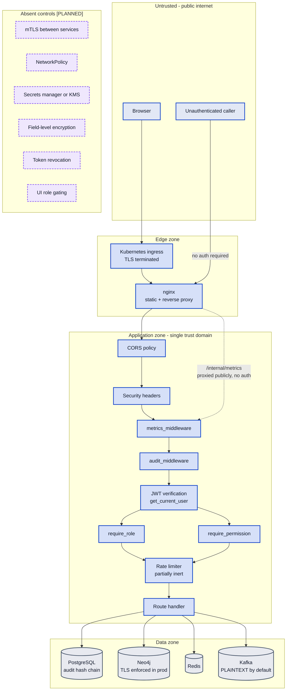

# MuleCatch — Security Architecture

**Contains Diagram 9 (Security Architecture).**

---

## Document control

| Field | Value |
|---|---|
| Purpose | Identity, authorisation, transport, secrets, audit integrity and personal-data protection — what exists and what does not |
| Audience | Bank security architects, penetration testers, internal audit |
| Built from | Forensic code inventories: `security-controls`, `api-surface`, `platform-infra`, `service-data-layer` |
| Codebase | `master` @ `a7b05bf` |
| Method | Absences are reported as first-class findings with the search that established them. Every control carries a `file:line` citation |
| Related | [System architecture](02-SYSTEM-ARCHITECTURE.md) · [Data architecture](03-DATA-ARCHITECTURE.md) · [Platform and deployment](08-PLATFORM-AND-DEPLOYMENT.md) · [Compliance and controls](10-COMPLIANCE-AND-CONTROLS.md) · [Delta register](11-DELTA-REGISTER.md) |

> This document is deliberately unflattering. A security architecture document that lists only
> controls is worthless to the reader who has to decide whether the system can be deployed. Every
> absence below was verified by search, not assumed.

---

## 1. Diagram 9 — Security Architecture

Note that the application is **one trust domain**. There is no internal segmentation, so any control
bypass has the full data zone within reach.

---

## 2. The RBAC matrix

Four roles are defined as keys of `ROLE_PERMISSIONS`
([auth.py:69-110](../../infra/security/auth.py#L69-L110)), carrying 13 permissions between them.

| Role | Permission count | Intended scope | Line |
|---|---|---|---|
| `ADMIN` | 13 | Full access including configuration | [auth.py:69](../../infra/security/auth.py#L69) |
| `SUPERVISOR` | 9 | Investigator plus STR approval | [:85-95](../../infra/security/auth.py#L85-L95) |
| `INVESTIGATOR` | 7 | View alerts, update status, export STR | [:96-104](../../infra/security/auth.py#L96-L104) |
| `READONLY` | 3 | `alerts:read`, `kpi:read`, `onboarding:read` | [:105-109](../../infra/security/auth.py#L105-L109) |

### 2.1 `AUDITOR` is a phantom role

`READ_ROLES` includes `AUDITOR`, but **`AUDITOR` has no entry in `ROLE_PERMISSIONS`**. Consequently
`require_permission` resolves `ROLE_PERMISSIONS.get("AUDITOR", [])` to an empty list
([auth.py:106](../../backend/middleware/auth.py#L106)), so an AUDITOR token is **denied every
permission-gated endpoint** while still passing the two `require_role(*READ_ROLES)` benchmark
endpoints. No LDAP group maps to it ([ldap_client.py:12-20](../../infra/ldap/ldap_client.py#L12-L20))
and no user-creation path assigns it.

The role an internal audit function would be given is the one role that cannot read anything. For a
system whose auditability is a regulatory control, this is a pointed defect.

### 2.2 Four permissions are declared and never checked

A repo-wide search for `config:read`, `config:write`, `alerts:delete` and `str:approve` returns only
their declarations plus two test comments. There is no `/config` route family at all, and STR approval
is gated by **role name** rather than by the `str:approve` permission that exists for exactly the two
roles allowed to approve. Two authorisation mechanisms coexist and the more expressive one is dead
code.

### 2.3 Default-role behaviour is inconsistent

A JWT with no `role` claim resolves to `READONLY` under `require_permission`
([auth.py:105](../../backend/middleware/auth.py#L105)) but to the empty string under `require_role`
([:89](../../backend/middleware/auth.py#L89)). Two guards disagree about the same token. The refresh
endpoint and both user-creation paths default to `READONLY`, which is the correct fail-safe direction.

### 2.4 No role gating exists in the interface

`ProtectedRoute` checks authentication only
([ProtectedRoute.js:9-36](../../frontend/src/auth/ProtectedRoute.js#L9-L36)). A READONLY user is
shown every navigation item and every action control; the calls simply fail. Authorisation is
correctly enforced server-side, so this is a usability and information-disclosure issue rather than a
privilege-escalation one — but the menu structure discloses the existence of capabilities the user
cannot access.

---

## 3. Authentication

| Control | Status | Citation |
|---|---|---|
| JWT issuance and verification | `[VALIDATED]` | [auth.py](../../backend/api/v1/routes/auth.py) |
| bcrypt password hashing | `[VALIDATED]` | `users.password_hash`, real bcrypt in tests |
| Failed-login tracking | `[INTEGRATED]` | `failed_logins` table, [init.sql:161-167](../../infra/database/init.sql#L161-L167) |
| LDAP directory bind | `[IMPLEMENTED]` | [ldap_client.py](../../infra/ldap/ldap_client.py) — enabled by no shipped configuration |
| **Token revocation** | **ABSENT** | §3.2 |
| **mTLS** | **ABSENT** | §5 |

### 3.1 The demo-mode bypass

`get_current_user` synthesises `{"sub": "demo_user", "role": "ADMIN"}` when authentication is disabled
([auth.py:50-60](../../backend/middleware/auth.py#L50-L60)), and both `require_role`
([:87-88](../../backend/middleware/auth.py#L87-L88)) and `require_permission`
([:103-104](../../backend/middleware/auth.py#L103-L104)) return the caller unchecked. **Every request
becomes ADMIN.**

`auth_enabled` defaults to `False` ([config.py:32](../../backend/core/config.py#L32)). The production
validator rejects the combination, but **only when `ENV=production`**
([production_validator.py:49-53](../../backend/core/production_validator.py#L49-L53)). Any
environment not named `production` — staging, UAT, pilot — runs fully open by default. For a bank
pilot handling real customer data in a non-production environment, that is the highest-severity
configuration risk in the system.

### 3.2 Token revocation does not work

Revocation is effectively absent. A JWT remains valid until expiry regardless of logout, role change,
or account deactivation. Setting `users.is_active = false` does not invalidate an outstanding token.
For a system where a compromised investigator session grants access to customer financial data, this
is a material gap — and it is the direct trade-off of stateless JWT, which §7 addresses.

### 3.3 LDAP is implemented but unreachable in practice

`ldap_enabled` defaults to `False` ([config.py:43](../../backend/core/config.py#L43)) and is `false`
or absent in **every** configuration in the repository — `.env.example`,
`.env.production.example`, both Compose files, and the Kubernetes ConfigMap. `LDAP_URL` defaults to
plaintext `ldap://localhost:389`, and the client passes no `use_ssl` or TLS object
([ldap_client.py:43](../../infra/ldap/ldap_client.py#L43)), so transport security depends entirely on
an `ldaps://` scheme in the URL. There is no certificate validation configuration and no StartTLS.
The production validator does enforce `ldaps://` when LDAP is enabled, which is correct.

---

## 4. Rate limiting: partially inert

`SlowAPIMiddleware` is **never installed** — a repo-wide search returns no registration — so the
declared `default_limits=['100/minute']`
([rate_limiter.py:24](../../backend/core/rate_limiter.py#L24)) has no effect. Only endpoints with an
explicit `@limiter.limit` decorator are limited.

**Eight endpoints have no limit at all**, including all three ROI routes,
`/api/v1/benchmark/{capabilities,results}`, `/api/v1/ingest/stream`, `/metrics` and
`/internal/metrics`.

Where limits do apply they are sensibly graduated — 2/hour for the UNSC watchlist refresh, 10/minute
for STR submission, 120/minute for device events. But **the key is `request.client.host`** and uvicorn
runs without `--proxy-headers` ([Dockerfile:60-65](../../backend/Dockerfile#L60-L65)). Behind nginx,
every caller therefore shares a single bucket keyed on the nginx container IP. The limits do not
isolate callers — they throttle the whole tenant collectively, which means one aggressive client can
exhaust the budget for every legitimate user.

### 4.1 An authenticated-only write endpoint

`POST /api/v1/ingest/seed` writes synthetic transactions to Kafka and is gated **only on being
authenticated** ([ingest.py:98](../../backend/api/v1/routes/ingest.py#L98)) — a READONLY token
satisfies it. A view-only compliance user can inject transaction events into the detection pipeline.

---

## 5. Transport and network security

| Boundary | Protection | Enforced by | Status |
|---|---|---|---|
| Browser → ingress | TLS | Ingress configuration | `[INTEGRATED]` |
| nginx → backend | **none** | — | plaintext HTTP |
| Backend → Neo4j | TLS when configured | `NEO4J_TLS_ENABLED`, validator-checked | `[INTEGRATED]` |
| Backend → PostgreSQL | TLS when `sslmode` set | validator-checked | `[INTEGRATED]` |
| Backend → Redis | TLS when `rediss://` | validator-checked | `[INTEGRATED]` |
| Backend → Kafka | **`PLAINTEXT` by default** | [config.py:25](../../backend/core/config.py#L25) | `[IMPLEMENTED]` |

**No mTLS on any boundary.** No client certificates are configured anywhere, there is no service mesh,
and there is **no `NetworkPolicy` in any of the 16 Kubernetes manifests**. Pod-to-pod traffic within
the namespace is unrestricted, so a compromised frontend pod has unmediated network access to
PostgreSQL, Neo4j, Redis and Kafka.

### 5.1 Internal metrics are publicly exposed

`GET /internal/metrics` has **no authentication**
([app.py:187-194](../../backend/api/app.py#L187-L194)), contradicting its own source comment claiming
Docker-network-only reachability. And [nginx.prod.conf:103-106](../../frontend/nginx.prod.conf#L103-L106)
proxies it publicly.

This is worth stating precisely because it corrects an earlier claim: the Kubernetes ingress **was**
hardened to remove this exposure, but the nginx configuration was not, so in a Compose deployment —
and in any Kubernetes deployment where traffic reaches nginx — the endpoint remains reachable. The
exposure discloses request volumes, endpoint names, error rates and latency distributions to an
unauthenticated caller.

---

## 6. Audit integrity

Each `audit_logs` row carries `previous_hash` and `entry_hash`
([init.sql:35-36](../../infra/database/init.sql#L35-L36)), computed with `hashlib.sha256`. A
verification endpoint exists at `GET /api/v1/audit-log/integrity`. A one-time legacy backfill refuses
to proceed on a mixed or partial chain, which is the correct conservative behaviour — it does not
silently "repair" possible tampering.

**What the chain proves and does not prove.** It detects retrospective modification or deletion of
interior rows. It does **not** establish authenticity: nothing anchors the chain outside the database,
so any principal able to write to the table can recompute it end to end. It is tamper-evident against
a careless attacker and not tamper-proof against a privileged one.

**Coverage is the larger problem.** Verified absent from the chain: login, logout and token refresh —
no `audit` reference exists in [auth.py](../../backend/api/v1/routes/auth.py) — and **the entire STR
lifecycle**: create, approve, submit and acknowledge, established by searching
[str_service.py](../../backend/services/str_service.py) for `audit` and finding nothing. Also
unchained: CSV upload, screening, onboarding assessment, benchmark execution and detection runs.

Combined with the frontend sending the literal `'demo_user'` as `approved_by` (see
[07](07-INVESTIGATOR-WORKFLOW.md) §4), there is **no trustworthy record of who approved or submitted
any STR**. For an AML filing control this is the single most consequential control gap in the system.

Two operational notes. `latest_hash()` is read on **every** audit write to obtain the previous link,
which serialises audit writes — and does so against an unindexed `timestamp DESC` scan in any
deployment bootstrapped without `init.sql` (see [03](03-DATA-ARCHITECTURE.md) §3). And the application
role retains `UPDATE` and `DELETE` on the audit table; nothing at the database level enforces
append-only.

---

## 7. Personal data protection

Full classification table is in [03-DATA-ARCHITECTURE.md](03-DATA-ARCHITECTURE.md) §6. In summary:
phone, email and government ID are one-way hashed — a genuinely good decision that preserves reuse
detection while discarding recoverable value. **Full name and postal address are stored plaintext**
because `rapidfuzz` matching requires cleartext, so the two most identifying attributes are the two
unprotected ones.

Verified absent: field-level encryption or tokenisation of any kind — no `pgcrypto`, no KMS, no vault;
response or log masking; a defined retention, archival or deletion policy; and any legal-hold
mechanism. PAN and Aadhaar are not modelled, so a deployment ingesting them would extend the schema
with no established protection pattern to follow.

---

## 8. Secrets and supply chain

| Control | Status | Evidence |
|---|---|---|
| Production validator rejects weak secrets | `[VALIDATED]` | 11 checks; real tests at `test_production_controls.py:63-97` |
| Externally provisioned K8s secrets | `[INTEGRATED]` | [kustomization.yaml](../../infra/k8s/base/kustomization.yaml) |
| **Secrets manager / KMS** | **ABSENT** | documented as an external prerequisite only |
| **Secret scanning in CI** | **ABSENT** | no gitleaks, no trufflehog |
| **SAST** | **ABSENT** | no bandit, despite the project's own Python security rules recommending it |
| Dependency vulnerability audit | `[INTEGRATED]` | build-blocking in CI |

**Committed plaintext development secrets**, acceptable for ephemeral CI but present in the repository:
`JWT_SECRET: test-secret-ci` and `ci_test_jwt_secret` / `NEO4J_PASSWORD: ci_test_password` in
[ci.yml](../../.github/workflows/ci.yml); and `dev_jwt_secret_change_in_production`, `mulecatch2024`
and `mulecatch` as fallback defaults in [docker-compose.yml](../../docker-compose.yml).

**The shipped production example config would fail the validator.** `.env.production.example` sets
`ENV=production` with non-TLS Redis, PostgreSQL without `sslmode`, no `KAFKA_SECURITY_PROTOCOL` so it
defaults to `PLAINTEXT`, and no `MODEL_VERSION` so it stays at `unvalidated-dev`. It correctly sets
`NEO4J_TLS_ENABLED=true` and a non-wildcard CORS origin. As shipped it cannot start — which is the
validator working as designed, but it means the file cannot be used as the template it presents itself
as.

---

## 9. Threat surface summary

| Surface | Exposure | Control | Verdict |
|---|---|---|---|
| Public API | Full route surface | JWT + RBAC + partial rate limiting | Adequate when `AUTH_ENABLED=true` |
| `/internal/metrics` | Operational telemetry | **none** | **Exposed** |
| Non-production environments | Everything | **none by default** | **Open — highest severity** |
| Pod-to-pod | All four datastores | **none** | **Unsegmented** |
| Stolen JWT | Everything the role permits, until expiry | **no revocation** | **Unmitigated** |
| Database compromise | Names and addresses in cleartext | **no field encryption** | **Unmitigated** |
| Privileged DB write | Audit chain recomputable | chain only, no external anchor | **Partially mitigated** |
| Dependency chain | Known CVEs | build-blocking audit | **Mitigated** |
| Source secrets | Committed dev credentials | none | **No scanning** |

---

## 10. Architectural decisions

### Decision: stateless JWT for session management

- **Why it exists.** Signed tokens verified per request, no server-side session store.
- **Why it is required.** Enables horizontal scaling without shared session state and keeps the auth
  path free of a datastore round trip.
- **Alternatives considered.** Server-side sessions in Redis; short-lived access tokens with refresh
  rotation and a revocation list; opaque reference tokens resolved against a store.
- **Advantages.** Simple, fast, no session store dependency.
- **Trade-offs.** **Revocation is the price, and it has not been paid.** Statelessness and immediate
  revocation are fundamentally in tension, and the standard resolution — short access-token lifetime
  plus a refresh-token denylist — is not implemented. Deactivating a user does not end their session.
- **Scalability considerations.** Genuinely scales well; ironically the system cannot currently run
  multiple replicas for unrelated reasons (see [08](08-PLATFORM-AND-DEPLOYMENT.md)), so the benefit is
  unrealised.
- **Security considerations.** A stolen token is valid until expiry. There is no binding to IP,
  device, or session.
- **Future improvements.** Short access-token lifetime with rotating refresh tokens and a Redis
  denylist keyed on `jti`; check `is_active` on refresh. `[PLANNED]`

### Decision: SHA-256 hash-chained audit log rather than an external append-only store

- **Why it exists.** Self-contained tamper evidence using PostgreSQL and `hashlib` alone.
- **Why it is required.** An AML control must show its decision record has not been altered.
- **Alternatives considered.** Database-enforced append-only via revoked `UPDATE`/`DELETE` grants — the
  cheapest real improvement available; a write-once external log service; periodic external
  notarisation of a chain digest; database-native temporal tables.
- **Advantages.** No new infrastructure; detects interior modification; cheap to verify.
- **Trade-offs.** Proves consistency, not authenticity — no external anchor means a privileged writer
  can rebuild the chain. Serialises writes. And critically, **the events it covers exclude the ones
  that matter most**: authentication and the entire STR lifecycle.
- **Scalability considerations.** One read per write, unindexed in some deployments.
- **Security considerations.** The application role can still `UPDATE` and `DELETE`.
- **Future improvements.** In priority order: chain the STR lifecycle and authentication events; revoke
  `UPDATE`/`DELETE` from the application role; anchor a periodic digest externally. The first is the
  highest-value security change available in the codebase. `[PLANNED]`

### Decision: authentication disabled by default, enforced only when `ENV=production`

- **Why it exists.** `auth_enabled=False` by default; the validator gates on `ENV=production`.
- **Why it is required.** Zero-friction local development and demonstration.
- **Alternatives considered.** Auth on by default with an explicit opt-out flag; a dedicated
  `demo` environment name that is the *only* value permitting the bypass; seeded credentials always
  required even locally.
- **Advantages.** Removes all setup friction for development and evaluation.
- **Trade-offs.** **This is a fail-open default, and fail-open defaults are the wrong shape for a
  security control.** The safe design is to require authentication and demand an explicit,
  loudly-logged opt-out. As written, any environment not literally named `production` runs entirely
  open — which includes exactly the staging and pilot environments where a bank would first place real
  customer data.
- **Scalability considerations.** None.
- **Security considerations.** The highest-severity configuration risk in the system.
- **Future improvements.** Invert the default. Permit the bypass only when `ENV` is explicitly `demo`,
  refuse it for every other value, and emit a startup warning on every request path when active.
  `[PLANNED]`

---

## 11. What this section establishes

There is real security engineering here, and it should be credited: a working RBAC matrix with a
correctly ordered privilege ladder, bcrypt hashing, failed-login tracking, security headers, graduated
rate limits, a production validator with eleven checks and genuine tests behind it, TLS enforcement per
datastore, non-root containers with a read-only filesystem, externally provisioned Kubernetes secrets,
build-blocking dependency audits, and a hash-chained audit log with a conservative legacy backfill.
That is well beyond prototype standard.

Four findings must be closed before real customer data is placed in any environment:

1. **Authentication fails open outside `ENV=production`.** Invert the default.
2. **The audit chain omits authentication and the entire STR lifecycle** — and the approver identity is
   a hardcoded literal — so no trustworthy record of who filed a report exists.
3. **`/internal/metrics` is unauthenticated and publicly proxied.**
4. **No network segmentation and no mTLS**, so one compromised pod reaches every datastore.

Two further items are architectural rather than defects and need a decision: **token revocation**, and
**plaintext name and address** as the cost of fuzzy matching. All are recorded with severity in
[11-DELTA-REGISTER.md](11-DELTA-REGISTER.md).
