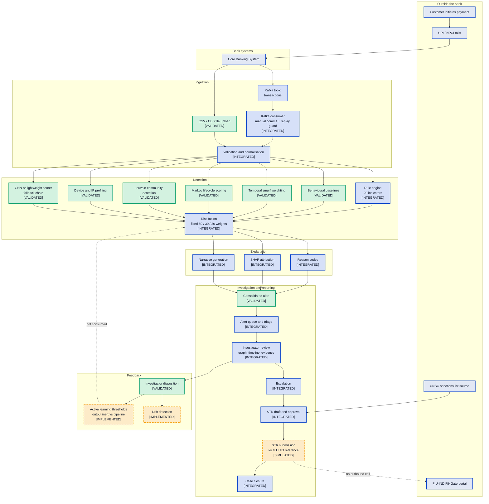
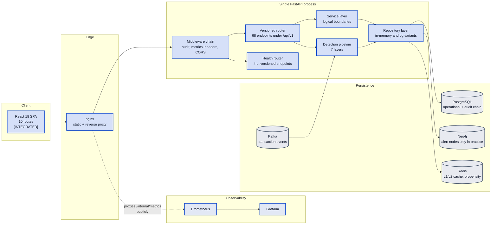

# MuleCatch — Complete End-to-End Architecture

**Diagram 15 of the MuleCatch architecture document set.**

---

## Document control

| Field | Value |
|---|---|
| Purpose | The single end-to-end view: a customer payment through to a closed fraud case, with every intervening component |
| Audience | Bank technical reviewers, security architects, maintaining engineers, evaluation panels |
| Built from | The 12 forensic code inventories produced by the grounding pass over `master` @ `a7b05bf` |
| Method | Every component below was located in source before being drawn. Claims carry `file:line` citations |
| Companion documents | [System architecture](02-SYSTEM-ARCHITECTURE.md) · [Detection engine](04-DETECTION-ENGINE.md) · [Graph layer](05-GRAPH-LAYER.md) · [Investigator workflow](07-INVESTIGATOR-WORKFLOW.md) · [Delta register](11-DELTA-REGISTER.md) |

> This document describes MuleCatch **as built**, not as intended. Where a stage of the chain is
> incomplete, simulated, or unreachable from the running application, it is labelled as such. That
> labelling is the point of this document: an architecture diagram that overstates its system is
> worse than no diagram, because it removes a reviewer's ability to trust the parts that are real.

---

## Status legend

| Label | Meaning |
|---|---|
| `[VALIDATED]` | Reachable from a registered route **and** covered by real, non-mock tests or repository benchmark evidence |
| `[INTEGRATED]` | Reachable from a route registered in [router.py](../../backend/api/v1/router.py) or a route in [App.js](../../frontend/src/App.js) |
| `[IMPLEMENTED]` | Code exists, but no registered route reaches it — import chain traced and confirmed dead-ended |
| `[PLANNED]` | Target state. Not in the codebase today |
| `[SIMULATED]` | The stage executes, but its external effect is synthesised locally rather than transmitted |

In the diagrams, `[PLANNED]` and unreachable components are the only ones drawn with a **dashed**
border. A reader should be able to see target state at a glance without reading a label.

---

## 1. The chain, at a glance

MuleCatch is a **single-process FastAPI modular monolith** — one application factory at
[app.py:32](../../backend/api/app.py#L32), one backend container image. It is not a microservice
estate, and this document does not draw one. The "services" below are *logical* boundaries inside
one process.

### Diagram 15A — End-to-end value chain

Two dashed edges in that diagram carry most of the architectural weight, and both are deliberate:

- **`n_submit -.-> n_fiu`** — the STR submission stage runs, changes state, and produces a
  reference, but makes no outbound call. See §4.
- **`n_al -.-> n_fuse`** — the active-learning loop records dispositions and computes adjusted
  thresholds, but the detection pipeline never reads them. The learning loop is open, not closed.

### Diagram 15B — Runtime and persistence view

The dashed edge from nginx to Prometheus records a live finding, not a design intent:
[nginx.prod.conf:103-106](../../frontend/nginx.prod.conf#L103-L106) proxies `/internal/metrics`
publicly, even though the Kubernetes ingress was hardened to remove that exposure. The endpoint
itself carries no authentication and its own source comment claims it is reachable only inside the
Docker network ([app.py:185-194](../../backend/api/app.py#L185-L194)).

---

## 2. Hop-by-hop specification

Each row states what enters, what happens, what leaves, where it lands, and how the hop fails.

| # | Hop | Input | Transform | Output | Store | Failure mode | Status |
|---|---|---|---|---|---|---|---|
| 1 | Customer payment | Customer intent | Debit authorisation on the rails | Payment instruction | — | Outside MuleCatch's control | `external` |
| 2 | UPI / NPCI | Payment instruction | Rail switching and settlement | Settled transaction | — | Outside MuleCatch's control | `external` |
| 3 | CBS | Settled transaction | Book of record posting | Transaction record | Bank CBS | Outside MuleCatch's control | `external` |
| 4 | Event publication | Transaction record | JSON serialisation | Kafka message | Kafka topic | Ad-hoc JSON, no schema registry and no message version field | `[INTEGRATED]` |
| 5 | Consumption | Kafka message | Poll, deserialise, dedupe | Transaction batch, max 100 | — | Detection runs synchronously in the consumer thread; the only flow control is `max_poll_records` | `[INTEGRATED]` |
| 6 | File ingest | CBS / CSV upload | Parse and field-map | Transaction batch | — | Real bank sample has no labels, so no accuracy can be computed from it | `[VALIDATED]` |
| 7 | Validation | Raw batch | Normalise, backfill missing timestamps with wall-clock now | Clean batch | — | Backfilling processing time destroys event-time ordering | `[INTEGRATED]` |
| 8 | Rule evaluation | Clean batch | 20 deterministic indicators | Rule hits and reason codes | — | 19 of 20 rules have no test; several thresholds hard-coded | `[INTEGRATED]` |
| 9 | Behavioural baseline | Clean batch | Per-account deviation | Behaviour signals | — | One rule uses a fixed assumed monthly average rather than a per-customer baseline | `[VALIDATED]` |
| 10 | Temporal weighting | Clean batch | Smurf and structuring scoring | Temporal score | — | Consolidation signal is suppressed to zero when a receive→forward pattern splits across two batches | `[VALIDATED]` |
| 11 | Markov lifecycle | Clean batch | State-transition scoring | Lifecycle score | — | Uses processing time, not event time | `[VALIDATED]` |
| 12 | Graph construction | Clean batch | In-memory graph assembly | Graph structure | *In-process only* | The Neo4j transaction, device and IP write methods have zero callers | `[INTEGRATED]` |
| 13 | Community detection | Graph structure | Louvain clustering | Communities, centrality | — | Runs per batch; scaling cost grows with batch graph size | `[VALIDATED]` |
| 14 | Device profiling | Clean batch | Shared-device and IP linking | Device trust signals | In-process dict | State is process-local, unbounded, and shared via an `lru_cache` singleton | `[VALIDATED]` |
| 15 | ML scoring | Graph + features | GNN, else lightweight scorer, else heuristic | Model score | — | Fallback chain means GNN scoring is not unconditionally active | `[VALIDATED]` |
| 16 | Risk fusion | All sub-scores | Weighted combination, fixed 50 / 30 / 20 | Risk score, severity, confidence | — | Weights are expert-selected constants, never calibrated against outcomes | `[INTEGRATED]` |
| 17 | Explanation | Alert + features | Reason codes, SHAP, narrative | Explanation artifacts | — | Several artifacts do not reach the UI intact — see §3 | `[INTEGRATED]` |
| 18 | Alert assembly | Scores + explanations | Consolidate into one alert object | Alert | Neo4j alert node, PostgreSQL | Alert nodes are the only graph writes that occur in practice | `[VALIDATED]` |
| 19 | Prioritisation | Alert set | Severity banding and ordering | Ranked queue | — | No investigator-capacity or alerts-per-day analysis exists | `[INTEGRATED]` |
| 20 | Investigation | Ranked queue | Human review of graph, reason codes, timeline | Disposition | PostgreSQL | No case assignment, SLA timer, evidence attachment or maker-checker control | `[INTEGRATED]` |
| 21 | Escalation | Disposition | Route to supervisor | Escalation record | PostgreSQL | Not covered by the audit hash chain | `[INTEGRATED]` |
| 22 | STR preparation | Escalated case | Generate report and PDF | STR draft | PostgreSQL | PDF executive-summary and mule-classification sections never populate | `[INTEGRATED]` |
| 23 | STR submission | Approved STR | State transition, mint reference | Local `FIU-YYYYMMDD-XXXXXX` | PostgreSQL | **No outbound call.** Reference is a local UUID | `[SIMULATED]` |
| 24 | Audit | Every audited action | SHA-256 hash chain | Tamper-evident record | PostgreSQL | Authentication events and the entire STR lifecycle are **not** chained | `[INTEGRATED]` |
| 25 | Feedback and learning | Disposition | Threshold adjustment, drift detection | Adjusted thresholds | Redis | Pipeline never reads the adjusted thresholds; drift detector has no caller | `[IMPLEMENTED]` |

---

## 3. Where the chain is broken

An end-to-end diagram is only useful if it distinguishes edges that carry data from edges that
merely look like they do. Five breaks matter architecturally.

**The persisted graph is not the analysed graph.** Community detection, centrality and
pass-through analysis all run against structures assembled in memory inside the detection pipeline.
The Neo4j client's write API for accounts, transactions, device links and IP links has **zero
callers**, and `ensure_indexes` ([neo4j_client.py:488](../../backend/graph_engine/neo4j_client.py#L488))
is never invoked, so no index or constraint is ever created. What persists to Neo4j is alert nodes.
A reviewer should read "graph database" here as *investigation store for alerts*, not as *the
transaction graph the detection operates on*.

**Three explanation artifacts do not survive the trip to the UI.** The SHAP panel reads a flat
per-feature shape while the API returns a nested per-account shape, so every bar renders
zero-width — and the only payload matching the frontend's expectation is the *error stub*. The
regulatory-report fields the UI reads do not exist in the generator's output. And `mule_type` is
structurally always `None` because `classify_cluster` emits `cluster_classification` while the
narrative generator reads `classification`. Each is a key-name mismatch, each is a one-line fix,
and each currently voids a feature that the architecture legitimately claims to have built.

**Regulatory transmission is simulated.** The STR lifecycle is real — states, role-gated
transitions, PDF generation, persistence. The submission is not. No FINGate URL, credential, or
certificate setting exists anywhere in the configuration surface. The repository is internally
honest about this: the docstrings say `(simulated)` and the README already states that portal
submission requires reporting-entity credentials.

**The tamper-evident audit chain does not cover the filing workflow.** Create, approve, submit and
acknowledge are unchained, as are login, logout and token refresh. For an AML filing control, the
absence of a tamper-evident record of *who approved and submitted an STR* is the most consequential
single control gap in the system.

**The learning loop is open.** Dispositions are captured and thresholds are computed, but the
detection pipeline never consumes them. Drift detection has no caller at all. "Continuous learning"
is presently a data-collection capability, not an adaptation capability.

---

## 4. What this architecture is, stated plainly

MuleCatch is a coherent, unusually complete **explainable graph-based AML detection prototype**. Its
genuine differentiator is real: a single alert object that fuses money movement, account behaviour,
temporal structure, device identity and community topology, and carries reason codes, attribution
and a narrative that an investigator can act on and a supervisor can review. That is architecturally
sound and it is largely built.

What it is not, on the evidence in this repository, is a calibrated AML control. The ensemble weights
are expert judgement rather than fitted parameters. No precision or recall figure exists on labelled
real data. The synthetic benchmarks are unstable enough that two runs with identical parameters
produced mean F1 of 0.4158 and 0.2291. Streaming is micro-batch rather than stateful. And a
meaningful fraction of the codebase — roughly a third by component count — is code that no
registered route reaches.

The correct reading is therefore: **strong architecture, incomplete integration, absent validation.**
Closing the integration gaps is largely engineering work already scoped in
[11-DELTA-REGISTER.md](11-DELTA-REGISTER.md). Closing the validation gap is not something source code
can do — it needs labelled bank data, approved thresholds, independent model validation, and
regulatory acceptance testing, each of which is recorded there with the evidence it requires.
